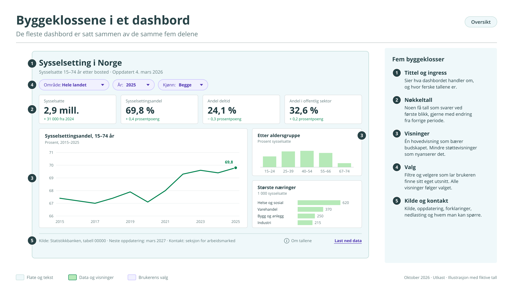
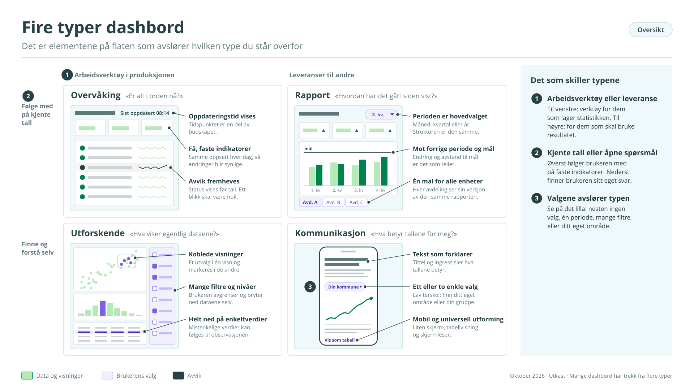
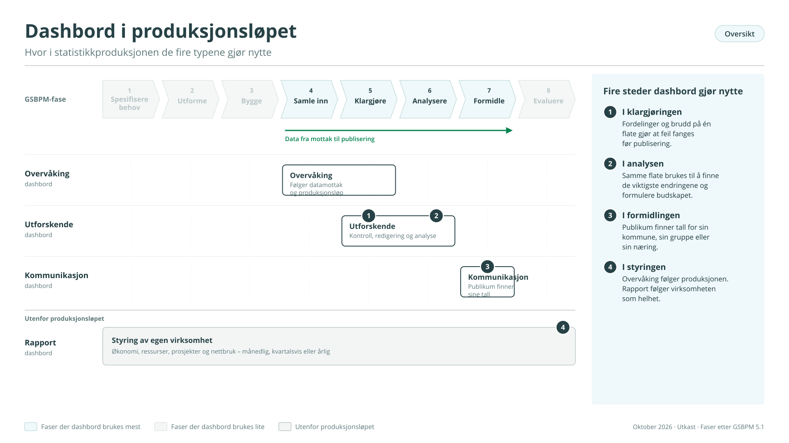
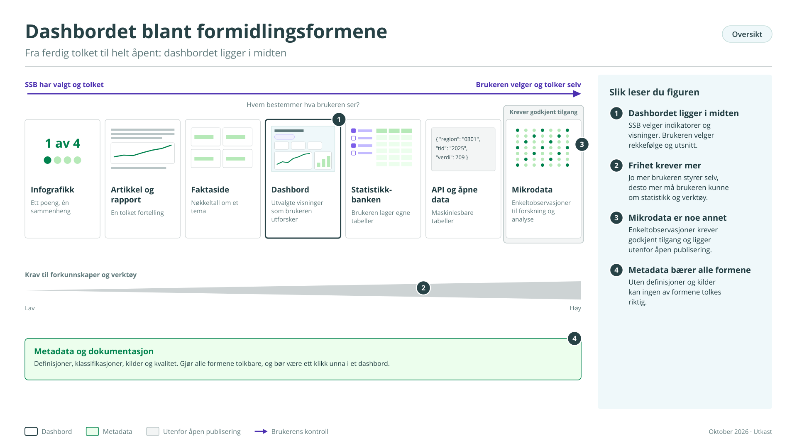
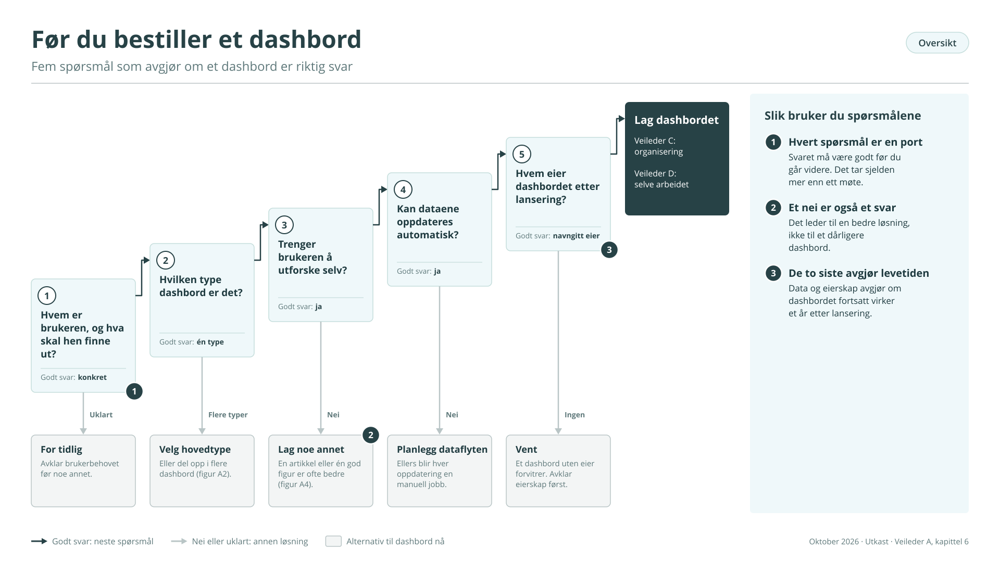

# Del A – Hvorfor dashbord?

## 1 Hvorfor en veileder?

Denne veilederen forklarer hva vi mener med et dashbord, hvilke typer vi lager, og hvilken plass de har i samfunnsoppdraget vårt. Den er skrevet for deg som skal beslutte, bestille eller eie et dashbord, og for alle som vil ha et felles utgangspunkt før de går videre til de mer praktiske veilederne.

Utgangspunktet er enkelt: Et dashbord skal hjelpe noen å forstå hva tallene viser. Det er verken pynt eller en teknologisk lekeplass.

## 2 Hva er et dashbord?

Ordet brukes om mye. I denne serien mener vi:

Et dashbord er en digital flate som samler utvalgte visualiseringer av statistiske data om ett tema, slik at en bestemt brukergruppe kan få oversikt og som oftest utforske videre selv.

Utvalgte: Et dashbord viser ikke alt, bare det som trengs for formålet. Flate: Elementene ses samtidig og i sammenheng, ikke etter hverandre som i en artikkel. Bestemt brukergruppe: Både utvalget og utformingen avhenger av hvem som skal bruke det.

De fleste dashbord er bygd av de samme byggeklossene: en tittel som sier hva det handler om, noen få nøkkeltall, et hoveddiagram, støttende diagrammer, filtre eller andre valg, og opplysninger om kilde, oppdatering og kontaktperson (figur A1).

<figure class="figur" id="figur-a1" markdown="span">
  [{ loading=lazy }](figurer/A1.svg){ title="Åpne figuren i full størrelse" }
  <figcaption>Figur A1. Byggeklossene i et dashbord · <a href="figurer/A1.svg" download>Last ned SVG</a></figcaption>
</figure>

Grensene mot andre produkter er ikke absolutte. En PowerPoint-rapport med diagrammer er ikke et dashbord, og heller ikke en enkeltstående figur med fast tekst. Et analyseverktøy der du må skrive kode for å få svar, er noe annet igjen. Det viktige er ikke å trekke grensen presist, men å vite hva produktet skal gjøre, for hvem og hvordan det skal brukes.

## 3 Fire typer dashbord

Dashbord har ulike brukere og løser ulike oppgaver. Vi skiller mellom fire hovedtyper, og hver av dem svarer på sitt eget spørsmål (figur A2).

<figure class="figur" id="figur-a2" markdown="span">
  [{ loading=lazy }](figurer/A2.svg){ title="Åpne figuren i full størrelse" }
  <figcaption>Figur A2. Fire typer dashbord · <a href="figurer/A2.svg" download>Last ned SVG</a></figcaption>
</figure>

Overvåkingsdashbord: «Er alt i orden nå?» Gir løpende status for systemer, datamottak eller produksjonsløp og viser raskt når noe avviker. Brukes av drifts- og produksjonsteam, og er viktigst når noe går galt. Må være stabile, raske og mulige å lese på et øyeblikk. Få og faste indikatorer, lite interaktivitet.

Rapportdashbord: «Hvordan har det gått siden sist?» Erstatter eller supplerer periodiske rapporter om økonomi, prosjekter, ressursbruk eller nettbruk. Oppdateres månedlig, kvartalsvis eller årlig, ofte automatisk fra flere fagsystemer. Brukerne er ledere og fagansvarlige som kjenner igjen strukturen fra gang til gang. En felles mal gjør at flere enheter kan bruke samme løsning.

Utforskende dashbord: «Hva viser egentlig dataene?» Et arbeidsverktøy for statistikere og analytikere i klargjøring og analyse. Her leter man etter feil, brudd og mistenkelige verdier før publisering, og etter mønstre og sammenhenger som skal formidles etterpå. Krever mye interaktivitet: filtrering, nedboring, kobling mellom visninger og veksling mellom nivåer og mål. Laget for dem som skal levere det publikum får, ikke for publikum selv.

Kommunikasjonsdashbord: «Hva betyr tallene for meg?» Publiseres på ssb.no for allmennheten, mediene, skoleverket og andre *eksterne brukere*. Avgrenset til ett statistikktema, med lav terskel, korte forklaringer og enkle valg som område, år eller gruppe. Må fungere på mobil, være universelt utformet og følge SSBs designprofil. Veileder E handler om denne typen.

|                | Overvåkning   | Rapport                     | Utforskende | Kommunikasjon                   |
|----------------|---------------|-----------------------------|-------------|---------------------------------|
| Brukere        | Interne       | Interne, av og til eksterne | Interne     | Eksterne                        |
| Tidsperspektiv | Nå            | Periodisk                   | Fritt valgt | Siste tall og historikk         |
| Interaktivitet | Lav           | Moderat                     | Høy         | Moderat                         |
| Utforming      | Standardisert | Felles mal                  | Tilpasset   | Tilpasset innenfor designprofil |
| Les videre     | C og D        | C og D                      | B og D      | E                               |

Typologien er et hjelpemiddel, ikke et regelverk, og mange dashbord har trekk fra flere typer. Men å bestemme tidlig hvilken type man lager, er den beste beskyttelsen mot et dashbord som prøver å være alt for alle.

## 4 Dashbord og samfunnsoppdraget

SSB skal samle inn, bearbeide og formidle statistikk som beskriver samfunnet pålitelig og forståelig, slik at tallene kan brukes i beslutninger, debatt og læring. Dashbord kan bidra flere steder i dette løpet (figur A3).

<figure class="figur" id="figur-a3" markdown="span">
  [{ loading=lazy }](figurer/A3.svg){ title="Åpne figuren i full størrelse" }
  <figcaption>Figur A3. Dashbord i produksjonsløpet · <a href="figurer/A3.svg" download>Last ned SVG</a></figcaption>
</figure>

I klargjøringen. Når data kontrolleres og redigeres, ser vi etter feil, ulogiske verdier og brudd i tidsserier. Det krever både oversikt og blikk for detaljer. Et dashbord som samler sentrale fordelinger og indikatorer på én flate, gjør det lettere å se hva som skiller seg ut og å ta gode beslutninger om redigering. Det gir bedre kvalitet og mer effektiv kontroll.

I analysen. Aktualitet er en del av kvaliteten, og mye statistikk publiseres kort tid etter at datagrunnlaget er klart. Tiden til analyse er derfor knapp. Et godt utforskende dashbord gjør det raskere å finne de viktigste endringene og formulere et tydelig budskap.

I formidlingen. Mange brukere er vant til å hente svar selv. Et dashbord som lar dem finne tall for egen kommune, aldersgruppe eller næring, senker terskelen for å bruke offisiell statistikk.

I styringen av egen virksomhet. Rapport- og overvåkingsdashbord gir ledere og driftsteam et felles bilde av ressurser, leveranser og systemer.

Dashbordet erstatter ikke faglig vurdering. Det gjør vurderingen raskere, bedre begrunnet og lettere å dele.

## 5 Dashbord blant andre formidlingsformer

SSB formidler statistikk på mange måter. Hver form har sin styrke, og et dashbord er ikke alltid riktig valg (figur A4).

Artikler forklarer og tolker. De leses fra start til slutt, og analysen er ferdig når de publiseres.

Faktasider gir rask oversikt over nøkkeltall om et tema, med lite rom for å gå i dybden.

Infografikk formidler ett poeng eller én sammenheng, gjerne i sosiale medier.

Statistikkbanken gir full frihet til å lage egne tabeller, men forutsetter at brukeren vet hva hen leter etter.

Rapporter og presentasjoner bærer et faglig resonnement eller en fortelling.

<figure class="figur" id="figur-a4" markdown="span">
  [{ loading=lazy }](figurer/A4.svg){ title="Åpne figuren i full størrelse" }
  <figcaption>Figur A4. Dashbordet blant formidlingsformene · <a href="figurer/A4.svg" download>Last ned SVG</a></figcaption>
</figure>

Dashbordet ligger mellom den ferdig tolkede artikkelen og den åpne Statistikkbanken. Vi har valgt indikatorene og laget visningene, men brukeren bestemmer rekkefølgen og hva som skal ses nærmere på. Det tvinger fram valg vi slipper i de andre formene: Hvilke indikatorer er viktigst? Hvilke spørsmål skal brukeren kunne få svar på? Hvordan leder vi brukeren inn i tallene uten en tekst som forklarer alt?

Derfor krever et dashbord en annen kombinasjon av kompetanse enn en artikkel eller et datasett: kjennskap til data og brukerbehov, og ferdigheter i visualisering, interaksjon og publisering. Det må dessuten forvaltes etter lansering, ofte i mange år.

## 6 Før du bestiller et dashbord

Fem spørsmål avgjør om et dashbord er riktig svar:

1.  Hvem er brukeren, og hva skal hen kunne finne ut? Kan du ikke svare konkret, er det for tidlig.

2.  Hvilken type dashbord er det? Se kapittel 3.

3.  Trenger brukeren å utforske selv? Har tallene ett tydelig budskap, er en artikkel eller én god figur ofte bedre.

4.  Kan dataene oppdateres automatisk? Hvis ikke, blir hver oppdatering en manuell jobb.

5.  Hvem eier dashbordet etter lansering? Et dashbord uten eier forvitrer.

Er svarene gode, går du videre til veileder C for organisering og veileder D for selve arbeidet.

<figure class="figur" id="figur-a5" markdown="span">
  [{ loading=lazy }](figurer/A5.svg){ title="Åpne figuren i full størrelse" }
  <figcaption>Figur A5. Før du bestiller et dashbord · <a href="figurer/A5.svg" download>Last ned SVG</a></figcaption>
</figure>

