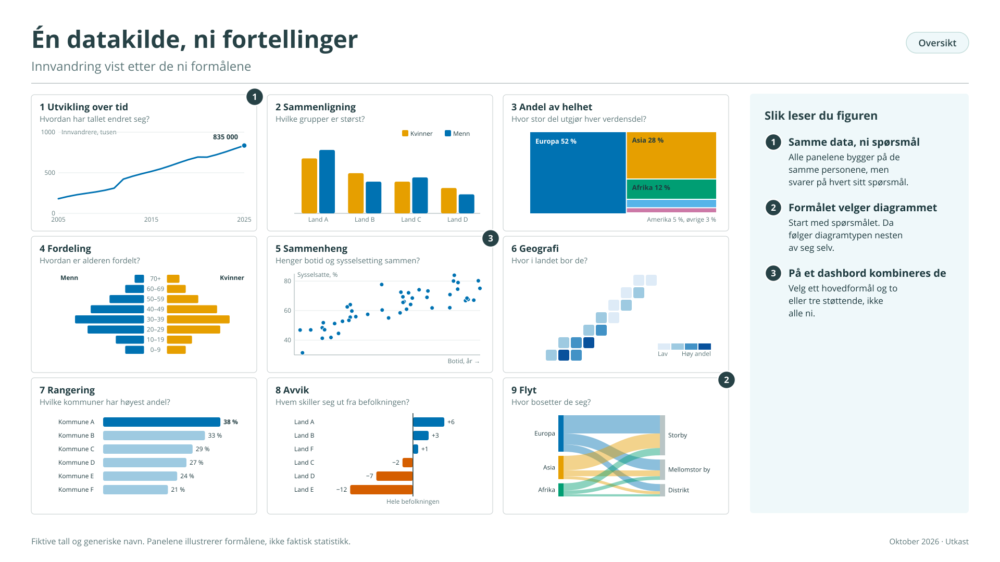
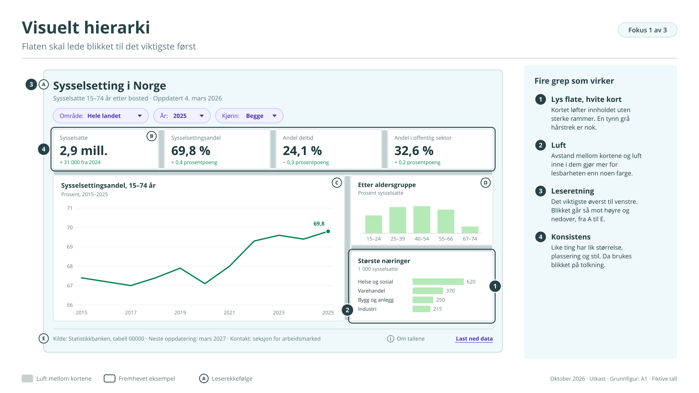
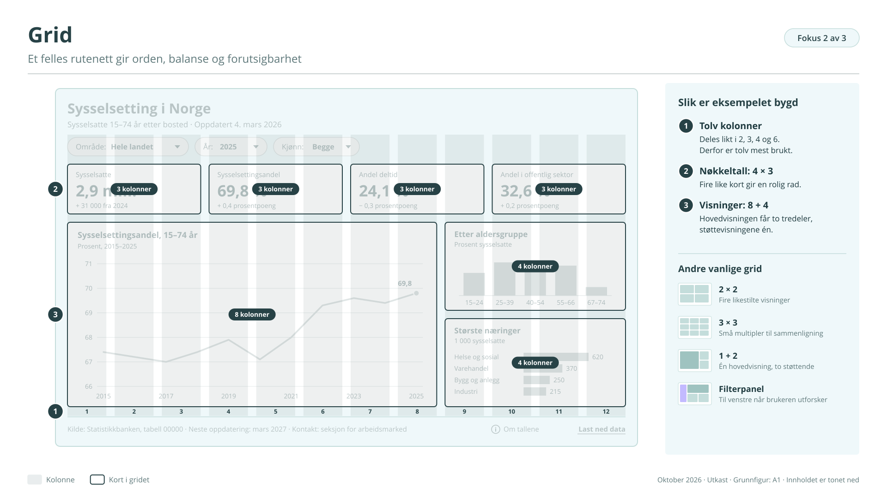
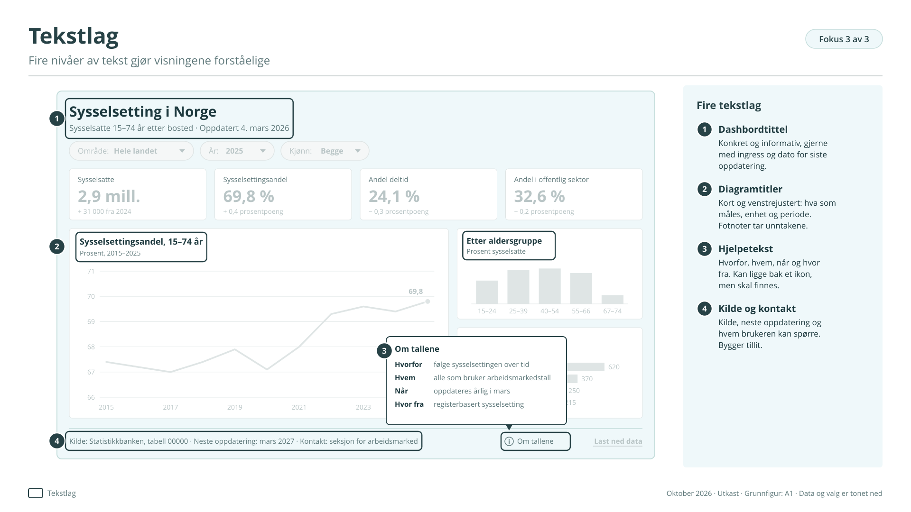
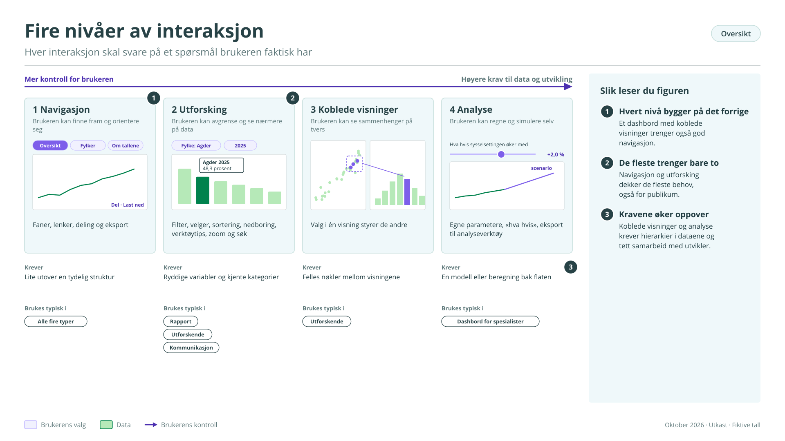
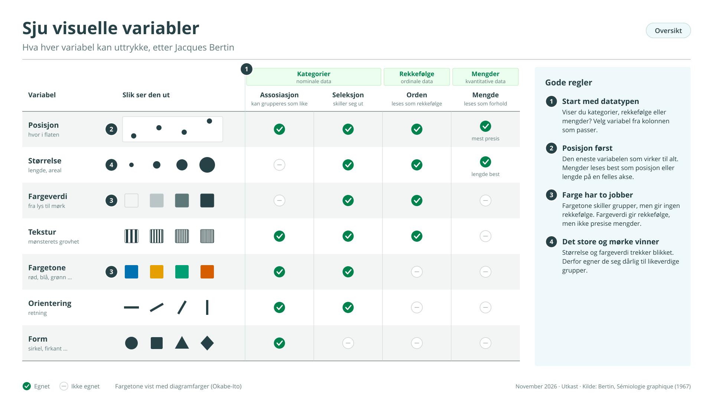
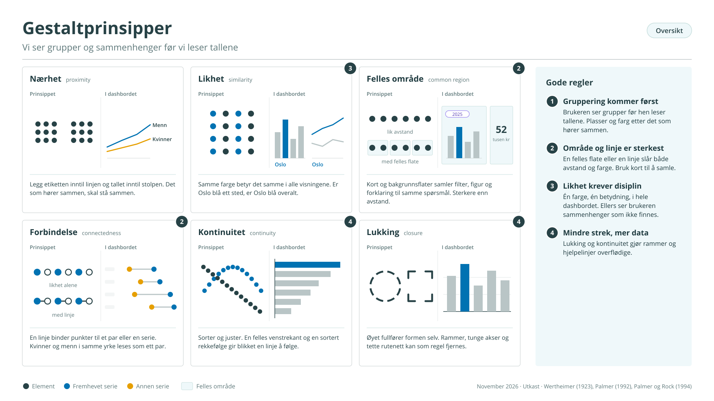
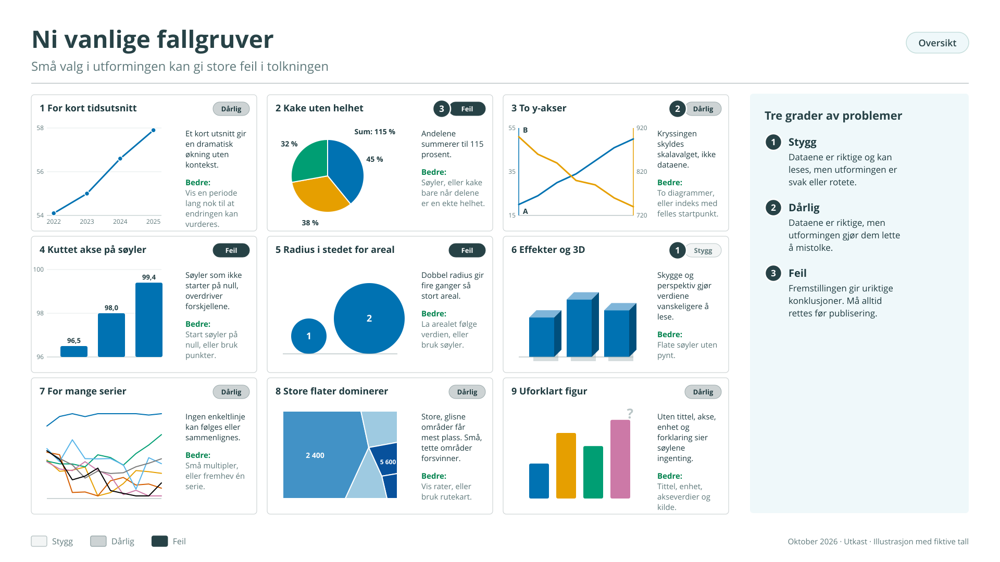
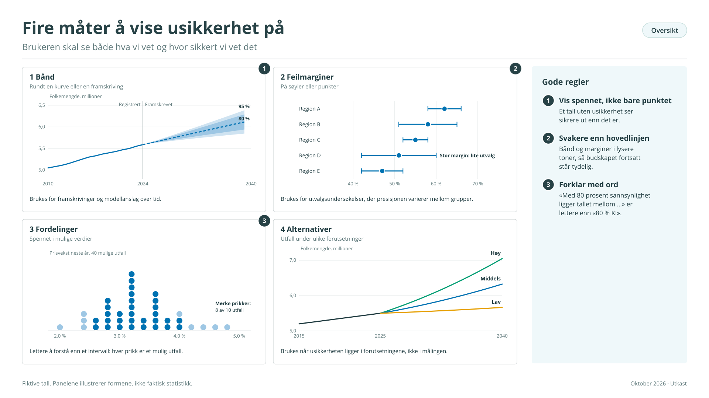

# Del B – Hva er et godt dashbord?

## 1 Start med brukeren

Det er fristende å begynne med det man har: en tabell i Statistikkbanken, en ny datakilde eller en diagramtype man gjerne vil prøve. Da ender man lett med et dashbord som viser mye og svarer på lite. Et godt dashbord begynner et annet sted, med hvem som skal bruke det og hva de skal bruke det til.

Målgruppen må være tydeligere enn «alle som er interessert i arbeidsmarkedet». En journalist som skal sjekke ledigheten i sitt fylke før en deadline, trenger noe annet enn en kommuneplanlegger som følger utviklingen over ti år. Det er vanskelig å lage ett dashbord som dekker begge. Velg én hovedbruker, og la de andre finne det de trenger i Statistikkbanken eller i en artikkel.

**Brukeroppgaven**

Skriv ned to til fire ting brukeren skal kunne forstå, undersøke eller følge med på. Formuler dem som oppgaver og ikke som innhold:

- Innhold: «Dashbordet viser sysselsetting etter kjønn, alder og fylke.»

- Oppgave: «Brukeren skal kunne se om sysselsettingen i eget fylke har gått opp eller ned det siste året, og om det skiller seg fra landet.»

Den andre formuleringen sier hvilke tall som trengs, hvilke sammenligninger som må være med, og hva som kan utelates. Alt på flaten skal kunne knyttes til en av oppgavene. Det som ikke kan det, hører hjemme et annet sted.

**Kontekst**

Et tall alene gir sjelden mening. At 4,1 prosent av arbeidsstyrken er arbeidsledige, forteller lite før brukeren vet om det er mer eller mindre enn i fjor, enn i resten av landet, eller enn det som er vanlig. De vanligste sammenhengene er:

- tid: forrige periode, eller samme periode i fjor

- sted: landet, fylket eller sammenlignbare kommuner

- gruppe: kvinner og menn, aldersgrupper, næringer

- referanse: et gjennomsnitt, et mål eller et normalnivå

Velg de sammenligningene som passer oppgaven, og bygg dem inn i visningen. Brukeren skal slippe å finne dem selv.

**Standardvisningen**

Mange brukere gjør aldri et valg. De ser det dashbordet viser når det åpnes, og går videre. Den første visningen må derfor være nyttig i seg selv, og ikke en tom flate som venter på et filter.

En god standardvisning viser hele landet og siste periode, med de viktigste nøkkeltallene og hovedvisningen ferdig utfylt. Den svarer på den vanligste brukeroppgaven uten ett eneste klikk. Filtrene er der for den som vil videre til sitt fylke, sin aldersgruppe eller sitt år. Hvis dashbordet ber brukeren «velge kommune for å se tall», har det gitt jobben videre til brukeren.

Resten av veilederen handler om visualisering, flate og interaksjon. Alle valgene der blir enklere når målgruppen, oppgavene, sammenligningene og standardvisningen er bestemt først.

## 2 Velg visning etter formål

Det samme datasettet kan vises på mange måter, og hver av dem svarer på et annet spørsmål. Derfor starter valget av diagram med formålet, ikke med diagramtypen. Vi skiller mellom ni formål:

| Formål             | Typisk spørsmål                     | Gode førstevalg                               |
|--------------------|-------------------------------------|-----------------------------------------------|
| Utvikling over tid | Hvordan har det endret seg?         | Linje, søyle, «small multiples»               |
| Sammenlikning      | Hvem har mest?                      | Liggende søyle, arealproporsjonale sirkler    |
| Andel av helhet    | Hvor stor del utgjør hver?          | Stablet søyle, «tree map», sektor, vaffel     |
| Fordeling          | Hvordan er verdiene spredt?         | Histogram, boksplott, befolkningspyramide     |
| Sammenheng         | Henger to størrelser sammen?        | Spredningsplott, sammenkoblet spredningsplott |
| Geografi           | Hvor er det høyt og lavt?           | Koroplettkart, symbolkart, flytkart           |
| Rangering          | Hvem ligger øverst og nederst?      | Sortert liggende søyle                        |
| Avvik              | Hva skiller seg ut fra det normale? | Avvik fra referanselinje, fargekodet tabell   |
| Flyt               | Hvor går strømmene?                 | Sankey, flytdiagram                           |

Figur B1 viser hvordan ett datasett om innvandring gir ni ulike fortellinger, avhengig av hvilket formål du velger. Utvikling over tid viser svingninger, sammenligning viser hvilke grupper som er størst, kartet viser hvor de bor, og flytdiagrammet viser hvor de flytter. Alle er riktige, men de sier ikke det samme.

<figure class="figur" id="figur-b1" markdown="span">
  [{ loading=lazy }](figurer/B1.svg){ title="Åpne figuren i full størrelse" }
  <figcaption>Figur B1. Én datakilde, ni fortellinger · <a href="figurer/B1.svg" download>Last ned SVG</a></figcaption>
</figure>

Mer om hvert formål, med metodiske hensyn og vanlige feil, står i vedlegg B1.

**Flere formål på én flate**

Et dashbord kombinerer nesten alltid flere formål. Det er en styrke, men bare hvis rollene er tydelige:

- Én hovedvisning bærer hovedspørsmålet. Den er størst og står der blikket går først.

- Støttevisningene nyanserer. De svarer på oppfølgingsspørsmålene: fordelt på hva, hvor, sammenlignet med hvem.

- Visningene deler akser og farger der de viser det samme. Hvis kvinner er oransje i ett diagram, er de oransje i alle.

- Hver visning har sitt eget formål. To visninger som svarer på samme spørsmål, er én for mye.

## 3 Flaten

**Hierarki og soner**

Når alt på flaten har samme vekt, vet ikke brukeren hvor blikket skal gå. Data og budskap skal fremstå som viktigere enn rammer, bakgrunn og pynt (figur B2).

<figure class="figur" id="figur-b2" markdown="span">
  [{ loading=lazy }](figurer/B2.svg){ title="Åpne figuren i full størrelse" }
  <figcaption>Figur B2. Visuelt hierarki · <a href="figurer/B2.svg" download>Last ned SVG</a></figcaption>
</figure>

Noen grep som virker:

- Lys bakgrunn, hvite kort. La flaten ha en svakt farget eller grå bakgrunn, og la hver visning ligge på et hvitt kort. Kortet løfter innholdet uten sterke rammer. Bruk eventuelt en tynn grå hårstrek rundt.

- Luft. Avstand mellom kortene og luft inne i dem gjør mer for lesbarheten enn noen farge. Et tettpakket dashbord oppleves kaotisk uansett hvor gode dataene er.

- Leseretning. Det viktigste står øverst til venstre. Blikket beveger seg deretter mot høyre og nedover.

- Konsistens. Når like ting har lik størrelse, plassering og stil, bruker brukeren blikket på tolkning og ikke på orientering.

**Grid**

Et grid gir orden, balanse og forutsigbarhet. Det gjør det også lettere å endre dashbordet senere, og å samarbeide når designer og utvikler bruker samme rutenett (figur B3).

<figure class="figur" id="figur-b3" markdown="span">
  [{ loading=lazy }](figurer/B3.svg){ title="Åpne figuren i full størrelse" }
  <figcaption>Figur B3. Grid · <a href="figurer/B3.svg" download>Last ned SVG</a></figcaption>
</figure>

| Grid                                      | Egner seg når                                             |
|-------------------------------------------|-----------------------------------------------------------|
| 2 x 2                                     | fire likestilte nøkkeltall eller visninger                |
| 3 × 3 eller 4 × 3                         | mange små visninger som skal sammenlignes (små multipler) |
| 1 + 2 eller 1 + 3                         | én tydelig hovedvisning med støttevisninger               |
| Fast filterpanel til venstre eller øverst | brukeren skal utforske aktivt                             |

**Tekstlag**

Gode tekster gir retning og gjør gode visualiseringer forståelige. Et dashbord har fire tekstlag (figur B4):

1.  Dashbordtittel. Konkret og informativ. Et spørsmål som «Hvordan utvikler næringene seg i kystkommunene?» kan aktivere leseren.

2.  Diagramtitler. Kort, venstrejustert, og med hva som måles, enhet og periode: «Sysselsatte, 15–74 år, prosent, 2015–2025». Fotnoter tar unntakene: «Tallene omfatter ikke olje og gass.»

3.  Hjelpetekst. Hvorfor dashbordet finnes, hvem det er for, hvor ofte det oppdateres, og hvor tallene kommer fra. Den kan ligge bak et informasjonsikon, men skal finnes.

4.  Kilde og kontakt. Kilde, oppdateringstidspunkt og hvem brukeren kan spørre. Det er et lite grep som bygger tillit.

<figure class="figur" id="figur-b4" markdown="span">
  [{ loading=lazy }](figurer/B4.svg){ title="Åpne figuren i full størrelse" }
  <figcaption>Figur B4. Tekstlag · <a href="figurer/B4.svg" download>Last ned SVG</a></figcaption>
</figure>

Bruk én skriftfamilie, faste størrelser for hvert nivå, og fet skrift for det som virkelig skal fremheves.

**Ikoner**

Ikoner kan erstatte ord for kjente funksjoner som filter, nedlasting og informasjon, og gjøre flaten lettere for brede målgrupper. Hold dem i én stil, la dem aldri konkurrere med dataene, og la dem aldri være eneste bærer av betydning. Illustrasjoner hører hjemme i kommunikasjonsdashbord (se veileder E), sjelden ellers.

## 4 Interaksjon

Interaktivitet skiller et dashbord fra en statisk figur. Men interaksjon er ikke et mål i seg selv. Hver interaksjon skal svare på et spørsmål brukeren faktisk har. Er spørsmålet uklart, er interaksjonen overflødig.

**Fire nivåer**

<figure class="figur" id="figur-b5" markdown="span">
  [{ loading=lazy }](figurer/B5.svg){ title="Åpne figuren i full størrelse" }
  <figcaption>Figur B5. Fire nivåer av interaksjon · <a href="figurer/B5.svg" download>Last ned SVG</a></figcaption>
</figure>

| Nivå              | Gjør det mulig å               | Eksempler                                                                             |
|-------------------|--------------------------------|---------------------------------------------------------------------------------------|
| Navigasjon        | finne fram og orientere seg    | faner, lenker, brødsmulesti, deling, eksport                                          |
| Utforsking        | avgrense og se nærmere på data | filter, velger, sortering, nedboring (drill-down), fremheving, verktøytips, zoom, søk |
| Koblede visninger | se sammenhenger på tvers       | valg i ett diagram styrer de andre, dynamisk skala                                    |
| Analyse           | regne og simulere selv         | egne parametere, «hva hvis», eksport til analyseverktøy                               |

De fleste dashbord trenger bare de to første nivåene, og det er helt riktig. Kommunikasjonsdashbord holder seg nesten alltid der. Utforskende dashbord trenger ofte koblede visninger. Analysenivået hører hjemme i dashbord for spesialister.

**Virkemidlene**

- Filter avgrenser datasettet: år, fylke, næring.

- Velger bytter mellom få, forhåndsdefinerte visninger: «menn/kvinner», «antall/prosent».

- Sortering og rangering endrer rekkefølgen, og gjør topp og bunn synlige.

- Nedboring går fra et samlet nivå til detaljer: fra fylke til kommune.

- Fremheving markerer noe uten å skjule resten.

- Verktøytips gir tall og forklaring ved peking, uten å ta fast plass.

- Zoom, panorering og søk hjelper i store kart og lange tidsserier.

To regler gjelder for alle: Det brukeren har valgt, skal alltid synes. Og informasjon som bare finnes i et verktøytips, finnes ikke for brukere på mobil eller med tastatur.

**Hva datastrukturen tåler**

Ikke alle virkemidler passer til alle data. Enkle filtre og sortering virker på én flat tabell. Nedboring forutsetter hierarkier som fylke og kommune, eller næring og næringsundergruppe. Koblede visninger og simulering krever ofte tett samarbeid mellom fagstatistiker og utvikler, og avklares tidlig (se veileder D).

## 5 Grunnlaget i kort form

**Fra tall til visuell form**

En visualisering oversetter data til visuelle egenskaper. Jacques Bertin beskrev disse egenskapene som visuelle variabler: posisjon, størrelse, fargeverdi (lyshet), fargetone, tekstur, orientering og form[^1]. De egner seg til ulike ting:

| Visuell variabel    | Skille kategorier | Vise rekkefølge | Vise mengde      |
|---------------------|-------------------|-----------------|------------------|
| Posisjon            | JA                | JA              | JA, mest presist |
| Størrelse           | JA                | JA              | JA               |
| Fargeverdi (lyshet) | JA                | JA              | Grovt            |
| Tekstur             | JA                | Grovt           | NEI              |
| Fargetone           | JA                | NEI             | NEI              |
| Orientering og form | JA                | NEI             | NEI              |

Det praktiske poenget er enkelt. Mengder vises best med posisjon langs en felles akse, slik søyle-, linje- og punktdiagrammer gjør. Fargetone og form skiller grupper, men sier ingenting om hvilken som er størst. Fargeverdi kan vise rekkefølge, som i et kart der mørkere betyr mer.

<figure class="figur" id="figur-b5i" markdown="span">
  [{ loading=lazy }](figurer/B5i.svg){ title="Åpne figuren i full størrelse" }
  <figcaption>Figur B5.i. Sju visuelle variabler · <a href="figurer/B5i.svg" download>Last ned SVG</a></figcaption>
</figure>

**Hvordan øyet leser en flate**

Vi ser helheter før detaljer. Elementer som står nær hverandre, oppfattes som en gruppe. Elementer som ligner hverandre i farge, form eller størrelse, oppfattes som beslektet. Øyet følger linjer og kanter, og fyller inn former som bare er antydet[^2]. På et dashbord betyr det at plassering og likhet sier noe om sammenheng, enten vi mener det eller ikke.

Noen egenskaper oppfattes nesten umiddelbart, før vi bevisst leter: en avvikende farge, en større form, noe som beveger seg. De er sterke virkemidler for fremheving, og derfor må de brukes sparsomt. Når alt er fremhevet, er ingenting det.

<figure class="figur" id="figur-b5ii" markdown="span">
  [{ loading=lazy }](figurer/B5ii.svg){ title="Åpne figuren i full størrelse" }
  <figcaption>Figur B5.ii. Gestaltprinsipper · <a href="figurer/B5ii.svg" download>Last ned SVG</a></figcaption>
</figure>

**Ærlig visualisering**

Grafikk skal bygge på data, og den visuelle ordenen skal følge ordenen i dataene. De fleste feil skjer ikke med vilje, men fordi små valg får store følger for tolkningen. En nyttig tredeling er:

- Stygg: rotete eller svak utforming, men dataene er riktige og kan leses.

- Dårlig: riktige data, men utformingen gjør dem vanskelige å lese eller lett å mistolke.

- Feil: fremstillingen gir uriktige konklusjoner, for eksempel fordi aksen er feil eller dataene er feilaggregert.

De vanligste fallgruvene er vist i figur B1: for kort tidsutsnitt, kakediagram som ikke summerer til en helhet, to y-akser, kuttet verdiakse på søyler, sirkler der radien i stedet for arealet følger verdien, 3D og andre effekter, for mange serier i samme diagram, kart der store flater dominerer, og figurer uten forklaring.

<figure class="figur" id="figur-b6" markdown="span">
  [{ loading=lazy }](figurer/B6.svg){ title="Åpne figuren i full størrelse" }
  <figcaption>Figur B6. Ni vanlige fallgruver · <a href="figurer/B6.svg" download>Last ned SVG</a></figcaption>
</figure>

## 6 Tilgjengelighet og klart språk

Kravene varierer med typen dashbord, men grunnprinsippene gjelder alle.

**Tilgjengelighet**

Forskriften om universell utforming av IKT krever at offentlige nettløsninger følger WCAG 2.1.[^3] For dashbord betyr det særlig:

- God kontrast, og farge som aldri er eneste bærer av betydning. Bruk også tekst, mønster eller form.

- Tastatur. Alle filtre og knapper skal kunne nås og brukes uten mus, og ha tydelige etiketter for skjermlesere.

- Tekstalternativ. Hver visualisering skal ha en tekstlig beskrivelse eller en tilhørende tabell.

- Ikke bare peking. Verktøytips og pekeeffekter kan aldri være eneste kilde til informasjon.

**Universell utforming**

Et dashbord skal kunne brukes uten forkunnskaper om grensesnittet. Interaksjonen skal være forutsigbar, og de viktigste tallene og tolkningene skal synes uten at brukeren må lete. For publiserte dashbord er mobil et krav, og løses med responsiv utforming, ikke bare skalering.

**Klart språk**

Titler og forklaringer skal være presise og konkrete: «Utslipp per fylke, tonn CO₂-ekvivalenter», ikke «Miljøindikator». Unngå forkortelser og internsjargong, og følg Språkrådets klarspråk-prinsipper[^4]. Vurder engelsk eller samisk versjon når målgruppen tilsier det.

**Kravene etter type**

|                   | Overvåking             | Rapport                        | Utforskende            | Kommunikasjon               |
|-------------------|------------------------|--------------------------------|------------------------|-----------------------------|
| WCAG              | Ved behov hos brukerne | Ja                             | Ved behov hos brukerne | Ja, fullt ut                |
| Mobil             | Sjelden                | Mindre viktig                  | Sjelden                | Krav                        |
| Språk             | Fagspråk greit         | Organisasjonens begreper greit | Fagspråk greit         | Klarspråk                   |
| Eksport og tabell | Lite behov             | PDF, Excel, utskrift           | Data ut                | Tabellvisning og nedlasting |

Ikke alle krav kan oppfylles fullt ut fra første dag. Start med det som betyr mest for brukeren: tydelige titler, forståelige filtre, god kontrast og logisk struktur. Bruk ferdige komponenter fra SSBs designsystem der de finnes, og forbedre over tid.

## 7 Usikkerhet og nyanser

Et dashbord kan gi et for enkelt eller for bastant bilde, ofte uten at noen har ment det. Alberto Cairo peker på at en av de vanligste kildene til feiltolkning er at usikkerheten er skjult[^5]. Et godt dashbord viser både hva vi vet og hvor sikkert vi vet det.

**Usikkerhet skal synes**

Statistikk bygger på utvalg, modeller og forutsetninger. Når tall presenteres uten usikkerhet, mister brukeren muligheten til å vurdere hvor mye de kan stole på dem. Figur B7 viser fire vanlige måter å vise usikkerhet på:

- Bånd rundt en kurve eller en framskriving.

- Feilmarginer på søyler eller punkter.

- Fordelinger som viser spennet i mulige verdier.

- Alternativer som viser utfall under ulike forutsetninger.

<figure class="figur" id="figur-b7" markdown="span">
  [{ loading=lazy }](figurer/B7.svg){ title="Åpne figuren i full størrelse" }
  <figcaption>Figur B7. Fire måter å vise usikkerhet på · <a href="figurer/B7.svg" download>Last ned SVG</a></figcaption>
</figure>

Usikkerheten skal støtte hovedbudskapet, ikke overdøve det. Brukeren trenger ikke kjenne metoden, men skal forstå at tallene har et spenn.

**Nyanser gir innsikt**

Gjennomsnitt og totaler skjuler variasjon. Et godt dashbord lar brukeren bryte ned tallene etter relevante kjennetegn, viser variasjon i små multipler, og gir flere innganger til samme fenomen. Da kan brukeren stille sine egne spørsmål: Gjelder dette for meg? Gjelder det for alle? Målet er å forenkle uten å utelate det som er viktig.

## 8 Kvalitet og tillit

Et dashbord er et ansikt utad for statistikken. Brukerne ser sjelden valgene bak, men de merker følgene: Er tallene til å stole på? Er visningen konsistent? Er den oppdatert?

Dashbordet skal støtte kvalitetsprinsippene for offisiell statistikk: relevans, nøyaktighet, aktualitet, sammenlignbarhet og tilgjengelighet. Kilde, periode og definisjoner skal være lette å finne. Utformingen skal være nøktern, uten effekter som forvirrer eller forsterker budskapet. Et dashbord skal ikke bevise noe, men gi brukeren grunnlag for å tolke tallene selv.

Hvordan dashbordet holdes oppdatert og forvaltes over tid, står i veileder C.

**Sjekkliste**

Bruk listen i planleggingen for å bli enige om hva som er viktigst, og ved brukertest for å se hva som mangler (se veileder D). Målet er ikke å score høyt på alt, men å gjøre bevisste valg.

| KAPITTEL | Et godt dashbord …                                                  |
|----------|---------------------------------------------------------------------|
| A        | … har ett klart formål og en definert målgruppe                     |
| 1        | … omsetter formål i konkrete brukeroppgaver                         |
| 1        | … gir brukeren relevant kontekst og sammenlikningsgrunnlag          |
| 1        | … åpner med meningsfull standardvisning                             |
| 2        | … har diagramtyper som passer formålet                              |
| 2        | … har én hovedvisning og støttevisninger med tydelige roller        |
| 3        | … leder blikket til det viktigste først                             |
| 3        | … følger et konsekvent grid med luft mellom elementene              |
| 3        | … har titler som sier hva, hvordan og når                           |
| 3        | … viser kilde, oppdatering og kontakt                               |
| 4        | … har bare interaksjon som svarer på et brukerspørsmål              |
| 4        | … viser alltid hva brukeren har valgt                               |
| 4        | … gir tydelig tilbakemelding på feil                                |
| 5        | … viser data ærlig, uten å forsterke budskapet                      |
| 5        | … bruker posisjon for mengder og farge for kategorier               |
| 6        | … kan brukes med tastatur, skjermleser og på mobil (når det kreves) |
| 6        | … tilbyr tabell eller nedlasting som alternativ                     |
| 7        | … viser usikkerhet der den finnes                                   |
| 7        | … lar brukeren se variasjon, ikke bare totaler                      |

[^1]:  Jacques Bertin, Sémiologie graphique, 1967. Bertin skilte mellom de to dimensjonene i planet (posisjon) og seks «retinale» variabler.

[^2]:  Gestaltprinsippene ble utviklet av Max Wertheimer, Kurt Koffka og Wolfgang Köhler tidlig på 1900-tallet. Se https://snl.no/gestaltpsykologi.

[^3]:  Se Tilsynet for universell utforming av IKT: https://www.uutilsynet.no/.

[^4]:  https://sprakradet.no/klarsprak/

[^5]:  Alberto Cairo, How Charts Lie, W. W. Norton, 2019.
