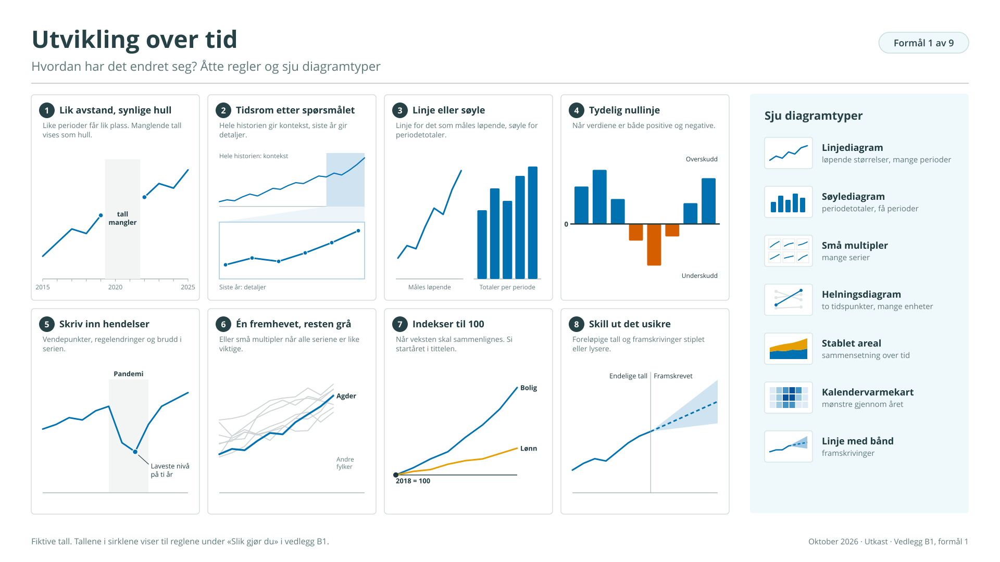
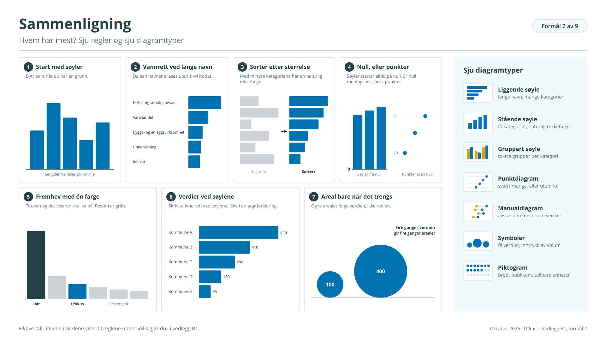
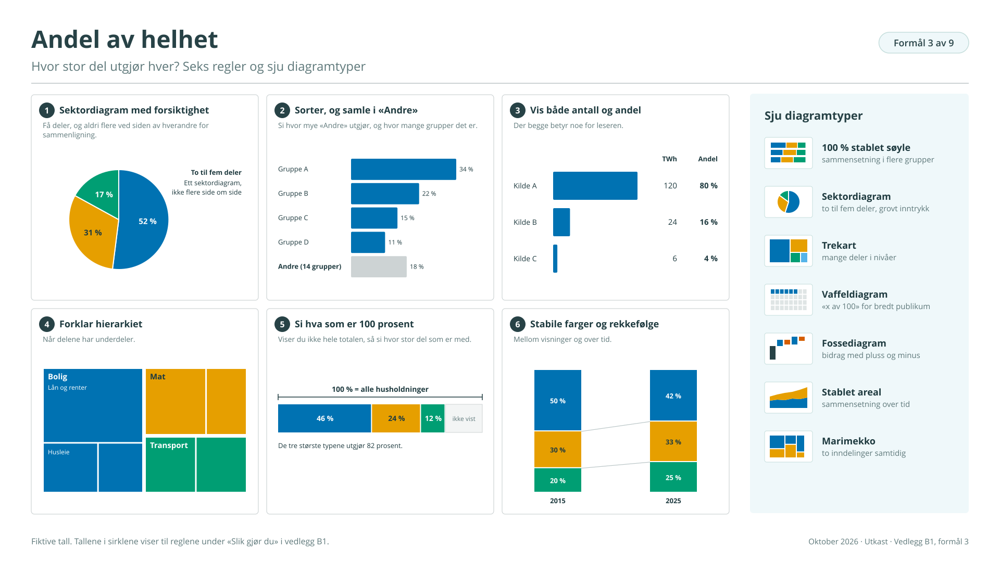
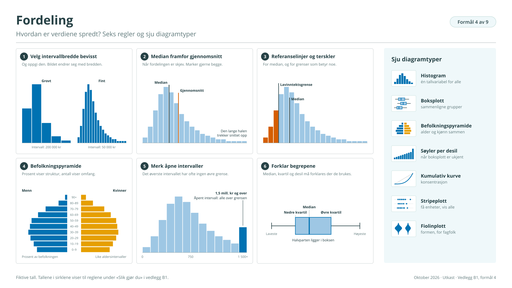
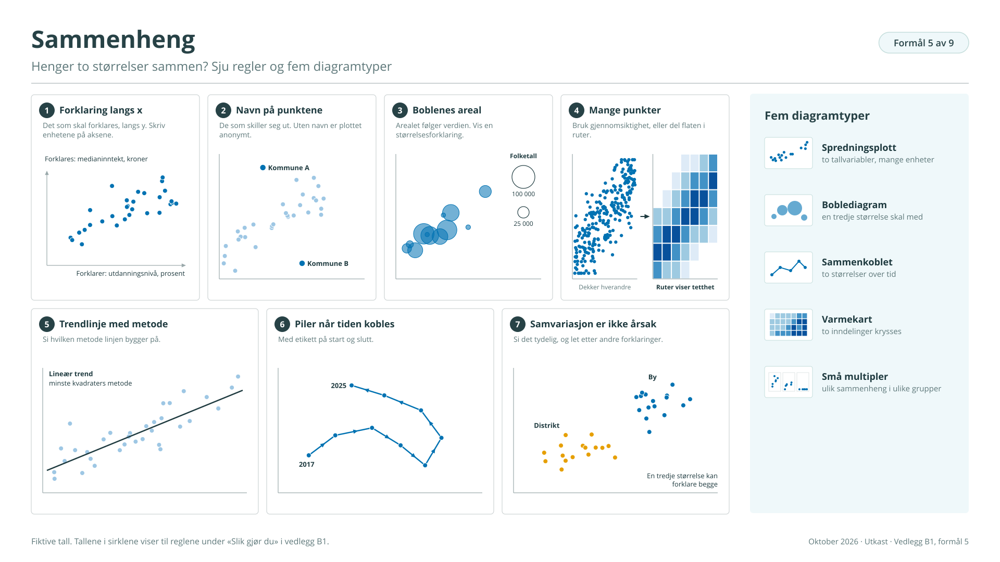
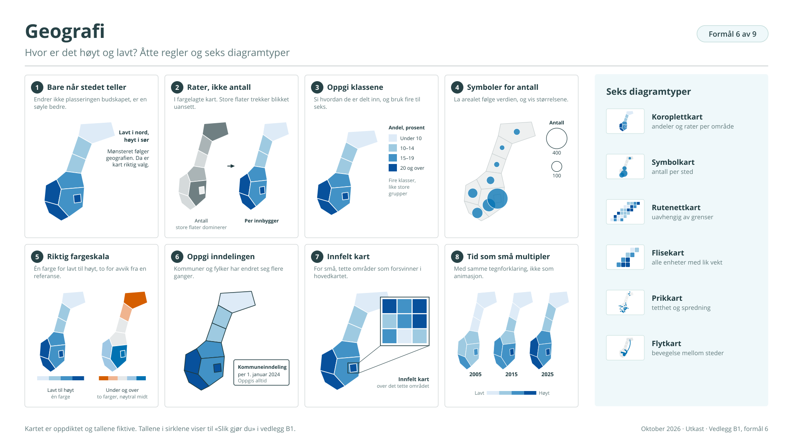
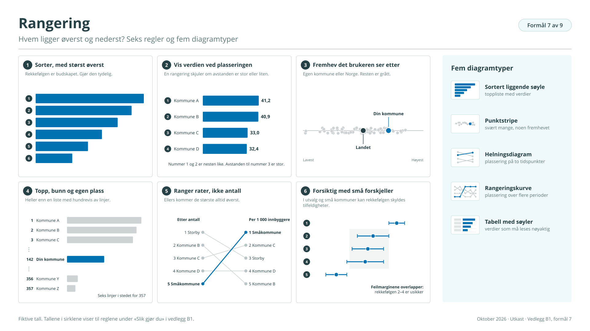
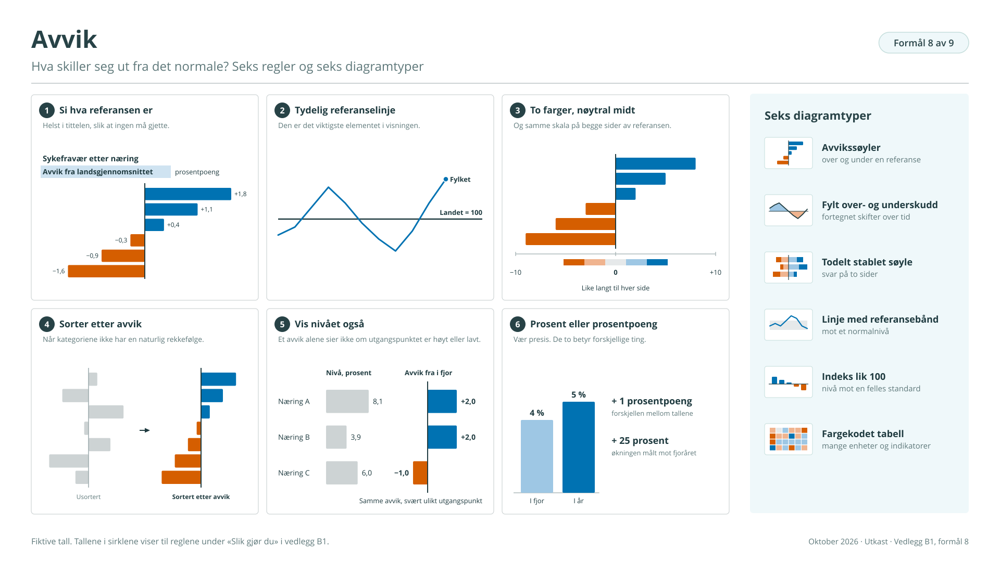
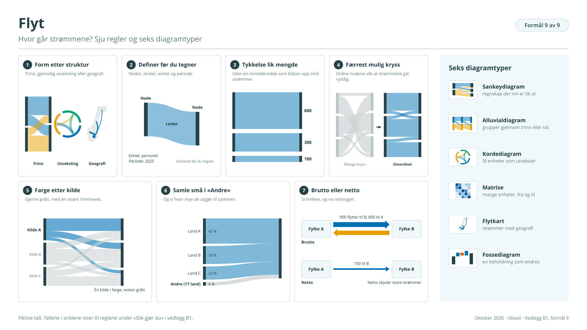

# Vedlegg B1: De ni formålene, ett for ett

## Slik bruker du vedlegget

Veileder B sier at valget av diagram starter med formålet. Dette vedlegget går gjennom de ni formålene ett for ett, etter samme mal: hva formålet er, typiske spørsmål, diagramtyper med eksempler fra SSBs statistikker, hovedregler, vanlige feil og hva som er særegent på et dashbord.

Inndelingen følger Visual Vocabulary fra Financial Times, som bruker de samme ni kategoriene og viser over 70 diagramtyper[^6]. Vedlegget tar bare med de typene som er mest aktuelle for offisiell statistikk.

| Formål i veilederen  | Kategori hos FT  |
|----------------------|------------------|
| 1 Utvikling over tid | Change over time |
| 2 Sammenligning      | Magnitude        |
| 3 Andel av helhet    | Part-to-whole    |
| 4 Fordeling          | Distribution     |
| 5 Sammenheng         | Correlation      |
| 6 Geografi           | Spatial          |
| 7 Rangering          | Ranking          |
| 8 Avvik              | Deviation        |
| 9 Flyt               | Flow             |

Eksemplene viser til statistikker SSB publiserer. De er valgt for å vise bredde, og er ikke en oversikt over hvilke dashbord som finnes.

## 1 Utvikling over tid

*Hvordan har det endret seg?*

Dette er det vanligste formålet i offisiell statistikk. Tiden ligger langs x-aksen, og visningen skal få fram trend, vendepunkter, sesongmønstre og brudd. Leseren vil nesten alltid vite to ting: hvor vi er nå, og om det er uvanlig.

<figure class="figur" id="figur-v1" markdown="span">
  [{ loading=lazy }](figurer/V1.svg){ title="Åpne figuren i full størrelse" }
  <figcaption>Figur V1. Utvikling over tid · <a href="figurer/V1.svg" download>Last ned SVG</a></figcaption>
</figure>

**Typiske spørsmål**

- Hvordan har konsumprisindeksen utviklet seg de siste tolv månedene?

- Når snudde boligprisene, og hvor raskt?

- Har samlet fruktbarhetstall falt jevnt, eller i rykk?

**Diagramtyper**

| Diagramtype                       | Bruk den når                                       | Eksempel fra SSB                                    |
|-----------------------------------|----------------------------------------------------|-----------------------------------------------------|
| Linjediagram                      | størrelsen er kontinuerlig og periodene er mange   | Arbeidsledighet i AKU, sesongjustert, per måned     |
| Søylediagram                      | hver periode har en egen total, og periodene er få | Fødte per år, nettoinnvandring per år               |
| Små multipler                     | mange serier skal sammenlignes                     | Boligprisindeksen i regionene, ett panel per region |
| Helningsdiagram                   | bare to tidspunkter teller, for mange enheter      | Andel eldre i kommunene, nå og for ti år siden      |
| Stablet arealdiagram              | sammensetningen endrer seg over tid                | Elektrisitetsproduksjon etter vann, vind og varme   |
| Kalendervarmekart                 | mønsteret gjentar seg gjennom året                 | Overnattinger per måned over flere år               |
| Linje med bånd eller alternativer | tallene er framskrevet                             | Befolkningsframskrivingene (se figur B7)            |

**Slik gjør du**

- La tiden ha lik avstand for like lange perioder. Vis hull der tall mangler.

- Velg tidsrom etter spørsmålet. Hele historien gir kontekst, siste år gir detaljer. Ofte trengs begge.

- Bruk linje for det som måles løpende, og søyle for periodetotaler.

- Gjør nullinjen tydelig når verdiene er både positive og negative.

- Skriv inn vendepunkter og kjente hendelser: pandemi, regelendring, brudd i tidsserien.

- Har du mange serier, så bruk små multipler, eller grå linjer med én fremhevet.

- Skal veksten sammenlignes, så indekser seriene til 100 i et felles startår og si det i tittelen.

- Vis foreløpige tall og framskrivinger annerledes enn endelige tall, for eksempel stiplet eller lysere.

**Vanlige feil**

- To y-akser som skaper en sammenheng som ikke finnes.
- Linjer som trekkes rett over et brudd i serien eller manglende perioder.
- Så mange linjer at ingen kan følges.
- Et tidsutsnitt som er valgt fordi det gir den bratteste kurven.

**På et dashbord**

Gi periodevelgeren en fornuftig standard, for eksempel de siste ti årene. La brukeren veksle mellom sesongjustert og ujustert der begge finnes. Bestem om y-aksen skal følge med når brukeren bytter område, og si det tydelig. Fast akse gjør områder sammenlignbare, mens fri akse viser formen på hver serie.

## 2 Sammenligning

*Hvem har mest?*

Formålet er å vise nivå i ulike kategorier, slik at leseren ser hva som er stort og lite, og hvor store forskjellene er. Søyler er nesten alltid det beste valget, fordi øyet sammenligner lengder fra en felles grunnlinje mer presist enn areal, vinkel og farge.

<figure class="figur" id="figur-v2" markdown="span">
  [{ loading=lazy }](figurer/V2.svg){ title="Åpne figuren i full størrelse" }
  <figcaption>Figur V2. Sammenligning · <a href="figurer/V2.svg" download>Last ned SVG</a></figcaption>
</figure>

**Typiske spørsmål**

- Hvilke næringer har flest sysselsatte?

- Hvor mye varierer kommunenes utgifter per innbygger til pleie og omsorg?

- Hvor mye tjener ulike yrker, og hvor stor er forskjellen mellom kvinner og menn?

**Diagramtyper**

| Diagramtype            | Bruk den når                                                              | Eksempel fra SSB                                   |
|------------------------|---------------------------------------------------------------------------|----------------------------------------------------|
| Liggende søylediagram  | navnene er lange eller kategoriene mange                                  | Sysselsatte etter næring                           |
| Stående søylediagram   | kategoriene er få og har en naturlig rekkefølge                           | Månedslønn etter utdanningsnivå                    |
| Gruppert søylediagram  | to eller tre grupper sammenlignes i hver kategori                         | Månedslønn for kvinner og menn etter yrke          |
| Punktdiagram           | kategoriene er svært mange, eller null ikke er et meningsfullt startpunkt | KOSTRA-nøkkeltall for kommunene i en kommunegruppe |
| Manualdiagram          | avstanden mellom to verdier er poenget                                    | Lønn for kvinner og menn i hver næring             |
| Proporsjonale symboler | få verdier med svært ulik størrelse skal gi et inntrykk av volum          | Eksportverdi for olje, gass, fisk og metaller      |
| Piktogram              | publikum er bredt og enhetene kan telles                                  | Husdyr i jordbruket, biler etter drivstoff         |

**Slik gjør du**

- Start med søyler. Bytt bare når du har en grunn.

- Legg søylene vannrett når tekstene er lange.

- Sorter etter størrelse, med mindre kategoriene har en naturlig rekkefølge som alder eller utdanningsnivå.

- La søyler alltid starte på null. Er null meningsløst, så bruk punkter.

- Fremhev totalen og det leseren skal se på med én farge. La resten være grått.

- Skriv verdiene rett ved søylene i stedet for å bruke tegnforklaring.

- Bruk areal bare når det trengs, og la arealet følge verdien, ikke radien.

**Vanlige feil**

- Verdiakse som ikke starter på null.

- Stablede søyler når poenget er å sammenligne nivå.

- Én farge per søyle uten at fargen betyr noe.

- Radardiagram, som gjør formen viktigere enn tallene.

**På et dashbord**

Sammenligning blir personlig når brukeren kan finne sin egen enhet. Tilby søk etter kommune, fremhev den valgte mot resten, og legg inn en referanselinje for landet eller kommunegruppen. La brukeren sortere, men velg standardsorteringen selv.

## 3 Andel av helhet

*Hvor stor del utgjør hver?*

Her er poenget hvordan en total er satt sammen. Formålet forutsetter en ekte helhet: delene utelukker hverandre og summerer til totalen. Leseren trenger sjelden nøyaktige andeler, men vil vite hva som er størst, og om noe utgjør en halv, en tredel eller nesten ingenting.

<figure class="figur" id="figur-v3" markdown="span">
  [{ loading=lazy }](figurer/V3.svg){ title="Åpne figuren i full størrelse" }
  <figcaption>Figur V3. Andel av helhet · <a href="figurer/V3.svg" download>Last ned SVG</a></figcaption>
</figure>

**Typiske spørsmål**

- Hvor stor del av kraftproduksjonen kommer fra vind?

- Hva bruker husholdningene pengene på?

- Hvordan ble folketallet endret i fjor: hvor mye var fødselsoverskudd, og hvor mye var innvandring?

**Diagramtyper**

| Diagramtype          | Bruk den når                                              | Eksempel fra SSB                                              |
|----------------------|-----------------------------------------------------------|---------------------------------------------------------------|
| 100 % stablet søyle  | sammensetningen skal sammenlignes mellom grupper eller år | Husholdningstyper i fylkene                                   |
| Sektordiagram        | delene er to til fem, og et grovt inntrykk er nok         | Bosatte i og utenfor tettsteder                               |
| Trekart              | delene er mange og ordnet i nivåer                        | Vektene i konsumprisindeksen, fra hovedgruppe til undergruppe |
| Vaffeldiagram        | «x av 100» skal forklares for et bredt publikum           | Innvandrere som andel av befolkningen                         |
| Fossediagram         | en total bygges opp av bidrag med pluss og minus          | Befolkningsendringer: fødte, døde, inn- og utvandring         |
| Stablet arealdiagram | sammensetningen skal følges over tid                      | Energibruk etter energibærer                                  |
| Marimekko            | to inndelinger skal vises samtidig                        | Sysselsatte etter næring og sektor                            |

**Slik gjør du**

- Bruk sektordiagram med forsiktighet: få deler, og aldri flere ved siden av hverandre for sammenligning.

- Sorter delene etter størrelse og samle de minste i «Andre». Si hvor mye «Andre» utgjør.

- Vis både antall og andel der begge betyr noe.

- Forklar hierarkiet når delene har underdeler.

- Si tydelig hva som er 100 prosent. Viser du ikke hele totalen, så si hvor stor del som er med.

- Hold farger og rekkefølge stabile mellom visninger og over tid.

**Vanlige feil**

- Deler som ikke summerer til en helhet. Det skjer ofte i spørreundersøkelser der flere svar er mulig, for eksempel om mediebruk.

- Mange små sektorer som ingen kan skille.

- Vanlige stablede søyler når leseren skal sammenligne segmentene i midten. Bare det nederste segmentet har felles grunnlinje.

- 3D-kaker og kaker som er «sprengt» fra hverandre.

**På et dashbord**

La brukeren veksle mellom antall og prosent. Hierarkier egner seg for nedboring, for eksempel fra hovedgruppe til undergruppe i konsumprisindeksen. «Andre» kan åpnes ved klikk, slik at standardvisningen er ryddig og detaljene likevel finnes.

## 4 Fordeling

*Hvordan er verdiene spredt?*

Et gjennomsnitt sier lite om hvordan folk flest har det. Fordelingsvisninger viser hvor verdiene samler seg, hvor stor spredningen er, om fordelingen er skjev, og om noen ligger langt utenfor. For statistikk om inntekt, lønn, formue og alder er dette ofte det viktigste formålet.

<figure class="figur" id="figur-v4" markdown="span">
  [{ loading=lazy }](figurer/V4.svg){ title="Åpne figuren i full størrelse" }
  <figcaption>Figur V4. Fordeling · <a href="figurer/V4.svg" download>Last ned SVG</a></figcaption>
</figure>

**Typiske spørsmål**

- Hvordan er inntekt etter skatt fordelt mellom husholdningene?

- Hvor stor er lønnsspredningen innenfor et yrke?

- Hvordan er befolkningen i kommunen fordelt på alder og kjønn?

**Diagramtyper**

| Diagramtype                 | Bruk den når                                 | Eksempel fra SSB                                   |
|-----------------------------|----------------------------------------------|----------------------------------------------------|
| Histogram                   | én tallvariabel skal vises for alle          | Månedslønn for alle lønnstakere                    |
| Boksplott                   | fordelingen skal sammenlignes mellom grupper | Lønn etter yrke, med median og kvartiler           |
| Befolkningspyramide         | alder og kjønn vises sammen                  | Befolkningen 1. januar                             |
| Søyler per desil            | publikum kjenner ikke boksplott              | Inntekt etter skatt i hver tidel av husholdningene |
| Kumulativ kurve             | konsentrasjon er poenget                     | Andel av formuen som eies av de rikeste            |
| Stripeplott                 | enhetene er få nok til at alle kan vises     | Alle kommuner på én KOSTRA-indikator               |
| Fiolin- eller tetthetsplott | formen er viktig og brukerne er fagfolk      | Boligpriser per kvadratmeter i ulike områder       |

**Slik gjør du**

- Velg intervallbredde bevisst, og oppgi den. Prøv gjerne ett alternativ for å se om bildet endrer seg.

- Bruk median framfor gjennomsnitt når fordelingen er skjev. Marker gjerne begge.

- Legg inn referanselinjer for median, og for terskler som lavinntektsgrensen.

- I befolkningspyramider: bruk like aldersintervaller, prosent for å vise struktur og antall for å vise omfang.

- Merk åpne intervaller tydelig, for eksempel «1,5 millioner kroner og over».

- Forklar begrepene i visningen: median, kvartil, desil.

**Vanlige feil**

- Ulike intervallbredder uten at det er merket.

- En hale som er kuttet uten at det sies.

- Mange overlappende kurver i samme panel.

- Bare gjennomsnitt, når spredningen er det interessante.

**På et dashbord**

Fordelinger blir levende når brukeren kan plassere seg selv: «Hvor ligger din lønn?» Vær samtidig oppmerksom på konfidensialitet. Når brukeren filtrerer ned til små grupper, kan intervaller bli så tynne at tall ikke kan vises. Dashbordet må da si at tall mangler, og ikke vise en tom eller misvisende fordeling.

## 5 Sammenheng

*Henger to størrelser sammen?*

Formålet er å vise forholdet mellom to eller flere variabler: om de øker sammen, går hver sin vei eller ikke har noe med hverandre å gjøre. Visningen viser et mønster, ikke en årsak, og det må sies.

<figure class="figur" id="figur-v5" markdown="span">
  [{ loading=lazy }](figurer/V5.svg){ title="Åpne figuren i full størrelse" }
  <figcaption>Figur V5. Sammenheng · <a href="figurer/V5.svg" download>Last ned SVG</a></figcaption>
</figure>

**Typiske spørsmål**

- Har kommuner med høyt utdanningsnivå også høy medianinntekt?

- Øker sysselsettingen blant innvandrere med botid?

- Hvordan har arbeidsledighet og ledige stillinger beveget seg i forhold til hverandre?

**Diagramtyper**

| Diagramtype                      | Bruk den når                               | Eksempel fra SSB                                   |
|----------------------------------|--------------------------------------------|----------------------------------------------------|
| Spredningsplott                  | to tallvariabler vises for mange enheter   | Kommuner etter utdanningsnivå og medianinntekt     |
| Boblediagram                     | en tredje størrelse skal med               | Det samme, med folketall som boblestørrelse        |
| Sammenkoblet spredningsplott     | to størrelser følges over tid              | Arbeidsledighet og ledige stillinger per kvartal   |
| Varmekart                        | to inndelinger krysses                     | Sykefravær etter næring og kvartal                 |
| Små multipler av spredningsplott | sammenhengen kan være ulik i ulike grupper | Det samme plottet per landsdel eller kommunegruppe |

**Slik gjør du**

- Legg forklaringsvariabelen langs x-aksen og det som skal forklares, langs y-aksen. Skriv enhetene på aksene.

- Sett navn på punktene som skiller seg ut. Uten navn er et spredningsplott anonymt.

- La boblenes areal følge verdien, og vis en størrelsesforklaring.

- Er punktene svært mange, så bruk gjennomsiktighet eller del flaten i ruter.

- Legger du inn en trendlinje, så si hvilken metode den bygger på.

- Bruk piler og start- og sluttetikett når punktene kobles over tid.

- Si tydelig at samvariasjon ikke er årsakssammenheng.

**Vanlige feil**

- To y-akser i et linjediagram for å «vise» at to serier følger hverandre.

- Slutninger om personer ut fra tall for kommuner. At kommuner med høy utdanning har høy inntekt, sier ikke at det gjelder hver innbygger.

- For mange farger og grupper i samme plott.

- Punkter som kobles med linje uten at rekkefølgen betyr noe.

**På et dashbord**

Verktøytipset er avgjørende her, fordi det sier hvilket punkt brukeren ser på. La brukeren søke opp og fremheve sin egen kommune. I utforskende dashbord kan et utvalg i spredningsplottet styre de andre visningene (se figur B6).

## 6 Geografi

*Hvor er det høyt og lavt?*

Kart er riktig når stedet er en del av budskapet: når mønsteret følger kyst og innland, by og land, nord og sør. Hvis plasseringen ikke endrer budskapet, er en sortert søyle bedre. Kart er godt egnet til å vise mønstre og dårlig egnet til å lese av nøyaktige verdier.

<figure class="figur" id="figur-v6" markdown="span">
  [{ loading=lazy }](figurer/V6.svg){ title="Åpne figuren i full størrelse" }
  <figcaption>Figur V6. Geografi · <a href="figurer/V6.svg" download>Last ned SVG</a></figcaption>
</figure>

**Typiske spørsmål**

- Hvor vokser folketallet, og hvor går det ned?
- Hvor er det flest fritidsboliger per innbygger?
- Hvor bor folk tett, uavhengig av kommunegrenser?

**Diagramtyper**

| Diagramtype   | Bruk den når                                             | Eksempel fra SSB                                |
|---------------|----------------------------------------------------------|-------------------------------------------------|
| Koroplettkart | andeler eller rater vises per område                     | Andel eldre i kommunene                         |
| Symbolkart    | antall vises per sted                                    | Fritidsbygg per kommune, folketall i tettsteder |
| Rutenettkart  | mønsteret skal vises uavhengig av administrative grenser | Befolkning på statistisk rutenett               |
| Flisekart     | alle enheter skal ha lik vekt                            | Fylkene som like store ruter                    |
| Prikkart      | tetthet og spredning er poenget                          | Bosettingsmønster                               |
| Flytkart      | bevegelse mellom steder skal vises                       | Pendling mellom kommuner                        |

**Slik gjør du**

- Bruk kart bare når geografien er vesentlig.

- Vis andeler og rater i koroplettkart, aldri antall. Store flater trekker oppmerksomhet uansett.

- Oppgi hvordan klassene er delt inn, og hold deg til fire til seks klasser.

- Bruk symboler for antall, og la arealet følge verdien.

- Bruk én farge fra lys til mørk for lavt til høyt, og to farger med nøytral midt for avvik rundt en referanse.

- Oppgi hvilken kommune- og fylkesinndeling kartet bygger på. Inndelingen har endret seg flere ganger.

- Bruk innfelte kart for små, tette områder som Oslo-området.

- Vis utvikling som små multipler med samme tegnforklaring, ikke som animasjon.

**Vanlige feil**

- Antall i koroplettkart, slik at folkerike kommuner alltid blir mørkest.
- Regnbuefarger.
- Klasseinndeling som endres mellom paneler uten at det sies.
- Små kommuner som forsvinner mellom de store.

**På et dashbord**

Legg alltid en sortert søyle eller en tabell ved siden av kartet. Det gir nøyaktig avlesning og er nødvendig for brukere som ikke kan bruke kartet. La søk etter kommune zoome kartet, og la et klikk i kartet styre de andre visningene.

## 7 Rangering

*Hvem ligger øverst og nederst?*

Rangering ligner på sammenligning, men her er rekkefølgen selve budskapet. Plasseringen er viktigere enn verdien: hvem er først, hvem er sist, og hvor ligger jeg? Formålet er populært og lett å misbruke, fordi en rangering alltid ser sikker ut.

<figure class="figur" id="figur-v7" markdown="span">
  [{ loading=lazy }](figurer/V7.svg){ title="Åpne figuren i full størrelse" }
  <figcaption>Figur V7. Rangering · <a href="figurer/V7.svg" download>Last ned SVG</a></figcaption>
</figure>

**Typiske spørsmål**

- Hvilke kommuner har høyest medianinntekt?

- Hvilke fornavn er mest brukt, og hvordan har topplisten endret seg?

- Hvor ligger Norge i Europa i prisnivå?

**Diagramtyper**

| Diagramtype                 | Bruk den når                                              | Eksempel fra SSB                                            |
|-----------------------------|-----------------------------------------------------------|-------------------------------------------------------------|
| Sortert liggende søyle      | en toppliste skal vises med verdier                       | De mest brukte fornavnene                                   |
| Punktstripe                 | svært mange enheter vises på én linje, med noen fremhevet | Alle kommuner etter medianinntekt, med egen kommune markert |
| Helningsdiagram             | plasseringen endres mellom to tidspunkter                 | Næringer etter verdiskaping, nå og for tjue år siden        |
| Rangeringskurve             | plasseringen følges over flere perioder                   | De mest brukte fornavnene gjennom hundre år                 |
| Tabell med innebygde søyler | verdiene må kunne leses nøyaktig                          | Prisnivå i europeiske land, EU = 100                        |

**Slik gjør du**

- Sorter eksplisitt, med størst øverst.

- Vis verdien ved siden av plasseringen. En rangering skjuler om avstanden er stor eller liten.

- Fremhev det brukeren bryr seg om, for eksempel egen kommune eller Norge, og la resten være grått.

- Vis topp og bunn, og brukerens egen plassering, heller enn en liste med 357 linjer.

- Ranger rater og andeler, ikke antall. Ellers kommer de største alltid øverst.

- Vær forsiktig når forskjellene er små. I utvalgsundersøkelser og små kommuner kan rekkefølgen skyldes tilfeldigheter.

**Vanlige feil**

- Rangering av enheter der feilmarginene overlapper.

- Rangeringskurver med så mange linjer at de blir et nøste.

- Alfabetisk rekkefølge når poenget er størrelse.

- Plassering uten verdi, slik at tiendeplass ser mye dårligere ut enn niende.

**På et dashbord**

«Finn min kommune» er den viktigste funksjonen. Vis plasseringen, verdien og de nærmeste naboene i rekkefølgen. La brukeren avgrense til sammenlignbare enheter, for eksempel samme kommunegruppe i KOSTRA. Da blir rangeringen mer rettferdig.

## 8 Avvik

*Hva skiller seg ut fra det normale?*

Avvik viser forskjellen fra en referanse: null, et mål, et gjennomsnitt, forrige periode eller et forventet nivå. Visningen viser både retning og størrelse. Formålet er sentralt i overvåkingsdashbord, og i all statistikk der spørsmålet er «mer eller mindre enn».

<figure class="figur" id="figur-v8" markdown="span">
  [{ loading=lazy }](figurer/V8.svg){ title="Åpne figuren i full størrelse" }
  <figcaption>Figur V8. Avvik · <a href="figurer/V8.svg" download>Last ned SVG</a></figcaption>
</figure>

**Typiske spørsmål**

- Hvilke varegrupper har steget mer i pris enn konsumprisindeksen totalt?

- Har Norge overskudd eller underskudd i handelen med varer, og hvordan har det endret seg?

- Hvilke næringer har høyere sykefravær enn gjennomsnittet?

**Diagramtyper**

| Diagramtype                        | Bruk den når                                | Eksempel fra SSB                                      |
|------------------------------------|---------------------------------------------|-------------------------------------------------------|
| Avvikssøyler                       | verdier ligger over og under en referanse   | Prisendring per varegruppe mot total KPI              |
| Linje med fylt over- og underskudd | fortegnet skifter over tid                  | Handelsbalansen i utenrikshandel med varer            |
| Todelt stablet søyle               | svar fordeler seg på to sider               | Industriledernes vurdering i konjunkturbarometeret    |
| Linje med referansebånd            | noe måles mot et normalnivå                 | Døde per uke mot tidligere år                         |
| Indeks med referanse lik 100       | nivå måles mot en felles standard           | Prisnivå i europeiske land                            |
| Fargekodet tabell                  | mange enheter og indikatorer vises samtidig | KOSTRA-nøkkeltall mot gjennomsnittet i kommunegruppen |

**Slik gjør du**

- Si hva referansen er, helst i tittelen: «Avvik fra landsgjennomsnittet».

- Gjør referanselinjen tydelig.

- Bruk to farger med nøytral midt, og samme skala på begge sider.

- Sorter etter avvik når kategoriene ikke har en naturlig rekkefølge.

- Vis nivået i tillegg der det trengs. Et avvik alene sier ikke om utgangspunktet er høyt eller lavt.

- Vær presis om prosent og prosentpoeng.

**Vanlige feil**

- En referanse som ikke er forklart.

- Rødt og grønt. Paret er vanskelig for fargesvake, og det legger en vurdering i tallene. En nedgang er ikke alltid dårlig.

- Ulik skala på hver side av referansen.

- Prosent og prosentpoeng om hverandre.

**På et dashbord**

La brukeren velge referanse: landet, fylket, kommunegruppen eller forrige år. Et terskelfilter som «vis bare avvik over fem prosent» hjelper i utforskende dashbord og overvåkingsdashbord. Standardvisningen må ha en referanse som gir mening uten at brukeren velger.

## 9 Flyt

*Hvor går strømmene?*

Flyt viser bevegelse mellom tilstander, grupper eller steder: hvor mye som går fra hva til hva. Slike data har en egen struktur, med noder og lenker, og trenger egne diagramtyper. Flytdiagrammer kan gi stor innsikt, men blir fort uleselige.

<figure class="figur" id="figur-v9" markdown="span">
  [{ loading=lazy }](figurer/V9.svg){ title="Åpne figuren i full størrelse" }
  <figcaption>Figur V9. Flyt · <a href="figurer/V9.svg" download>Last ned SVG</a></figcaption>
</figure>

**Typiske spørsmål**

- Hvor flytter folk fra og til?

- Hvordan går elevene gjennom videregående opplæring: hvor mange fullfører, bytter eller slutter?

- Hvordan går energien fra kilde til bruk?

**Diagramtyper**

| Diagramtype           | Bruk den når                                           | Eksempel fra SSB                                   |
|-----------------------|--------------------------------------------------------|----------------------------------------------------|
| Sankeydiagram         | et regnskap skal vises, der det som går inn, kommer ut | Energibalansen, fra tilgang til sluttbruk          |
| Alluvialdiagram       | grupper følges gjennom trinn eller tid                 | Gjennomføring i videregående opplæring             |
| Kordediagram          | få enheter utveksler med hverandre                     | Flytting mellom landsdelene                        |
| Matrise som varmekart | enhetene er mange                                      | Pendling mellom kommuner, kryssløp mellom næringer |
| Flytkart              | strømmene har en geografi                              | Utenrikshandel etter land                          |
| Fossediagram          | en beholdning endres gjennom bidrag                    | Folketallet fra ett år til det neste               |

**Slik gjør du**

- Velg form etter strukturen i dataene: trinn, gjensidig utveksling eller geografi.

- Definer noder, lenker, enhet og periode før du tegner.

- La tykkelsen følge mengden, uten en minstebredde som blåser opp små strømmer.

- Ordne nodene slik at færrest mulig strømmer krysser.

- Bruk farge etter kilde, og gjerne grått med én fremhevet strøm.

- Samle små strømmer i «Andre», og si hvor mye de utgjør.

- Si om tallene er brutto eller netto, og vis retningen.

**Vanlige feil**

- Så mange noder at diagrammet blir et nøste.

- Nettotall som skjuler store strømmer i begge retninger.

- Beholdning og strøm blandet i samme diagram.

- Regnbuefarger og bånd i 3D.

**På et dashbord**

Flytdiagrammer vinner mye på interaksjon. Når brukeren peker på en node, fremheves alle strømmer inn og ut. Tilby filter på kilde og veksling mellom brutto og netto. Et flytdiagram kan ikke leses av en skjermleser, så en tabell som alternativ er nødvendig.

[^6]:  Financial Times, Visual Vocabulary: https://ft-interactive.github.io/visual-vocabulary/. Kildekode og plakat: https://github.com/Financial-Times/chart-doctor/tree/main/visual-vocabulary.
