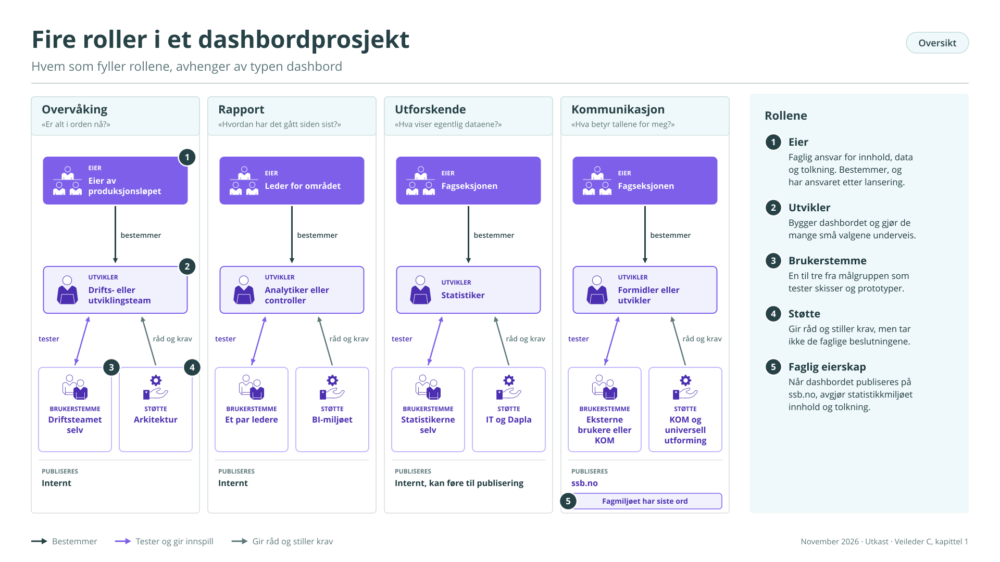
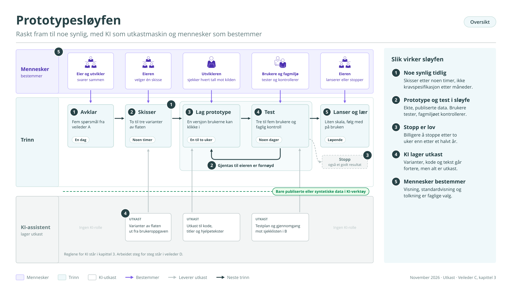
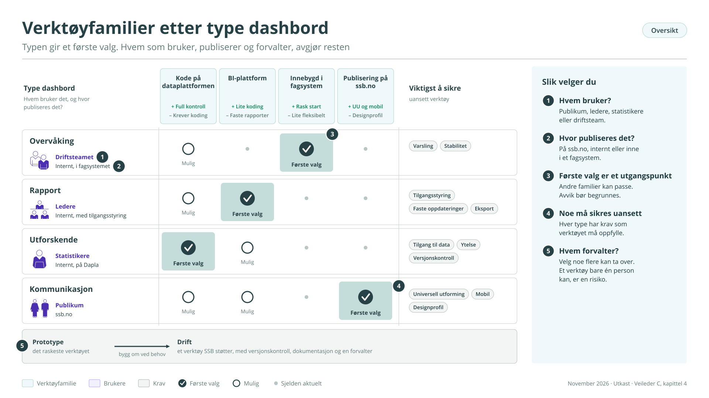
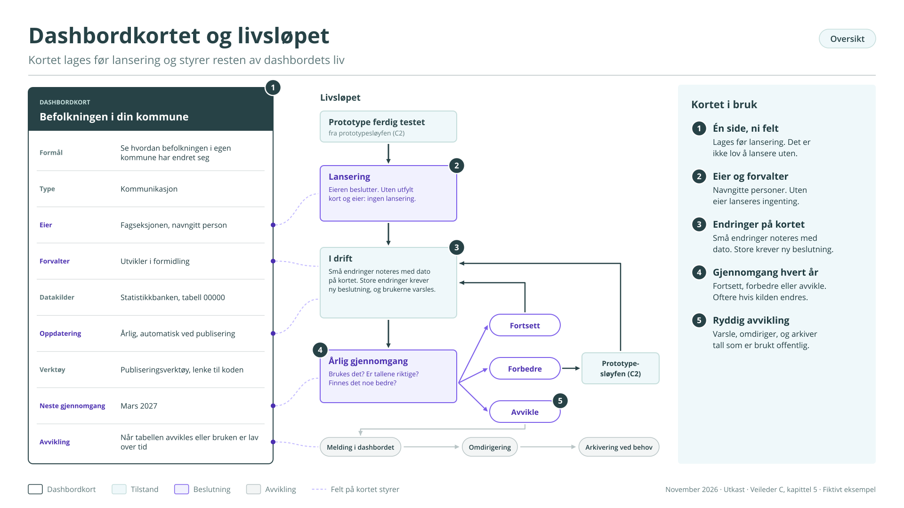
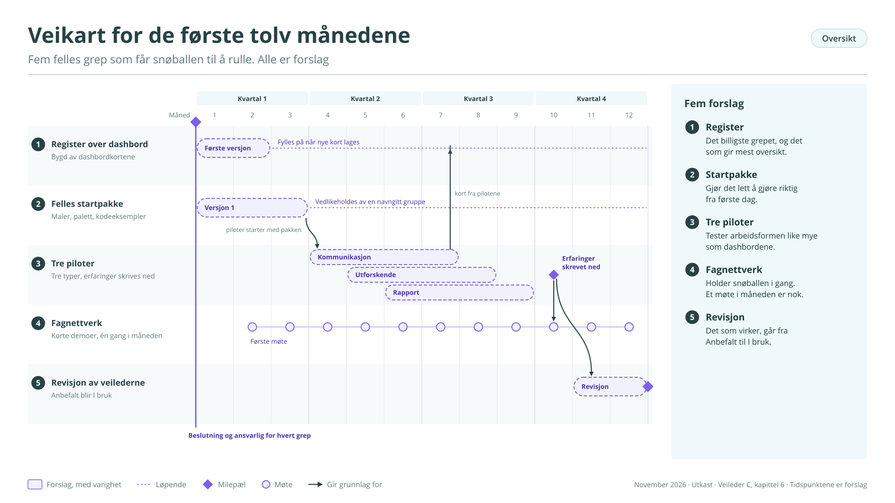

# Del C – Hvordan bør vi jobbe med dashbord i SSB?

## Om denne veilederen

SSB har laget dashbord i mange år, men uten en felles arbeidsform. Denne veilederen beskriver derfor hvordan vi bør jobbe, ikke hvordan vi allerede gjør det. Rådene bygger på beste praksis fra andre statistikkbyråer og fagmiljøer, tilpasset SSB, og på de erfaringene vi har.

For at det skal være tydelig hva som er hva, er rådene merket:

- *I bruk:* praksis vi har i dag.

- *Anbefalt:* beste praksis vi bør ta i bruk.

- *Forslag:* grep som krever en beslutning før de kan innføres.

Veilederen er skrevet for eiere, ledere og støttemiljøer, og for alle som skal sette i gang et dashbordprosjekt. De fire typene dashbord er beskrevet i veileder A, de faglige prinsippene i veileder B og arbeidet steg for steg i veileder D.

## 1 Roller

*Anbefalt.* Et dashbordprosjekt trenger fire roller. I små prosjekter kan én person ha flere av dem, men alle fire må være dekket.

- Eier. Har det faglige ansvaret og tar beslutningene: hva dashbordet skal vise, hvem det er for, og når det er godt nok. Eieren står også for dataene og tolkningen av dem, og har ansvaret etter lansering.

- Utvikler. Bygger dashbordet og gjør de mange små valgene om data, visninger og interaksjon.

- Brukerstemme. En til tre personer fra målgruppen som ser på skisser og prototyper underveis. Når målgruppen er publikum, kan noen fra KOM være stedfortreder.

- Støtte. KOM, IT, arkitektur og universell utforming. Gir råd og stiller krav, men tar ikke de faglige beslutningene.

Hvem som fyller rollene, avhenger av typen dashbord (figur C1):

<table>
<colgroup>
<col style="width: 18%" />
<col style="width: 22%" />
<col style="width: 18%" />
<col style="width: 16%" />
<col style="width: 24%" />
</colgroup>
<thead>
<tr class="header">
<th></th>
<th>
Overvåking
</th>
<th>
Rapport
</th>
<th>
Utforskende
</th>
<th>
Kommunikasjon
</th>
</tr>
</thead>
<tbody>
<tr class="odd">
<td>
Eier
</td>
<td>
Den som eier produksjonsløpet eller systemet
</td>
<td>
Leder for området
</td>
<td>
Fagseksjonen
</td>
<td>
Fagseksjonen
</td>
</tr>
<tr class="even">
<td>
Utvikler
</td>
<td>
Drifts- eller utviklingsteam
</td>
<td>
Analytiker eller controller
</td>
<td>
Statistiker
</td>
<td>
Formidler eller visualiseringsutvikler
</td>
</tr>
<tr class="odd">
<td>
Brukerstemme
</td>
<td>
Driftsteamet selv
</td>
<td>
Et par ledere
</td>
<td>
Statistikerne selv
</td>
<td>
Eksterne brukere, 
eller KOM
</td>
</tr>
<tr class="even">
<td>
Støtte
</td>
<td>
Arkitektur
</td>
<td>
BI-miljøet
</td>
<td>
IT og Dapla
</td>
<td>
KOM og universell utforming
</td>
</tr>
</tbody>
</table>

<figure class="figur" id="figur-c1" markdown="span">
  [{ loading=lazy }](figurer/C1.svg){ title="Åpne figuren i full størrelse" }
  <figcaption>Figur C1. Fire roller i et dashbordprosjekt · <a href="figurer/C1.svg" download>Last ned SVG</a></figcaption>
</figure>

Ett prinsipp gjelder alltid for dashbord som publiseres: det faglige eierskapet ligger hos statistikkmiljøet. European Statistics Code of Practice krever at statistikken er faglig uavhengig og objektiv. Utforming og redaksjonell innpakning kan aldri overstyre det faglige innholdet. Når KOM og fagmiljøet er uenige om en tolkning eller en visning, avgjør fagmiljøet.

## 2 Samspill

De fleste prosjekter har glede av vanlige råd om samarbeid. Her er de fem møtepunktene som er særegne for dashbord.

**1 Én setning om brukeroppgaven.** *Anbefalt.*

Før noe tegnes, blir eier, utvikler og brukerstemme enige om én setning: hvem som skal bruke dashbordet, og hva de skal kunne finne ut. Setningen er målestokken for alle senere valg (veileder A, kapittel 6, og veileder B, kapittel 1).

**2 Datastrukturen før interaksjonen.** *Anbefalt.*

Hvilke filtre og hvilken nedboring som er mulig, avgjøres av dataene, ikke av utformingen. Har dataene ikke et hierarki fra fylke til kommune, kan brukeren ikke bore seg ned. Eier og utvikler går gjennom datastrukturen sammen tidlig (veileder B, kapittel 4).

**3 En avtalt standardvisning.** *Anbefalt.*

Det dashbordet viser når det åpnes, er det de fleste brukerne ser. Standardvisningen er derfor en faglig beslutning, ikke en teknisk detalj, og eieren godkjenner den.

**4 Faglig kontroll av visningene.** *Anbefalt.*

Fagmiljøet kontrollerer vanligvis tallene. I et dashbord må de også kontrollere visningene: Kan et filter gi en misvisende kombinasjon? Kan små grupper gi tall som ikke skal publiseres? Gir standardsorteringen et skjevt bilde? Denne kontrollen er et fast steg før lansering.

**5 Når kravene trekker hver sin vei.** *Anbefalt.*

KOM har krav til designprofil, universell utforming og mobil. Fagmiljøet har krav til presisjon og nyanser. De fleste konflikter løses når begge ser en prototype. De som ikke løses, avgjør eieren, i tråd med prinsippet i kapittel 1.

## 3 Arbeidsform: raske prototyper

*Anbefalt.* Den beste måten å finne ut hva et dashbord skal være, er å lage det raskt og vise det fram. Lange kravspesifikasjoner før noen har sett noe, gir sjelden bedre dashbord. Arbeidet bør gå i korte runder der noe synlig kommer på bordet tidlig (figur C2).

<figure class="figur" id="figur-c2" markdown="span">
  [{ loading=lazy }](figurer/C2.svg){ title="Åpne figuren i full størrelse" }
  <figcaption>Figur C2. Prototypesløyfen · <a href="figurer/C2.svg" download>Last ned SVG</a></figcaption>
</figure>

| Trinn           | Hva skjer                                                                    | Resultat                                            | Tid            |
|-----------------|------------------------------------------------------------------------------|-----------------------------------------------------|----------------|
| 1 Avklar        | Eier og utvikler svarer på de fem spørsmålene i veileder A                   | Én side: brukeroppgave, type, eier, datakilder      | En dag         |
| 2 Skisser       | Flere enkle varianter av flaten, på papir eller med KI                       | To til tre skisser å velge mellom                   | Noen timer     |
| 3 Lag prototype | En fungerende versjon med ekte, publiserte data                              | Noe brukerne kan klikke i                           | En til to uker |
| 4 Test          | Tre til fem brukere prøver prototypen, og fagmiljøet kontrollerer visningene | En liste over endringer                             | Noen dager     |
| 5 Lanser og lær | Lanser i liten skala, følg med på bruken, forbedre                           | Et dashbord i bruk, og et dashbordkort (kapittel 5) | Løpende        |

Trinn 3 og 4 gjentas til eieren er fornøyd. Noen prototyper bør aldri lanseres, og det er et godt resultat: det er billigere å stoppe etter to uker enn etter et halvt år.

Hvordan en prototype blir et varig produkt, står i kapittel 4. Arbeidet steg for steg, med brukerhistorier og sjekklister, står i veileder D.

**KI-assistenter i arbeidet**

*Anbefalt.* KI-assistenter gjør det mulig å komme mye raskere fra idé til noe synlig. Brukt riktig kan de gjøre trinn 2 og 3 til en jobb på timer og dager. Brukt feil kan de gi dashbord som ser riktige ut uten å være det.

KI er nyttig til å:

- lage flere varianter av en flate ut fra en beskrivelse av brukeroppgaven

- skrive utkast til kode, for eksempel i Python eller JavaScript

- skrive utkast til titler, hjelpetekster og forklaringer

- gå gjennom et utkast mot sjekklisten i veileder B og SSBs diagramstandard, som et ekstra par øyne

- lage testplaner og spørsmål til brukertester

Noen regler gjelder alltid:

- Ingen upubliserte eller taushetsbelagte data i KI-verktøy som ikke er godkjent for det. Prototyper lages med publiserte tall eller med syntetiske data. Følg SSBs retningslinjer for bruk av KI.

- KI lager utkast. Mennesker bestemmer. Valg av visning, standardvisning og tolkning er faglige beslutninger.

- Hvert tall kontrolleres mot kilden. KI kan hente feil tabell, bruke feil enhet eller finne på verdier som ser rimelige ut.

- Faglig kontroll er et fast steg, ikke noe man gjør hvis det er tid.

- Vær åpen om KI-bruk overfor fagmiljøet og i dokumentasjonen.

*I bruk.* I 2026 er denne arbeidsformen prøvd ut på prototyper for noen av SSBs mest brukte statistikker, blant annet befolkningsframskrivinger, konsumprisindeksen, folkemengde, navn og utenrikshandel. Hver prototype gikk gjennom faste steg: innsikt om statistikken og vanlige misforståelser, konseptgrafikk, valg av tabeller i Statistikkbanken, bygging og faglig kontroll. KI-assistenter laget utkastene, og hvert steg ble godkjent av et menneske før neste startet. Fagseksjonene kontrollerte resultatet. Erfaringen er at en prototype kan bli ferdig på dager, og at det er den faglige kontrollen, ikke byggingen, som tar tid.

## 4 Verktøy

Verktøy endrer seg raskt, og mange råd om bestemte produkter er utdatert etter et par år. Dette kapitlet beskriver derfor hvordan man velger. Konkrete verktøy står i en egen oversikt med holdbarhetsdato.

**Tre spørsmål avgjør valget**

*Anbefalt.*

1.  Hvem skal bruke dashbordet? Publikum, ledere, statistikere eller driftsteam.

2.  Hvor skal det publiseres? På ssb.no, internt, eller inne i et fagsystem.

3.  Hvem skal forvalte det? Velg et verktøy som noen andre enn utvikleren kan ta over. Et verktøy bare én person kan, er en risiko.

**Fire verktøyfamilier**

- Kode på dataplattformen. Dashbord skrevet i Python eller R på Dapla. Gir full kontroll, tett kobling til data og metadata, og versjonskontroll. Krever kodekompetanse.

- BI-plattformer. Verktøy med grafisk grensesnitt der mye kan lages uten koding. Gode for faste rapporter, tilgangsstyring og planlagte oppdateringer.

- Innebygd i drifts- og fagsystemer. Overvåkingsflater som følger med systemet. Raske å ta i bruk, men lite fleksible.

- Publiseringsverktøy for ssb.no. Verktøy som kan bygges inn på nettsidene og oppfyller kravene til universell utforming, mobil og designprofil.

| Type dashbord | Første valg                       | Viktigst å sikre                              |
|---------------|-----------------------------------|-----------------------------------------------|
| Overvåking    | Innebygd i drifts- og fagsystemer | Varsling, stabilitet                          |
| Rapport       | BI-plattform                      | Tilgangsstyring, faste oppdateringer, eksport |
| Utforskende   | Kode på dataplattformen           | Tilgang til data, ytelse, versjonskontroll    |
| Kommunikasjon | Publiseringsverktøy for ssb.no    | Universell utforming, mobil, designprofil     |

<figure class="figur" id="figur-c3" markdown="span">
  [{ loading=lazy }](figurer/C3.svg){ title="Åpne figuren i full størrelse" }
  <figcaption>Figur C3. Verktøyfamilier etter type dashbord · <a href="figurer/C3.svg" download>Last ned SVG</a></figcaption>
</figure>

**Fra prototype til drift**

*Anbefalt.* En prototype kan lages i det verktøyet som er raskest. Et dashbord som skal leve, må stå i et verktøy SSB støtter, med versjonskontroll, dokumentasjon og en forvalter. Avklar tidlig om prototypen skal bygges om før lansering, og sett av tid til det.

**Data og publisering**

*I bruk.* To regler fra statistikkproduksjonen gjelder også for dashbord:

- Upubliserte data blir værende internt. Utforskende dashbord og overvåkingsdashbord med upubliserte tall skal ha tilgangsstyring.

- Publiserte dashbord oppdateres samtidig med statistikken, ikke før. Alle brukere skal få nye tall på samme tid.

**Eksempler på verktøy**

Oversikten gjelder per november 2026. Den kontrolleres hvert halvår, og statusen må bekreftes av IT.

| Verktøy                            | Familie                     | Typisk bruk i SSB                      | Status    |
|------------------------------------|-----------------------------|----------------------------------------|-----------|
| Python med Dash eller Plotly       | Kode på dataplattformen     | Utforskende dashbord på Dapla          | Avklares  |
| R med Shiny                        | Kode på dataplattformen     | Utforskende dashbord på Dapla          | Avklares  |
| Power BI                           | BI-plattform                | Rapportdashbord for ledelse og styring | I bruk    |
| Tableau                            | BI-plattform og publisering | Kommunikasjonsdashbord på ssb.no       | Avklares  |
| Grafana                            | Innebygd                    | Overvåking av systemer og dataflyt     | I bruk    |
| Highcharts                         | Publisering                 | Interaktive figurer på ssb.no          | Avklares  |
| HTML og JavaScript på GitHub Pages | Prototype                   | Prototyper for faglig kontroll         | Prøves ut |

## 5 Forvaltning

Et dashbord slutter oftest å virke fordi ingen lenger har ansvaret, ikke fordi teknikken svikter. Utvikleren bytter jobb, kildetabellen endres, eller dashbordet blir stående med gamle tall uten at noen merker det.

**Dashbordkortet**

*Anbefalt.* Hvert dashbord får et dashbordkort: én side som sier det viktigste om det. Kortet lages før lansering, og det er ikke lov å lansere uten (figur C4).

| Felt              | Innhold                                              |
|-------------------|------------------------------------------------------|
| Formål            | Brukeroppgaven, i én setning                         |
| Type              | Overvåking, rapport, utforskende eller kommunikasjon |
| Eier              | Seksjon og navngitt person                           |
| Forvalter         | Den som holder dashbordet i gang teknisk             |
| Datakilder        | Tabeller, API-er eller datasett                      |
| Oppdatering       | Hvor ofte, og om det skjer automatisk                |
| Verktøy           | Og hvor koden eller filen ligger                     |
| Neste gjennomgang | Dato                                                 |
| Avvikling         | Hva som skal til for å legge det ned                 |

<figure class="figur" id="figur-c4" markdown="span">
  [{ loading=lazy }](figurer/C4.svg){ title="Åpne figuren i full størrelse" }
  <figcaption>Figur C4. Dashbordkortet og livsløpet · <a href="figurer/C4.svg" download>Last ned SVG</a></figcaption>
</figure>

**Årlig gjennomgang**

*Anbefalt.* Eieren går gjennom dashbordet minst én gang i året, og oftere hvis datakilden endres. Gjennomgangen tar for seg tre spørsmål: Brukes det? Er tallene og forklaringene riktige? Finnes det et bedre alternativ? Svaret er enten «fortsett», «forbedre» eller «avvikle».

**Endringer**

*Anbefalt.* Små endringer, som en rettet tekst eller en ny periode, noteres med dato i dashbordkortet. Store endringer i innhold eller funksjon gjør eieren til en ny beslutning, og brukerne varsles i dashbordet.

**Avvikling**

*Anbefalt.* Et dashbord skal ikke leve bare fordi det en gang ble laget. Lav bruk over tid, foreldet innhold eller et bedre alternativ er grunner til å legge det ned. Avvikling gjøres ryddig: en melding i dashbordet en periode, så omdirigering til det som erstatter det, og arkivering hvis tallene er brukt i offentlig debatt eller saksbehandling.

Uten en eier skal det ikke lanseres noe dashbord (veileder A, figur A5).

## 6 Kom i gang: forslag

Kapitlene 1–5 gjelder det enkelte dashbordprosjektet. For at SSB skal få en felles praksis, trengs det også noen felles grep. Her er fem forslag for de første seks til tolv månedene. Alle krever en beslutning og en ansvarlig (figur C5).

<figure class="figur" id="figur-c5" markdown="span">
  [{ loading=lazy }](figurer/C5.svg){ title="Åpne figuren i full størrelse" }
  <figcaption>Figur C5. Veikart for de første tolv månedene · <a href="figurer/C5.svg" download>Last ned SVG</a></figcaption>
</figure>

**1 Et register over dashbord.** *Forslag.*

En enkel oversikt over dashbordene som finnes i SSB, bygd av dashbordkortene. Registeret viser hva som finnes, hvem som eier det, og hva som snart skal gjennomgås. Det er det billigste grepet og det som gir mest oversikt.

**2 En felles startpakke.** *Forslag.*

Det som trengs for å komme raskt i gang: grunnmalen for flaten i veileder B, palett og diagramstandard, maler for dashbordkort og brukertest, og noen kodeeksempler for de vanligste verktøyene. Pakken vedlikeholdes av én navngitt person eller gruppe.

**3 Tre piloter.** *Forslag.*

Tre dashbord laget etter denne veilederen, gjerne av ulike typer: ett kommunikasjonsdashbord, ett utforskende og ett rapportdashbord. Pilotene skal teste arbeidsformen like mye som å lage gode dashbord, og erfaringene skrives ned.

**4 Et lite fagnettverk.** *Forslag.*

En møteplass for dem som lager dashbord, med korte demoer av hva som er laget og hva man har lært. Et møte i måneden er nok til å holde snøballen i gang.

**5 Revisjon etter et år.** *Forslag.*

Veilederserien gjennomgås etter et år, med erfaringene fra pilotene. Det som har vist seg å virke, endrer status fra «Anbefalt» til «I bruk».
