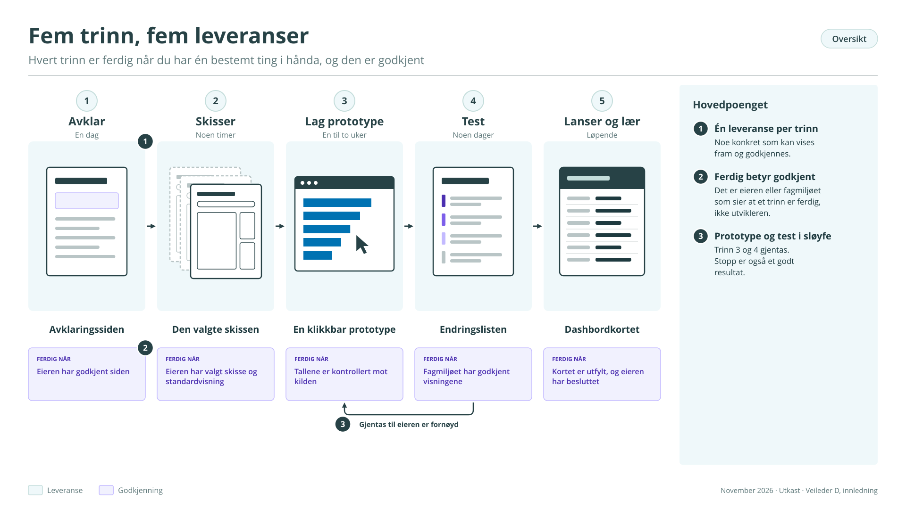
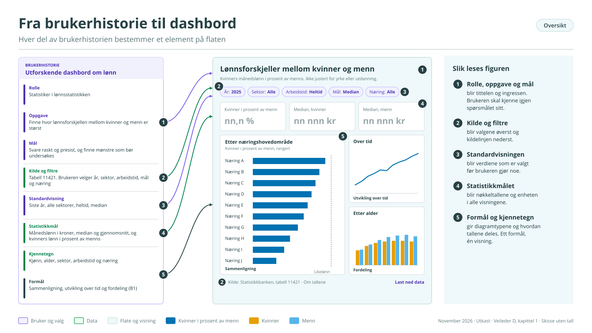
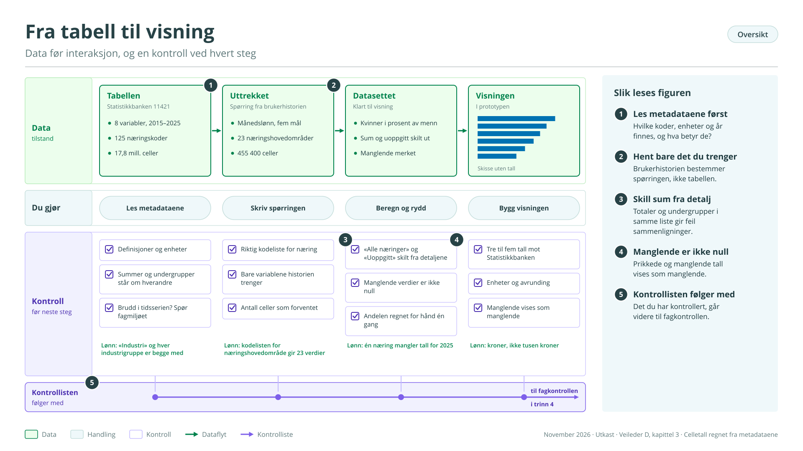
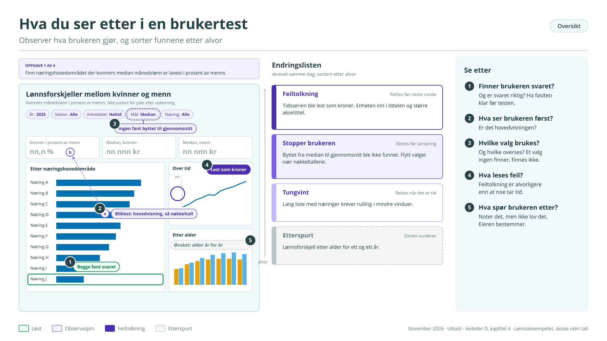
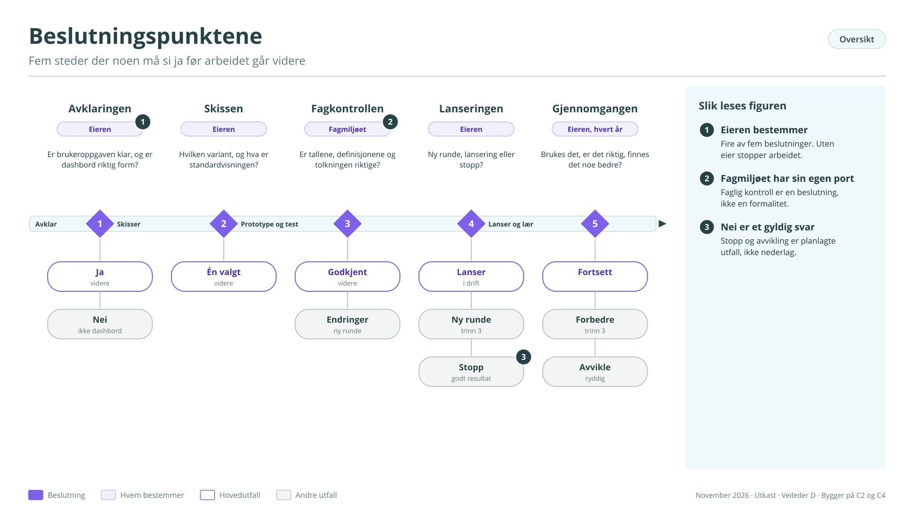
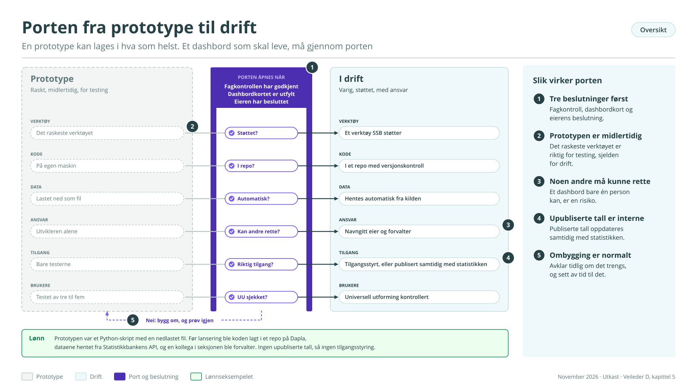

# Del D – Hvordan lager vi et dashbord i praksis?

## Om denne veilederen

Denne veilederen er for den som skal bygge et dashbord. Den følger de fem trinnene i prototypesløyfen fra veileder C (figur C2): avklar, skisser, lag prototype, test, lanser og lær. Hvert kapittel sier hva som skal gjøres, hva som skal være ferdig før neste trinn, og hvor KI-assistenter kan hjelpe.

Veilederen gjentar ikke det som står andre steder:

- Veileder A forklarer hva et dashbord er, de fire typene og de fem spørsmålene som avgjør om dashbord er riktig løsning.

- Veileder B og vedlegg B1 handler om hva som gjør et dashbord godt: brukeren, flaten, diagramtypene og tekstlaget.

- Veileder C beskriver roller, arbeidsform, verktøyvalg og forvaltning.

- Veileder E er et forenklet opplegg for kommunikasjonsdashbord på ssb.no.

Bruk veilederen som en sjekkliste ved siden av arbeidet. Malene står samlet i vedlegg D1.

<figure class="figur" id="figur-d1" markdown="span">
  [{ loading=lazy }](figurer/D1.svg){ title="Åpne figuren i full størrelse" }
  <figcaption>Figur D1. Fem trinn, fem leveranser · <a href="figurer/D1.svg" download>Last ned SVG</a></figcaption>
</figure>

*Eksempelet: lønn*

Gjennom hele veilederen følger vi ett eksempel, et utforskende dashbord om lønn. Eksempelet er laget for veilederen og beskriver ikke et faktisk prosjekt, men det bygger på en ekte tabell i Statistikkbanken: 11421 Aldersfordelt månedslønn, etter kjønn, arbeidstid, sektor og næring, som dekker årene 2015–2025.

Utgangspunktet er dette: Statistikerne i fagseksjonen for lønnsstatistikk får jevnlig spørsmål om lønnsforskjeller mellom kvinner og menn, og de vil raskere kunne se hvor forskjellene er store og hva de henger sammen med. Tabellen har svarene, men den har mange dimensjoner, og det er tungt å lete i den én utvalgsboks om gangen.

*Eksempelet står i rammer merket Lønn i hvert kapittel.*

## 1 Avklar

Målet med trinnet er én side som eier og utvikler er enige om. Det tar sjelden mer enn en dag, og det er den dagen som sparer mest tid senere.

**Fem spørsmål og én setning**

Start med de fem spørsmålene i veileder A: Hvem er brukeren? Hvilken oppgave skal dashbordet løse? Er dataene klare? Hvem eier det? Er dashbord riktig form? Hvis svaret på det siste er nei, er avklaringen likevel en suksess.

Skriv deretter brukeroppgaven i én setning. Klarer du ikke det, er dashbordet ikke avklart ennå. En setning som «gi oversikt over lønn» er for vag. En god setning har et verb som beskriver hva brukeren faktisk gjør: finne, sammenligne, oppdage, følge med på.

**Brukerhistorien**

En vanlig brukerhistorie har formen Som \[rolle\] ønsker jeg å \[gjøre noe\] for å \[oppnå noe\]. For dashbord med statistikk trenger vi mer, fordi valget av data og visninger må styres av historien. Malen vi bruker, har sju deler:

| Del             | Spørsmål                                                       |
|-----------------|----------------------------------------------------------------|
| Rolle           | Hvem er brukeren?                                              |
| Oppgave         | Hva vil brukeren gjøre?                                        |
| Mål             | Hvorfor, og hva skjer etterpå?                                 |
| Statistikkmål   | Hvilke tall skal vises, og i hvilken enhet?                    |
| Kjennetegn      | Hvilke grupper skal tallene deles etter?                       |
| Formål          | Hvilke av de ni formålene i vedlegg B1 skal visningene støtte? |
| Kilde og filtre | Hvilke tabeller, og hva skal brukeren kunne velge?             |

De tre siste delene er det som skiller malen fra en vanlig brukerhistorie. De tvinger fram valg som ellers blir tatt tilfeldig under byggingen. Figur D1 viser hvordan hver del av historien blir et element på flaten.

<figure class="figur" id="figur-d2" markdown="span">
  [{ loading=lazy }](figurer/D2.svg){ title="Åpne figuren i full størrelse" }
  <figcaption>Figur D2. Fra brukerhistorie til dashbord · <a href="figurer/D2.svg" download>Last ned SVG</a></figcaption>
</figure>

*Lønn. Brukerhistorien ble slik:*

Som statistiker i lønnsstatistikken ønsker jeg å finne hvor lønnsforskjellen mellom kvinner og menn er størst, og om den henger sammen med alder, sektor eller arbeidstid, for å kunne svare raskt og presist på spørsmål og finne mønstre som bør undersøkes nærmere.

- Statistikkmål: månedslønn i kroner, både median og gjennomsnitt, og kvinners lønn i prosent av menns.

- Kjennetegn: kjønn, alder, sektor, arbeidstid og næring.

- Formål: sammenligning (vedlegg B1, kapittel 2), utvikling over tid (kapittel 1) og fordeling (kapittel 4).

- Kilde og filtre: tabell 11421. Brukeren velger år, sektor, arbeidstid og næring.

Eier er seksjonslederen. Utvikler er en statistiker i seksjonen. To kolleger er brukerstemme. Typen er utforskende, og dashbordet skal bare brukes internt.

**Leveranse**

Avklaringssiden (mal i vedlegg D1): brukeroppgaven i én setning, brukerhistorien, type, eier, utvikler, brukerstemme og datakilder. Eieren godkjenner siden før neste trinn.

KI kan hjelpe med å foreslå flere formuleringer av brukeroppgaven og stille kontrollspørsmål til brukerhistorien. Be gjerne assistenten om å finne det som er uklart eller motsier seg selv. Valget av brukeroppgave er eierens.

## 2 Skisser

Målet med trinnet er to til tre enkle skisser av flaten, og et valg mellom dem. Det tar noen timer.

**Fra historie til flate**

Arbeid i denne rekkefølgen:

1.  Formål gir diagramtype. Hvert formål i brukerhistorien peker på noen få diagramtyper i vedlegg B1. Velg én per visning.

2.  Grunnmalen gir plassering. Bruk grunnmalen i veileder B: tittel og ingress øverst, valg, nøkkeltall, én hovedvisning og noen få støttevisninger.

3.  Bestem standardvisningen. Hva ser brukeren før hun har klikket på noe? Standardvisningen er det viktigste enkeltvalget i et dashbord, fordi de fleste aldri endrer den (veileder B, kapittel 1).

4.  Lag varianter. To til tre skisser som er forskjellige på et vesentlig punkt, for eksempel hvilken visning som er hovedvisningen. Varianter som bare skiller seg i farge, gir ingen ny innsikt.

Skisser på papir, på tavle eller med KI. Det viktigste er at skissene er raske å lage og lette å forkaste.

*Lønn. Tre varianter:*

- A har en tidsserie for kvinners lønn i prosent av menns som hovedvisning, med næring som filter.

- B har en rangert liste over næringer etter lønnsforskjell som hovedvisning, med alder og tidsutvikling som støttevisninger.

- C har et rutenett av små diagrammer, ett per sektor.

Eieren valgte B, fordi spørsmålet som kommer oftest er «hvor er forskjellen størst?». Fra A beholdt hun tidsserien som støttevisning. Standardvisningen er siste år, alle sektorer, heltidsansatte og median.

**Leveranse**

Den valgte skissen, med standardvisningen beskrevet i én setning.

KI kan hjelpe med å lage varianter ut fra brukerhistorien, og med å tegne dem raskt som enkle HTML-sider eller bilder. Gi assistenten brukerhistorien, grunnmalen og diagramstandarden. Be om varianter som er forskjellige i struktur, og be om en begrunnelse for hver.

## 3 Lag prototype

Målet med trinnet er en fungerende versjon med ekte, publiserte tall som brukerne kan klikke i. Det tar en til to uker.

**Data før interaksjon**

Det vanligste feilsteget er å begynne med knappene. Begynn med dataene, og forstå strukturen før du bygger noe som avhenger av den:

- Hent tabellen og les metadataene. Hvilke variabler finnes, hvilke koder, hvilke år, og hvilke enheter? Hva er definert som hva?

- Se etter blandede nivåer. Mange tabeller har summer og undergrupper i samme liste. Hvis du viser alle verdiene samtidig, sammenlignes aggregater med detaljer, eller tall telles to ganger.

- Se etter manglende verdier. Små grupper er ofte prikket eller mangler. Bestem hvordan dashbordet skal vise dem, og vis dem aldri som null.

- Se etter brudd. Endringer i definisjoner, kodelister eller metode kan gjøre at år ikke er sammenlignbare. Spør fagmiljøet hvis du er i tvil.

- Hent bare det du trenger. Lag spørringen ut fra brukerhistorien, ikke ut fra hele tabellen.

<figure class="figur" id="figur-d3" markdown="span">
  [{ loading=lazy }](figurer/D3.svg){ title="Åpne figuren i full størrelse" }
  <figcaption>Figur D3. Fra tabell til visning · <a href="figurer/D3.svg" download>Last ned SVG</a></figcaption>
</figure>

*Lønn.*

Tabell 11421 har 125 næringskoder der hovedområder og undergrupper står om hverandre, for eksempel både «Industri» og de enkelte industrigruppene. Prototypen bruker derfor kodelisten for næringshovedområde i hovedvisningen og lar brukeren gå ned til næringsgruppe. Tabellen har seks statistikkmål. Brukerhistorien trenger median, gjennomsnitt og nedre og øvre kvartil. Antall arbeidsforhold ble også tatt med, slik at dashbordet kan vise hvor få personer et tall bygger på. Utvikleren spurte fagmiljøet hvordan månedslønn for deltidsansatte er beregnet, før arbeidstid ble lagt inn som filter.

**Kontroller hvert tall**

Hvert tall i prototypen skal kunne spores tilbake til tabellen. Det gjelder særlig når KI har skrevet koden:

- Sammenlign tre til fem tilfeldige tall i dashbordet med Statistikkbanken.

- Kontroller summer, andeler og beregnede størrelser for hånd for minst én kombinasjon av valg.

- Kontroller enheter og avrunding: kroner eller tusen kroner, prosent eller prosentpoeng.

- Kontroller at manglende verdier vises som manglende.

Skriv ned hva som er kontrollert. Listen går videre til fagkontrollen i trinn 4.

**Tekstlaget**

Tittel, ingress, hjelpetekster, forklaringer og kildeangivelse skrives nå, ikke til slutt (veileder B). En prototype uten tekst blir testet som en annen prototype enn den som lanseres.

*Lønn.*

Ingressen sier hva lønnsforskjellen er målt som, og at forskjellen ikke er justert for yrke eller utdanning. Det siste var det første fagmiljøet spurte om.

**Verktøyet**

Bruk det verktøyet som gir deg en klikkbar prototype raskest (veileder C, kapittel 4). Avklar likevel nå om prototypen skal bygges om før lansering. For et utforskende dashbord er kode på dataplattformen første valg.

KI kan hjelpe med å skrive kode for spørringen, datatransformasjonen og visningene, og med utkast til tekstlaget. Gi assistenten tabellens metadata, brukerhistorien og den valgte skissen. Be om kode som er lett å lese, og om en liste over antakelser assistenten har gjort. Reglene i veileder C gjelder alltid: bare publiserte eller syntetiske data i KI-verktøy, og hvert tall kontrolleres mot kilden.

**Leveranse**

En prototype brukerne kan klikke i, med publiserte tall, tekstlag og en liste over hva som er kontrollert.

## 4 Test

Målet med trinnet er en liste over endringer og en beslutning: en ny runde, lansering eller stopp. Det tar noen dager. Testen har to deler som er like viktige: brukertest og faglig kontroll.

**Brukertest**

Tre til fem brukere er nok til å finne de største problemene. Flere brukere finner stort sett de samme problemene om igjen.

Forbered. Skriv tre til fem oppgaver som brukeren skal løse med dashbordet. Oppgavene skal komme fra brukerhistorien og ha et riktig svar du kjenner på forhånd. Ikke beskriv hvordan de skal løses.

Gjennomfør. Én bruker om gangen, 20–30 minutter. Be brukeren tenke høyt. Ikke hjelp, og ikke forklar. Hvis brukeren står fast, noter hvor og hvorfor. Det er det viktigste funnet.

Se etter:

- Finner brukeren svaret, og er svaret riktig?

- Hva ser brukeren på først? Er det hovedvisningen?

- Hvilke valg prøver brukeren, og hvilke overser hun?

- Hva leser brukeren feil? Feiltolkning er alvorligere enn tidsbruk.

- Hva spør brukeren etter som ikke finnes?

Skriv endringslisten samme dag. Sorter etter alvor: feil tolkning først, deretter det som stopper brukeren, og til sist det som bare er tungvint.

<figure class="figur" id="figur-d4" markdown="span">
  [{ loading=lazy }](figurer/D4.svg){ title="Åpne figuren i full størrelse" }
  <figcaption>Figur D4. Hva du ser etter i en brukertest · <a href="figurer/D4.svg" download>Last ned SVG</a></figcaption>
</figure>

*Lønn.*

Oppgavene var blant annet: «Finn næringshovedområdet der kvinners median månedslønn er lavest i prosent av menns» og «Har forskjellen i offentlig sektor blitt mindre siden 2015?». Begge testbrukerne fant den første. En av dem leste tidsserien som kroner og ikke prosent, fordi aksetittelen var for liten. Ingen av dem oppdaget at median kunne byttes til gjennomsnitt.

**Faglig kontroll**

Fagmiljøet kontrollerer at dashbordet er faglig riktig. Det er et fast steg, og det tar ofte lengre tid enn byggingen. Gjør det enkelt å si ja:

- Send lenke til prototypen, listen over hva som allerede er kontrollert, og en kort sjekkliste (vedlegg D1).

- Be om svar innen en bestemt dato.

- Still konkrete spørsmål: Er definisjonene riktige? Er det tall som ikke bør vises sammen? Mangler det forbehold?

- Skriv ned svarene og hva som er endret.

**Universell utforming**

Også interne dashbord skal kunne brukes av alle. Kontroller minst at fargene fungerer for fargeblinde, at kontrasten er god nok, at dashbordet kan brukes med tastatur, og at tallene finnes som tabell eller nedlasting.

**Beslutningen**

Eieren går gjennom endringslisten og svarene fra fagkontrollen og velger én av tre:

- Ny runde gjennom trinn 3 og 4, med endringene.

- Lansering når de viktigste endringene er gjort og fagmiljøet har godkjent.

- Stopp hvis testen viser at dashbord ikke er riktig løsning. Det er et godt resultat (veileder C, kapittel 3).

KI kan hjelpe med å lage testoppgaver ut fra brukerhistorien, gå gjennom prototypen mot sjekklisten i veileder B, og sortere notater fra testene. Selve testen må gjøres med mennesker.

*Lønn.*

Etter to runder godkjente fagmiljøet visningene. Forbeholdet om yrke og utdanning ble flyttet fra ingressen til hovedvisningen, der det var synlig når brukerne trengte det.

<figure class="figur" id="figur-d5" markdown="span">
  [{ loading=lazy }](figurer/D5.svg){ title="Åpne figuren i full størrelse" }
  <figcaption>Figur D5. Beslutningspunktene · <a href="figurer/D5.svg" download>Last ned SVG</a></figcaption>
</figure>

## 5 Lanser og lær

Målet med trinnet er et dashbord i bruk, med en eier, et dashbordkort og en plan for gjennomgang.

**Fra prototype til drift**

Et dashbord som skal leve, må stå i et verktøy SSB støtter, med versjonskontroll, dokumentasjon og en forvalter (veileder C, kapittel 4). Hvis prototypen er laget i noe annet, bygg den om nå. Sjekk at:

- koden ligger i et repo med versjonskontroll

- dataene hentes automatisk og ikke fra en fil på en enkeltpersons område

- noen andre enn utvikleren kan oppdatere og rette dashbordet

- dashbordet har tilgangsstyring hvis det viser upubliserte tall

- publiserte dashbord oppdateres samtidig med statistikken, ikke før

<figure class="figur" id="figur-d6" markdown="span">
  [{ loading=lazy }](figurer/D6.svg){ title="Åpne figuren i full størrelse" }
  <figcaption>Figur D6. Porten fra prototype til drift · <a href="figurer/D6.svg" download>Last ned SVG</a></figcaption>
</figure>

**Dashbordkortet**

Fyll ut dashbordkortet før lansering (veileder C, kapittel 5, figur C4). Uten kort og eier lanseres det ikke noe dashbord.

**Lanser smått**

Lanser først for en liten gruppe. Si tydelig hva dashbordet er til, og hvem som kan svare på spørsmål. Gi brukerne en enkel måte å melde fra om feil på.

**Følg med på bruken**

Følg med på om dashbordet brukes og hvordan: antall brukere, hvilke valg som brukes, og hvilke spørsmål som kommer inn. Gjør den første gjennomgangen etter et halvt år, ikke etter et år. Det er da det er lettest å rette kursen.

*Lønn.*

Dashbordet ble lansert for seksjonen og for kommunikasjonsavdelingen, som ofte får spørsmål om lønn fra mediene. Ved gjennomgangen etter seks måneder viste det seg at næringsgruppene nesten ikke ble brukt, mens mange ønsket å se lønnsforskjellen etter alder for ett og ett år. Det første ble fjernet og det andre lagt inn i neste runde.

## Vedlegg D1 Maler

Malene er utgangspunkt og kan tilpasses. De inngår i startpakken som er foreslått i veileder C, kapittel 6.

**Avklaringsside**

| Felt               | Innhold                                              |
|--------------------|------------------------------------------------------|
| Navn på dashbordet |                                                      |
| Brukeroppgave      | Én setning                                           |
| Brukerhistorie     | Se mal under                                         |
| Type               | Overvåking, rapport, utforskende eller kommunikasjon |
| Eier               | Seksjon og navngitt person                           |
| Utvikler           |                                                      |
| Brukerstemme       | En til tre personer fra målgruppen                   |
| Datakilder         | Tabeller, API-er eller datasett                      |
| Publiseres         | Internt, i fagsystem eller på ssb.no                 |
| Godkjent av eier   | Dato                                                 |

**Brukerhistorie**

*Som \[rolle\] ønsker jeg å \[oppgave\] for å \[mål\].*

| Del             | Innhold                                |
|-----------------|----------------------------------------|
| Statistikkmål   | Hvilke tall, i hvilken enhet           |
| Kjennetegn      | Hvilke grupper tallene deles etter     |
| Formål          | Fra vedlegg B1                         |
| Kilde           | Tabellnummer eller datasett            |
| Filtre          | Hva brukeren kan velge                 |
| Standardvisning | Hva brukeren ser før hun har valgt noe |

**Testplan**

| Felt          | Innhold                                                         |
|---------------|-----------------------------------------------------------------|
| Testbrukere   | Tre til fem, med rolle                                          |
| Oppgaver      | Tre til fem, med riktig svar                                    |
| Gjennomføring | Én om gangen, 20–30 minutter, tenk høyt                         |
| Notater       | Hvor brukeren stopper, hva som leses feil, hva som etterspørres |
| Endringsliste | Sortert: feiltolkning, stopper brukeren, tungvint               |

**Sjekkliste for faglig kontroll**

- Er definisjonene og begrepene riktige?

- Stemmer tallene med kilden? (Se listen over hva utvikleren har kontrollert.)

- Er det tall eller grupper som ikke bør sammenlignes?

- Vises manglende og prikkede verdier riktig?

- Er det brudd i tidsserien som må forklares?

- Mangler det forbehold eller forklaringer?

- Er tolkningen i titler og tekster faglig forsvarlig?

**Dashbordkort**

Se veileder C, kapittel 5.
