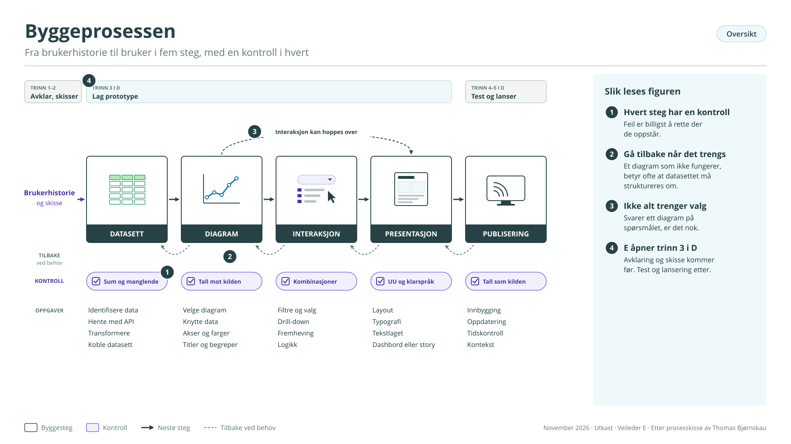
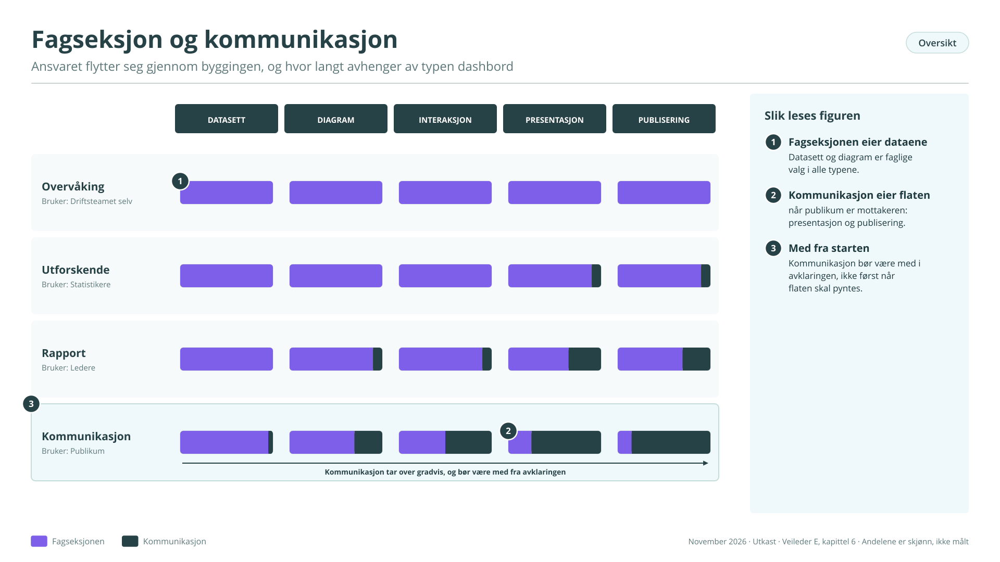
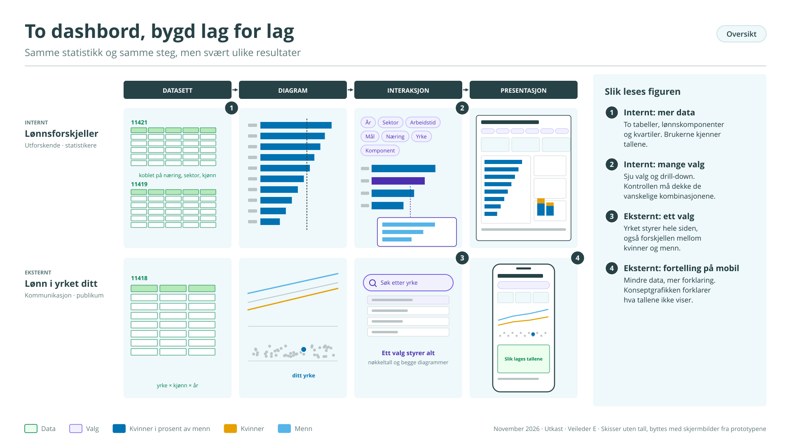
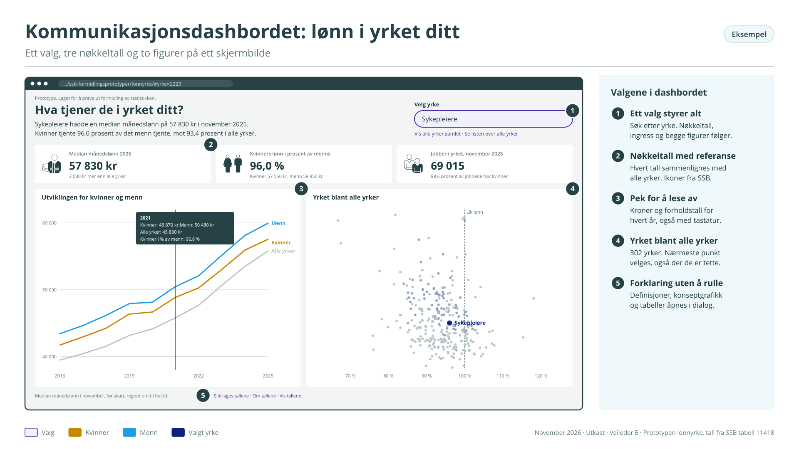
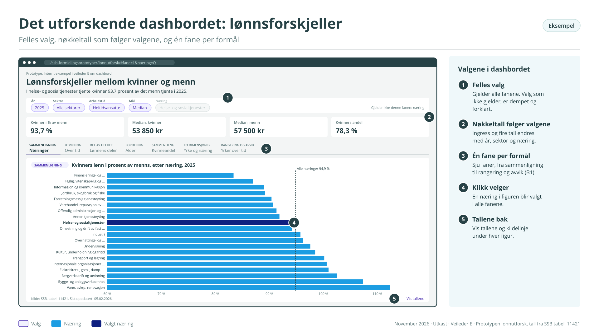

# Del E – Hvordan bygger vi prototypen?

## Om denne veilederen

Veileder D beskriver de fem trinnene i et dashbordprosjekt: avklar, skisser, lag prototype, test, og lanser og lær. Denne veilederen handler om trinn 3, selve byggingen. Den er skrevet for den som sitter med brukerhistorien og den valgte skissen og skal gjøre dem om til noe brukerne kan klikke i.

Byggingen går gjennom fem steg (figur E1):

1.  Datasett: finne, hente, rydde og koble dataene

2.  Diagram: velge visning og knytte dataene til den

3.  Interaksjon: legge til valg, filtre og fremheving

4.  Presentasjon: sette sammen flaten med layout, tekst og typografi

5.  Publisering: gjøre prototypen klar for brukerne

<figure class="figur" id="figur-e1" markdown="span">
  [{ loading=lazy }](figurer/E1.svg){ title="Åpne figuren i full størrelse" }
  <figcaption>Figur E1. Byggeprosessen · <a href="figurer/E1.svg" download>Last ned SVG</a></figcaption>
</figure>

Prosessen er laget for BI-verktøy som Tableau og Power BI, men stegene er de samme når dashbordet skrives i kode og når en KI-assistent lager utkastene. Vedlegg E1 viser oppgavene i hvert steg for de tre arbeidsmåtene.

Tre regler gjelder hele veien:

- Bygg i rekkefølge, men gå tilbake. Et diagram som ikke fungerer, betyr ofte at datasettet må struktureres annerledes. Det er normalt.

- Hvert steg slutter med en kontroll. Det er billigere å finne en feil i datasettet enn i det ferdige dashbordet.

- KI lager utkast. Mennesker bestemmer. Reglene i veileder C, kapittel 3, gjelder: bare publiserte eller syntetiske data i KI-verktøy, og hvert tall kontrolleres mot kilden.

*To eksempler*

Veilederen følger to dashbord om lønn gjennom alle stegene. De bygger på samme statistikk, men er laget for svært ulike brukere. Forskjellen mellom dem viser forskjellen mellom et utforskende dashbord og et kommunikasjonsdashbord bedre enn en definisjon kan.

|            | Internt: lønnsforskjeller                                                                                                                            | Eksternt: lønn i yrket ditt                                                              |
|------------|------------------------------------------------------------------------------------------------------------------------------------------------------|------------------------------------------------------------------------------------------|
| Type       | Utforskende                                                                                                                                          | Kommunikasjon                                                                            |
| Bruker     | Statistikere i lønnsstatistikken                                                                                                                     | Publikum, for eksempel en som vurderer et yrke                                           |
| Spørsmålet | Hvor er lønnsforskjellen mellom kvinner og menn størst, hva henger den sammen med, og ligger den i avtalt lønn eller i tilleggene?                   | Hva tjener de som jobber i yrket mitt, og er det forskjell på kvinner og menn?           |
| Data       | Tabell 11421 (kjønn, alder, arbeidstid, sektor, næring) koblet med 11419 (yrke og næring). Lønnskomponenter, kvartiler og antall heltidsekvivalenter | Tabell 11418, månedslønn etter yrke, kjønn, sektor og arbeidstid                         |
| Valg       | Sju: år, sektor, arbeidstid, mål, næring, yrkesgruppe og lønnskomponent                                                                              | Ett: yrke                                                                                |
| Visninger  | Én hovedvisning og tre støttevisninger                                                                                                               | Tre nøkkeltall, to diagrammer og en forklaring av tallene                                |
| Verktøy    | Python med Plotly Dash på Dapla, KI-assistert                                                                                                        | Prototype bygd med arbeidsprosessen for formidlingsprototyper, publisert på GitHub Pages |
| Publiseres | Internt                                                                                                                                              | Som prototype, før en eventuell lansering på ssb.no                                      |

Det interne eksempelet bygger videre på eksempelet i veileder D, med flere variabler og en tabell til. Det tåler kompleksiteten fordi brukerne kjenner tallene. Det eksterne bygger på lønnsprototypen som er under arbeid i serien av formidlingsprototyper for SSBs mest brukte statistikker.

Begge eksemplene er laget for veilederen, men bruker ekte tabeller. Tallene i figurene er fjernet eller oppdiktet.

## 1 Datasett

Målet med steget er et ryddig datasett som inneholder det brukerhistorien trenger, og ikke mer.

**Oppgaver**

- Identifiser dataene. Hvilke tabeller eller datasett svarer på spørsmålet? Velg det minste som holder.

- Hent dem. Skriv spørringen mot Statistikkbankens API, eller les filene fra dataplattformen. Lagre rådataene uendret, slik at du kan gå tilbake til dem.

- Transformer dem. Gjør om til langt format: én rad per observasjon, én kolonne per variabel. De fleste diagramverktøy og biblioteker forventer dette formatet.

- Koble ved behov. Legg til andre datasett, for eksempel kodelister med navn eller grupperinger. Kontroller at koblingen ikke mister eller dobler rader.

**Kontroll**

Dette er steget der de fleste feilene oppstår, og der de er lettest å rette (veileder D, figur D2):

- Les metadataene. Hvilke koder, enheter og år finnes, og hva betyr de?

- Skill sum fra detalj. Mange tabeller har totaler og undergrupper i samme liste.

- Les statussymbolene. I Statistikkbanken betyr «:» at tallet er skjult av hensyn til personvern, «..» at det mangler, «.» at det ikke kan forekomme og «-» at det er null. Manglende tall skal aldri bli null.

- Se etter brudd. Nye koder, endrede definisjoner eller ny metode kan gjøre at år ikke kan sammenlignes.

- Tell, ikke anslå. Antall koder, grupper og år skal være talt fra dataene.

**KI kan hjelpe**

KI-assistenter er gode til å skrive spørringer og transformasjoner. Gi assistenten tabellens metadata og brukerhistorien, og be om kode som er lett å lese, med en liste over antakelser. Kontroller resultatet mot rådataene: antall rader, et par tilfeldige verdier og at ingen statussymboler er blitt til tall.

*Internt.* Statistikeren henter to tabeller. Tabell 11421 gir lønn etter kjønn, alder, arbeidstid, sektor og næring. Den har 125 næringskoder der hovedområder og undergrupper står om hverandre, så hun bruker kodelisten for næringshovedområde, som gir 23 verdier. «Alle næringer» og «Uoppgitt» skilles ut før rangeringen, og én næring mangler tall for heltidsansatte i 2025. Tabell 11419 gir lønn etter yrke og næring, og kobles på næring, sektor, kjønn, arbeidstid og år. Fra begge hentes lønnskomponentene: avtalt månedslønn, uregelmessige tillegg, bonus og overtid. Hun henter også kvartilene og antall heltidsekvivalenter, slik at dashbordet kan vise spredningen og hvor mange personer et tall bygger på.

Tre ting kontrolleres særskilt. Den første er definisjonen: hvilke komponenter inngår i månedslønn? Ifølge «Om statistikken» består månedslønn av avtalt månedslønn, uregelmessige tillegg og bonus. Overtid er ikke med. Komponentene kan derfor stables til månedslønn, mens overtid må vises for seg. Månedslønn er også regnet om til heltidsekvivalenter, slik at heltid og deltid kan sammenlignes. Den andre er koblingen: yrke etter næring gir mange små grupper, og flere tall er skjult. Den tredje er at kvartiler ikke kan legges sammen eller regnes snitt av. Datasettet lagres som Parquet-filer i langt format, én per tabell, og koblingen gjøres i koden.

*Eksternt.* Tabell 11418 har 582 yrkeskoder på fire nivåer, fra «Ledere» til enkeltyrker som «Personalsjefer», i samme liste. Prototypen bruker kodelisten for yrker på firesiffernivå, fordi det er der folk kjenner igjen yrket sitt. Den henter median månedslønn for kvinner, menn og begge kjønn, for alle år fra 2015, for heltidsansatte og alle sektorer. Mange yrker har få ansatte, og tallene for ett av kjønnene er ofte skjult. Det avgjør hvilke yrker som kan vise forskjellen mellom kvinner og menn, og det må forklares i prototypen. Rådataene lagres uendret i prototypens datamappe, med en kildefil som beskriver hver spørring.

**Leveranse**

Et datasett i langt format, rådataene uendret, og en kort beskrivelse av hva som er gjort og kontrollert.

## 2 Diagram

Målet med steget er én visning per spørsmål, koblet til dataene og kontrollert.

**Oppgaver**

- Velg diagram eller kart. Formålet i brukerhistorien peker på noen få diagramtyper (vedlegg B1). Begynn med hovedvisningen.

- Knytt dataene til diagrammet. Bestem hvilken variabel som går på hvilken akse, hva som gir farge, og hva som skal være filter.

- Juster egenskapene. Akser og skala, sortering, farger, rutenett og linjer, etter SSBs diagramstandard. Søylediagram starter på null. Kategorier sorteres etter verdi når rekkefølgen ikke betyr noe i seg selv.

- Sett ord på det. Tittel, aksetitler, enheter og begreper. Bruk SSBs navn på begreper og serier, ikke egne forkortelser.

**Kontroll**

- Sammenlign tre til fem tall i diagrammet med kilden.

- Kontroller enheter og avrunding: kroner eller tusen kroner, prosent eller prosentpoeng.

- Kontroller at manglende verdier vises som manglende.

- Kontroller at fargene kan skilles av fargeblinde.

**KI kan hjelpe**

KI kan lage diagramkoden og foreslå varianter. Den kan også gå gjennom diagrammet mot diagramstandarden. Valget av diagramtype er et faglig valg, og det gjør du selv.

*Internt.* Hovedvisningen er et liggende søylediagram med kvinners lønn i prosent av menns per næringshovedområde, sortert fra størst til minst forskjell. En stiplet linje viser nivået for alle næringer, i stedet for at «Alle næringer» står som én av søylene. Tre støttevisninger nyanserer bildet: en tidsserie, et søylediagram med kvinner og menn etter alder, og et stablet søylediagram som deler månedslønnen i avtalt lønn, uregelmessige tillegg og bonus for kvinner og menn. Det siste viser om forskjellen ligger i grunnlønnen eller i tilleggene. Kvartilene vises som et spenn rundt medianen, ikke som egne søyler. Statistikeren skrev koden med Plotly i Python, med en KI-assistent som laget det første utkastet.

*Eksternt.* Prototypen har to diagrammer. Det første viser utviklingen i median månedslønn for det valgte yrket, med en linje for kvinner og en for menn, og en tynn grå linje for alle yrker som referanse. Det andre plasserer yrket blant alle yrker: hvert yrke er et punkt etter kvinners lønn i prosent av menns, og det valgte yrket er fremhevet. Tre nøkkeltall over diagrammene viser medianlønnen i yrket, kvinners lønn i prosent av menns, og hvordan yrket ligger an mot alle yrker. Det er alt. Et kommunikasjonsdashbord vinner på å vise mindre.

**Leveranse**

Hovedvisningen og eventuelle støttevisninger, koblet til dataene og kontrollert.

## 3 Interaksjon

Målet med steget er valg som hjelper brukeren å finne sitt eget svar, uten å gjøre dashbordet vanskeligere å forstå.

**Oppgaver**

- Sett opp filtre og valg. Hvilke valg trenger brukerhistorien? Hvert valg skal svare på et spørsmål brukeren faktisk har.

- Legg til interaktivitet. Mouseover med verdier, fremheving av valgt kategori, og drill-down fra hovedområde til undergruppe.

- Lag logikken. Bestem hva som skjer når brukeren velger, og hva som vises når en kombinasjon ikke har data.

**Regler**

- Få valg. Hvert nye valg dobler antallet kombinasjoner som må fungere og kontrolleres.

- Alle visninger følger valget. Et filter som bare virker på én visning, skaper feiltolkninger.

- Standardvisningen er det første brukeren ser, og de fleste endrer den aldri (veileder B, kapittel 1).

- Interaksjon kan hoppes over. Svarer ett godt diagram på spørsmålet, trengs det ingen valg. Pilene i figur E1 som går fra diagram direkte til presentasjon, viser dette.

**Kontroll**

Velg tre kombinasjoner, gjerne en som er vanlig, en som er sjelden og en som mangler data, og kontroller at tallene stemmer med kilden.

**KI kan hjelpe**

KI er god til å skrive logikken mellom valg og visninger, for eksempel callbacks i Dash. Be assistenten forklare logikken med vanlige ord før du godtar koden.

*Internt.* Sju valg: år, sektor, arbeidstid, mål (median, gjennomsnitt eller kvartiler), næring, yrkesgruppe og lønnskomponent. Standardvisningen er siste år, alle sektorer, heltidsansatte, median og månedslønn i alt. Statistikeren kan klikke på et næringshovedområde i hovedvisningen og gå ned til næringsgruppene, og klikke på en søyle for å se yrkene i næringen. Når en gruppe bygger på få heltidsekvivalenter, vises det i mouseover-teksten. Det er mange valg, men brukerne kjenner tallene og vet hva de leter etter. Sju valg betyr mange kombinasjoner, og kontrollen må dekke de vanskelige: yrke i en liten næring, deltid og kvartiler. I brukertesten fant ingen byttet fra median til gjennomsnitt (veileder D, figur D3), så valget ble flyttet nær nøkkeltallene.

*Eksternt.* Ett valg: yrke, med søk, fordi ingen vil bla gjennom flere hundre yrker. Valget styrer begge diagrammene og alle nøkkeltallene. Standardvisningen er et yrke mange kjenner, ikke det første i alfabetet. Yrker der tallene for kvinner eller menn er skjult, kan velges, men viser en forklaring i stedet for en tom linje.

**Leveranse**

Valg og interaktivitet som fungerer for alle kombinasjoner, med en liste over hvilke kombinasjoner som er kontrollert.

## 4 Presentasjon

Målet med steget er en flate som brukeren forstår uten forklaring.

**Oppgaver**

- Layout. Sett sammen flaten etter grunnmalen i veileder B: tittel og ingress, valg, nøkkeltall, hovedvisning, støttevisninger, og kilde og kontakt nederst.

- Typografi og farger. Bruk SSBs designprofil og diagramstandard. Fremhev det viktigste, og demp resten.

- Dashbord eller fortelling. Et dashbord viser alt samtidig. En fortelling, eller story, leder brukeren gjennom stoffet i rekkefølge. Fortellingen passer ofte bedre for publikum.

- Tekstlaget. Ingress, hjelpetekster, tekst ved mouseover, forklaringer og forbehold (veileder B). Skriv tekstene nå, ikke til slutt.

- Ikoner og illustrasjoner, når de hjelper brukeren å forstå, ikke som pynt.

**Kontroll**

- Universell utforming: kontrast, tastaturnavigasjon, og tallene som tabell eller nedlasting.

- Klarspråk: kan noen utenfor fagmiljøet lese tekstene?

- For publiserte dashbord: fungerer flaten på mobil?

**KI kan hjelpe**

KI kan skrive utkast til tittel, ingress og hjelpetekster, og gå gjennom tekstene for klarspråk. Fagmiljøet godkjenner alle tekster som tolker tallene.

*Internt.* Én side etter grunnmalen. Ingressen sier hva lønnsforskjellen er målt som, og at den ikke er justert for yrke eller utdanning. Det er nok tekst for denne brukergruppen. Statistikerne vil ha tallene, ikke forklaringer de kan selv.

*Eksternt.* En fortelling i fem deler: et spørsmål øverst («Hva tjener de i yrket ditt?»), velgeren og nøkkeltallene, utviklingen for kvinner og menn, yrket blant alle yrker, og nederst en konseptgrafikk som forklarer hvordan lønnstallene lages og hva de ikke viser: tallene gjelder november, de er før skatt, og de omfatter avtalt lønn, uregelmessige tillegg og bonus, men ikke overtid, naturalytelser eller feriepenger. Den viktigste forklaringen gjelder forskjellen mellom kvinner og menn: at den ikke er justert for alder, utdanning eller ansiennitet, og at den derfor ikke sier noe om lik lønn for likt arbeid. Teksten er skrevet for en som aldri har brukt Statistikkbanken. Median forklares i én setning der den brukes første gang.

**Leveranse**

En klikkbar prototype med tekst, klar for brukertest i trinn 4 i veileder D.

## 5 Publisering

Målet med steget er at prototypen kan brukes der brukerne er, med riktige tall til riktig tid. Selve lanseringen er beskrevet i veileder D, trinn 5. Her står det som må bygges.

**Oppgaver**

- Velg hvor den publiseres. Internt på dataplattformen, inne i et fagsystem, eller på ssb.no.

- Bygg den inn. På ssb.no bygges dashbordet inn i en side eller artikkel i publiseringsløsningen. Konteksten rundt, med ingress, artikkel og lenker til statistikken, er en del av produktet.

- Sett opp oppdateringen. Tallene bør hentes automatisk fra kilden, ikke legges inn for hånd.

- Sett opp tidskontrollen. Publiserte dashbord oppdateres samtidig med statistikken, ikke før. Upubliserte tall krever tilgangsstyring.

**Kontroll**

- Viser dashbordet de samme tallene som Statistikkbanken etter siste oppdatering?

- Er det tydelig hvor gamle tallene er, og når de oppdateres neste gang?

- Er det fylt ut et dashbordkort (veileder C, kapittel 5)?

*Internt.* Dashbordet kjører på Dapla og hentes fra et repo med versjonskontroll. Det viser bare publiserte tall og trenger derfor ingen ekstra tilgangsstyring. Veileder F beskriver hvordan det gjøres på Dapla.

*Eksternt.* Prototypen publiseres på GitHub Pages, tydelig merket som prototype, slik at fagmiljøet kan kontrollere den med en lenke. Skal den bli en del av ssb.no, må den bygges inn i publiseringsløsningen, følge designprofilen og oppdateres samtidig med statistikken. Det krever kommunikasjonsavdelingen og en ny beslutning fra eieren.

**Leveranse**

En prototype som er publisert der brukerne skal bruke den, med automatisk oppdatering og et dashbordkort.

## 6 Fagseksjon og kommunikasjon

Ansvaret flytter seg gjennom byggingen. Fagseksjonen har hovedansvaret for datasett, diagram og interaksjon, fordi det er der de faglige valgene tas. Kommunikasjon har hovedansvaret for presentasjon og publisering når publikum er mottakeren. Overgangen skjer rundt interaksjon og presentasjon, og det er der samarbeidet er viktigst.

Hvor stor plass kommunikasjon får, avhenger av typen dashbord (figur E2):

- Overvåking og utforskende dashbord lages av og for fagmiljøet. Kommunikasjon er knapt med.

- Rapportdashbord for ledere trenger hjelp med presentasjonen, men publiseres internt.

- Kommunikasjonsdashbord trenger begge fra start. Kommunikasjon bør være med allerede i avklaringen, ikke først når flaten skal pyntes.

<figure class="figur" id="figur-e2" markdown="span">
  [{ loading=lazy }](figurer/E2.svg){ title="Åpne figuren i full størrelse" }
  <figcaption>Figur E2. Fagseksjon og kommunikasjon · <a href="figurer/E2.svg" download>Last ned SVG</a></figcaption>
</figure>

**Når publikum er mottakeren**

Et kommunikasjonsdashbord bygges gjennom de samme stegene, men fem ting er annerledes:

1.  Ett spørsmål. Publikum kommer med ett spørsmål og går når det er besvart. Bygg rundt det.

2.  Få valg. Ett valg som driver hele siden, for eksempel yrke, kommune eller navn, er ofte nok.

3.  Mer forklaring, mindre data. Det brukerne trenger, er hva tallene betyr og hva de ikke viser. En konseptgrafikk som forklarer hvordan tallene lages, gjør ofte mer nytte enn et diagram til.

4.  Mobil først. De fleste ser dashbordet på telefonen.

5.  Strengere krav ved lansering: universell utforming, designprofil, og oppdatering samtidig med statistikken.

<figure class="figur" id="figur-e3" markdown="span">
  [{ loading=lazy }](figurer/E3.svg){ title="Åpne figuren i full størrelse" }
  <figcaption>Figur E3. To dashbord, bygd lag for lag · <a href="figurer/E3.svg" download>Last ned SVG</a></figcaption>
</figure>

## Vedlegg B1 Skjermbilder fra prototypene

<figure class="figur" id="figur-e4" markdown="span">
  [{ loading=lazy }](figurer/E4.svg){ title="Åpne figuren i full størrelse" }
  <figcaption>Figur E4. Kommunikasjonsdashbordet: lønn i yrket ditt · <a href="figurer/E4.svg" download>Last ned SVG</a></figcaption>
</figure>

<figure class="figur" id="figur-e5" markdown="span">
  [{ loading=lazy }](figurer/E5.svg){ title="Åpne figuren i full størrelse" }
  <figcaption>Figur E5. Det utforskende dashbordet: lønnsforskjeller · <a href="figurer/E5.svg" download>Last ned SVG</a></figcaption>
</figure>

## Vedlegg E2 Oppgaver per steg i tre arbeidsmåter

Oversikten viser hvordan oppgavene løses i BI-verktøy, i kode og med en KI-assistent. Navnene på verktøy er eksempler. Statusen for verktøyene i SSB står i veileder C, kapittel 4.

| Steg         | BI-verktøy (Tableau, Power BI)                     | Kode (Python, R)                                                                   | KI-assistent                                                 |
|--------------|----------------------------------------------------|------------------------------------------------------------------------------------|--------------------------------------------------------------|
| Datasett     | Datakilde og koblinger i verktøyet, beregnede felt | Spørring mot API, lesing av Parquet, transformasjon med pandas, polars eller dplyr | Utkast til spørring og transformasjon, liste over antakelser |
| Diagram      | Dra felt til rader, kolonner og merker             | Plotly, matplotlib eller ggplot2                                                   | Utkast til diagramkode, gjennomgang mot diagramstandarden    |
| Interaksjon  | Filtre, parametre og handlinger                    | Callbacks i Dash, reactive i Shiny                                                 | Utkast til logikken, forklart med vanlige ord                |
| Presentasjon | Dashbord eller story i verktøyet                   | Layout i Dash eller Shiny, eller HTML og CSS                                       | Utkast til tekstlaget, klarspråk                             |
| Publisering  | Publisering til server eller innbygging            | Kjøring på dataplattformen, eller statisk side                                     | Utkast til dokumentasjon og dashbordkort                     |
