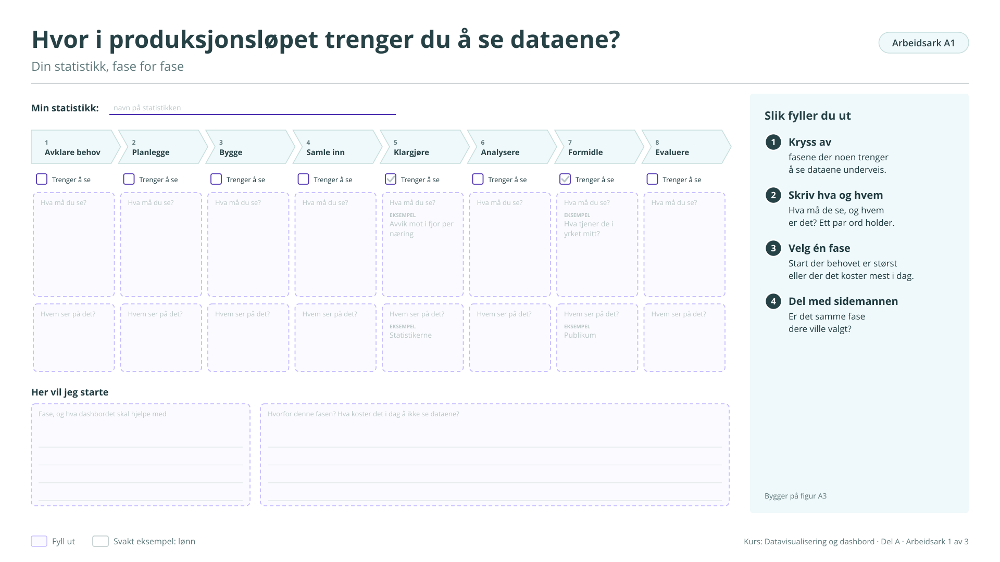

# Arbeidsark A1: Hvor i produksjonsløpet trenger du å se dataene?

Din statistikk, fase for fase. Bygger på [figur A3](../a-hvorfor.md#figur-a3). Brukes ikke i kurset på fire timer, men står i veilederen.

!!! info "Slik fyller du ut"

    1. **Kryss av.** fasene der noen trenger å se dataene underveis.
    2. **Skriv hva og hvem.** Hva må de se, og hvem er det? Et par ord holder.
    3. **Velg én fase.** Start der behovet er størst eller der det koster mest i dag.
    4. **Del med sidemannen.** Er det samme fase dere ville valgt?

    Svarene lagres bare i denne nettleseren. Last dem ned når du er ferdig, eller ta en sikkerhetskopi fra [oversikten](index.md#svarene-dine).

<button type="button" class="md-button" data-gjor="kopier">Kopier svarene</button>
<button type="button" class="md-button" data-gjor="lastned">Last ned (.md)</button>
<button type="button" class="md-button" data-gjor="skrivut">Skriv ut</button>
<button type="button" class="md-button ark-tom" data-gjor="tom">Tøm arket</button>

<form class="ark-skjema" onsubmit="return false">
<label class="ark-felt ark-felles">Min statistikk (følger med på alle arkene)<input type="text" data-k="felles.statistikk" data-l="Min statistikk" placeholder="Eksempel: Lønn, tabell 11421"></label>
<section class="ark-del"><h3>Fase for fase</h3>

<h4>1 Avklare behov</h4><label class="ark-kryss"><input type="checkbox" data-k="A1.f1.trenger" data-l="Trenger å se"> Trenger å se</label><label class="ark-felt">Hva må du se?<textarea data-k="A1.f1.hva" data-l="Hva må du se?" rows="2"></textarea></label><label class="ark-felt">Hvem ser på det?<input type="text" data-k="A1.f1.hvem" data-l="Hvem ser på det?"></label>

<h4>2 Planlegge</h4><label class="ark-kryss"><input type="checkbox" data-k="A1.f2.trenger" data-l="Trenger å se"> Trenger å se</label><label class="ark-felt">Hva må du se?<textarea data-k="A1.f2.hva" data-l="Hva må du se?" rows="2"></textarea></label><label class="ark-felt">Hvem ser på det?<input type="text" data-k="A1.f2.hvem" data-l="Hvem ser på det?"></label>

<h4>3 Bygge</h4><label class="ark-kryss"><input type="checkbox" data-k="A1.f3.trenger" data-l="Trenger å se"> Trenger å se</label><label class="ark-felt">Hva må du se?<textarea data-k="A1.f3.hva" data-l="Hva må du se?" rows="2"></textarea></label><label class="ark-felt">Hvem ser på det?<input type="text" data-k="A1.f3.hvem" data-l="Hvem ser på det?"></label>

<h4>4 Samle inn</h4><label class="ark-kryss"><input type="checkbox" data-k="A1.f4.trenger" data-l="Trenger å se"> Trenger å se</label><label class="ark-felt">Hva må du se?<textarea data-k="A1.f4.hva" data-l="Hva må du se?" rows="2"></textarea></label><label class="ark-felt">Hvem ser på det?<input type="text" data-k="A1.f4.hvem" data-l="Hvem ser på det?"></label>

<h4>5 Klargjøre</h4><label class="ark-kryss"><input type="checkbox" data-k="A1.f5.trenger" data-l="Trenger å se"> Trenger å se</label><label class="ark-felt">Hva må du se?<textarea data-k="A1.f5.hva" data-l="Hva må du se?" rows="2" placeholder="Eksempel: Avvik mot i fjor per næring"></textarea></label><label class="ark-felt">Hvem ser på det?<input type="text" data-k="A1.f5.hvem" data-l="Hvem ser på det?" placeholder="Eksempel: Statistikerne"></label>

<h4>6 Analysere</h4><label class="ark-kryss"><input type="checkbox" data-k="A1.f6.trenger" data-l="Trenger å se"> Trenger å se</label><label class="ark-felt">Hva må du se?<textarea data-k="A1.f6.hva" data-l="Hva må du se?" rows="2"></textarea></label><label class="ark-felt">Hvem ser på det?<input type="text" data-k="A1.f6.hvem" data-l="Hvem ser på det?"></label>

<h4>7 Formidle</h4><label class="ark-kryss"><input type="checkbox" data-k="A1.f7.trenger" data-l="Trenger å se"> Trenger å se</label><label class="ark-felt">Hva må du se?<textarea data-k="A1.f7.hva" data-l="Hva må du se?" rows="2" placeholder="Eksempel: Hva tjener de i yrket mitt?"></textarea></label><label class="ark-felt">Hvem ser på det?<input type="text" data-k="A1.f7.hvem" data-l="Hvem ser på det?" placeholder="Eksempel: Publikum"></label>

<h4>8 Evaluere</h4><label class="ark-kryss"><input type="checkbox" data-k="A1.f8.trenger" data-l="Trenger å se"> Trenger å se</label><label class="ark-felt">Hva må du se?<textarea data-k="A1.f8.hva" data-l="Hva må du se?" rows="2"></textarea></label><label class="ark-felt">Hvem ser på det?<input type="text" data-k="A1.f8.hvem" data-l="Hvem ser på det?"></label>

</section><section class="ark-del"><h3>Her vil jeg starte</h3><label class="ark-felt">Fase, og hva dashbordet skal hjelpe med<textarea data-k="A1.start" data-l="Fase, og hva dashbordet skal hjelpe med" rows="3"></textarea></label><label class="ark-felt">Hvorfor denne fasen? Hva koster det i dag å ikke se dataene?<textarea data-k="A1.hvorfor" data-l="Hvorfor denne fasen? Hva koster det i dag å ikke se dataene?" rows="3"></textarea></label></section>
</form>

??? note "Arbeidsarket som figur (til utskrift eller tavle)"

    { loading=lazy }

    [Last ned SVG](ark/ARK_A1.svg){ download } · [Last ned PNG](ark/ARK_A1.png){ download }

[Alle arbeidsark](index.md) · [Arbeidsark A2 →](a2.md)
