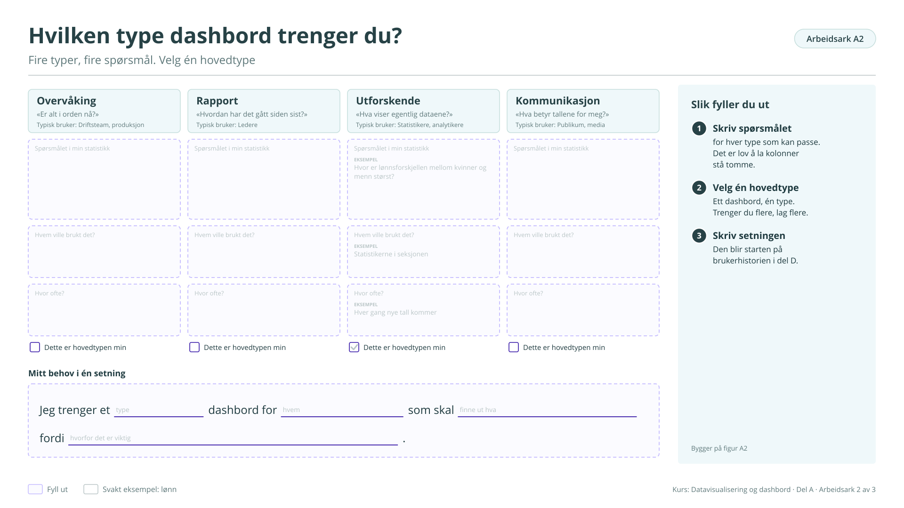

# Arbeidsark A2: Hvilken type dashbord trenger du?

Fire typer, fire spørsmål. Velg én hovedtype. Bygger på [figur A2](../a-hvorfor.md#figur-a2). Brukes i økt 1.

!!! info "Slik fyller du ut"

    1. **Skriv spørsmålet.** for hver type som kan passe. Det er lov å la kolonner stå tomme.
    2. **Velg én hovedtype.** Ett dashbord, én type. Trenger du flere, lag flere.
    3. **Skriv setningen.** Den blir starten på brukerhistorien i arbeidsark D1.

    Svarene lagres bare i denne nettleseren. Last dem ned når du er ferdig, eller ta en sikkerhetskopi fra [oversikten](index.md#svarene-dine).

<button type="button" class="md-button" data-gjor="kopier">Kopier svarene</button>
<button type="button" class="md-button" data-gjor="lastned">Last ned (.md)</button>
<button type="button" class="md-button" data-gjor="skrivut">Skriv ut</button>
<button type="button" class="md-button ark-tom" data-gjor="tom">Tøm arket</button>

<form class="ark-skjema" onsubmit="return false">
<label class="ark-felt ark-felles">Min statistikk (følger med på alle arkene)<input type="text" data-k="felles.statistikk" data-l="Min statistikk" placeholder="Eksempel: Lønn, tabell 11421"></label>
<section class="ark-del"><h3>Fire typer</h3>

<h4>Overvåking</h4>
«Er alt i orden nå?» Typisk bruker: Driftsteam, produksjon.
<label class="ark-felt">Spørsmålet i min statistikk<textarea data-k="A2.overvåking.sporsmal" data-l="Spørsmålet i min statistikk" rows="3"></textarea></label><label class="ark-felt">Hvem ville brukt det?<input type="text" data-k="A2.overvåking.hvem" data-l="Hvem ville brukt det?"></label><label class="ark-felt">Hvor ofte?<input type="text" data-k="A2.overvåking.ofte" data-l="Hvor ofte?"></label>

<h4>Rapport</h4>
«Hvordan har det gått siden sist?» Typisk bruker: Ledere.
<label class="ark-felt">Spørsmålet i min statistikk<textarea data-k="A2.rapport.sporsmal" data-l="Spørsmålet i min statistikk" rows="3"></textarea></label><label class="ark-felt">Hvem ville brukt det?<input type="text" data-k="A2.rapport.hvem" data-l="Hvem ville brukt det?"></label><label class="ark-felt">Hvor ofte?<input type="text" data-k="A2.rapport.ofte" data-l="Hvor ofte?"></label>

<h4>Utforskende</h4>
«Hva viser egentlig dataene?» Typisk bruker: Statistikere, analytikere.
<label class="ark-felt">Spørsmålet i min statistikk<textarea data-k="A2.utforskende.sporsmal" data-l="Spørsmålet i min statistikk" rows="3" placeholder="Eksempel: Hvor er lønnsforskjellen mellom kvinner og menn størst?"></textarea></label><label class="ark-felt">Hvem ville brukt det?<input type="text" data-k="A2.utforskende.hvem" data-l="Hvem ville brukt det?" placeholder="Eksempel: Statistikerne i seksjonen"></label><label class="ark-felt">Hvor ofte?<input type="text" data-k="A2.utforskende.ofte" data-l="Hvor ofte?" placeholder="Eksempel: Hver gang nye tall kommer"></label>

<h4>Kommunikasjon</h4>
«Hva betyr tallene for meg?» Typisk bruker: Publikum, media.
<label class="ark-felt">Spørsmålet i min statistikk<textarea data-k="A2.kommunikasjon.sporsmal" data-l="Spørsmålet i min statistikk" rows="3"></textarea></label><label class="ark-felt">Hvem ville brukt det?<input type="text" data-k="A2.kommunikasjon.hvem" data-l="Hvem ville brukt det?"></label><label class="ark-felt">Hvor ofte?<input type="text" data-k="A2.kommunikasjon.ofte" data-l="Hvor ofte?"></label>

</section><section class="ark-del"><h3>Hovedtypen</h3><fieldset class="ark-valg" data-k="A2.hovedtype" data-l="Dette er hovedtypen min"><legend>Dette er hovedtypen min</legend><label><input type="radio" name="A2.hovedtype" value="Overvåking"> Overvåking</label><label><input type="radio" name="A2.hovedtype" value="Rapport"> Rapport</label><label><input type="radio" name="A2.hovedtype" value="Utforskende"> Utforskende</label><label><input type="radio" name="A2.hovedtype" value="Kommunikasjon"> Kommunikasjon</label></fieldset></section><section class="ark-del"><h3>Mitt behov i én setning</h3>
Setningen
Jeg trenger et <input type="text" class="ark-hull" data-k="A2.s.type" data-l="type" placeholder="type" style="width:8ch"> dashbord for <input type="text" class="ark-hull" data-k="A2.s.hvem" data-l="hvem" placeholder="hvem" style="width:8ch"> som skal <input type="text" class="ark-hull" data-k="A2.s.hva" data-l="finne ut hva" placeholder="finne ut hva" style="width:16ch"> fordi <input type="text" class="ark-hull" data-k="A2.s.hvorfor" data-l="hvorfor det er viktig" placeholder="hvorfor det er viktig" style="width:25ch"> .

</section>
</form>

??? note "Arbeidsarket som figur (til utskrift eller tavle)"

    { loading=lazy }

    [Last ned SVG](ark/ARK_A2.svg){ download } · [Last ned PNG](ark/ARK_A2.png){ download }

[← Arbeidsark A1](a1.md) · [Alle arbeidsark](index.md) · [Arbeidsark A3 →](a3.md)
