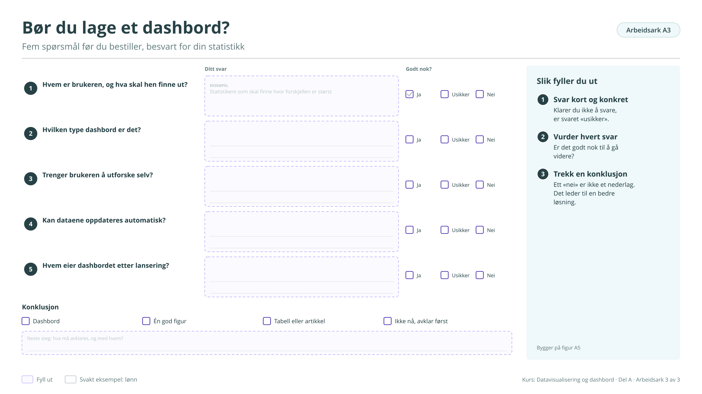

# Arbeidsark A3: Bør du lage et dashbord?

Fem spørsmål før du bestiller, besvart for din statistikk. Bygger på [figur A5](../a-hvorfor.md#figur-a5). Brukes ikke i kurset på fire timer, men står i veilederen.

!!! info "Slik fyller du ut"

    1. **Svar kort og konkret.** Klarer du ikke å svare, er svaret «usikker».
    2. **Vurder hvert svar.** Er det godt nok til å gå videre?
    3. **Trekk en konklusjon.** Ett «nei» er ikke et nederlag. Det leder til en bedre løsning.

    Svarene lagres bare i denne nettleseren. Last dem ned når du er ferdig, eller ta en sikkerhetskopi fra [oversikten](index.md#svarene-dine).

<button type="button" class="md-button" data-gjor="kopier">Kopier svarene</button>
<button type="button" class="md-button" data-gjor="lastned">Last ned (.md)</button>
<button type="button" class="md-button" data-gjor="skrivut">Skriv ut</button>
<button type="button" class="md-button ark-tom" data-gjor="tom">Tøm arket</button>

<form class="ark-skjema" onsubmit="return false">
<label class="ark-felt ark-felles">Min statistikk (følger med på alle arkene)<input type="text" data-k="felles.statistikk" data-l="Min statistikk" placeholder="Eksempel: Lønn, tabell 11421"></label>
<section class="ark-del"><h3>Fem spørsmål</h3>
<h4>1 Hvem er brukeren, og hva skal hen finne ut?</h4><label class="ark-felt">Ditt svar<textarea data-k="A3.q1.svar" data-l="Ditt svar" rows="2" placeholder="Eksempel: Statistikere som skal finne hvor forskjellen er størst"></textarea></label><fieldset class="ark-valg" data-k="A3.q1.vurdering" data-l="Godt nok?"><legend>Godt nok?</legend><label><input type="radio" name="A3.q1.vurdering" value="Ja"> Ja</label><label><input type="radio" name="A3.q1.vurdering" value="Usikker"> Usikker</label><label><input type="radio" name="A3.q1.vurdering" value="Nei"> Nei</label></fieldset>

<h4>2 Hvilken type dashbord er det?</h4><label class="ark-felt">Ditt svar<textarea data-k="A3.q2.svar" data-l="Ditt svar" rows="2"></textarea></label><fieldset class="ark-valg" data-k="A3.q2.vurdering" data-l="Godt nok?"><legend>Godt nok?</legend><label><input type="radio" name="A3.q2.vurdering" value="Ja"> Ja</label><label><input type="radio" name="A3.q2.vurdering" value="Usikker"> Usikker</label><label><input type="radio" name="A3.q2.vurdering" value="Nei"> Nei</label></fieldset>

<h4>3 Trenger brukeren å utforske selv?</h4><label class="ark-felt">Ditt svar<textarea data-k="A3.q3.svar" data-l="Ditt svar" rows="2"></textarea></label><fieldset class="ark-valg" data-k="A3.q3.vurdering" data-l="Godt nok?"><legend>Godt nok?</legend><label><input type="radio" name="A3.q3.vurdering" value="Ja"> Ja</label><label><input type="radio" name="A3.q3.vurdering" value="Usikker"> Usikker</label><label><input type="radio" name="A3.q3.vurdering" value="Nei"> Nei</label></fieldset>

<h4>4 Kan dataene oppdateres automatisk?</h4><label class="ark-felt">Ditt svar<textarea data-k="A3.q4.svar" data-l="Ditt svar" rows="2"></textarea></label><fieldset class="ark-valg" data-k="A3.q4.vurdering" data-l="Godt nok?"><legend>Godt nok?</legend><label><input type="radio" name="A3.q4.vurdering" value="Ja"> Ja</label><label><input type="radio" name="A3.q4.vurdering" value="Usikker"> Usikker</label><label><input type="radio" name="A3.q4.vurdering" value="Nei"> Nei</label></fieldset>

<h4>5 Hvem eier dashbordet etter lansering?</h4><label class="ark-felt">Ditt svar<textarea data-k="A3.q5.svar" data-l="Ditt svar" rows="2"></textarea></label><fieldset class="ark-valg" data-k="A3.q5.vurdering" data-l="Godt nok?"><legend>Godt nok?</legend><label><input type="radio" name="A3.q5.vurdering" value="Ja"> Ja</label><label><input type="radio" name="A3.q5.vurdering" value="Usikker"> Usikker</label><label><input type="radio" name="A3.q5.vurdering" value="Nei"> Nei</label></fieldset>
</section><section class="ark-del"><h3>Konklusjon</h3><fieldset class="ark-valg" data-k="A3.konklusjon" data-l="Konklusjon"><legend>Konklusjon</legend><label><input type="radio" name="A3.konklusjon" value="Dashbord"> Dashbord</label><label><input type="radio" name="A3.konklusjon" value="Én god figur"> Én god figur</label><label><input type="radio" name="A3.konklusjon" value="Tabell eller artikkel"> Tabell eller artikkel</label><label><input type="radio" name="A3.konklusjon" value="Ikke nå, avklar først"> Ikke nå, avklar først</label></fieldset><label class="ark-felt">Neste steg: hva må avklares, og med hvem?<textarea data-k="A3.neste" data-l="Neste steg: hva må avklares, og med hvem?" rows="3"></textarea></label></section>
</form>

??? note "Arbeidsarket som figur (til utskrift eller tavle)"

    { loading=lazy }

    [Last ned SVG](ark/ARK_A3.svg){ download } · [Last ned PNG](ark/ARK_A3.png){ download }

[← Arbeidsark A2](a2.md) · [Alle arbeidsark](index.md) · [Arbeidsark B1 →](b1.md)
