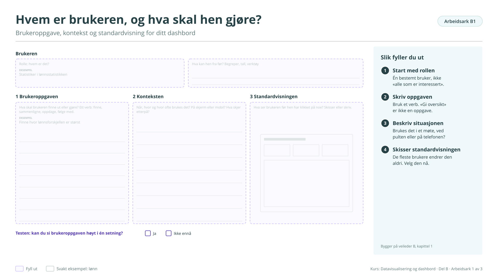

# Arbeidsark B1: Hvem er brukeren, og hva skal hen gjøre?

Brukeroppgave, kontekst og standardvisning for ditt dashbord. Bygger på [veileder B](../b-godt-dashbord.md). Brukes ikke i kurset på fire timer, men står i veilederen.

!!! info "Slik fyller du ut"

    1. **Start med rollen.** Én bestemt bruker, ikke «alle som er interessert».
    2. **Skriv oppgaven.** Bruk et verb. «Gi oversikt» er ikke en oppgave.
    3. **Beskriv situasjonen.** Brukes det i et møte, ved pulten eller på telefonen?
    4. **Skisser standardvisningen.** De fleste brukere endrer den aldri. Velg den nå.

    Svarene lagres bare i denne nettleseren. Last dem ned når du er ferdig, eller ta en sikkerhetskopi fra [oversikten](index.md#svarene-dine).

<button type="button" class="md-button" data-gjor="kopier">Kopier svarene</button>
<button type="button" class="md-button" data-gjor="lastned">Last ned (.md)</button>
<button type="button" class="md-button" data-gjor="skrivut">Skriv ut</button>
<button type="button" class="md-button ark-tom" data-gjor="tom">Tøm arket</button>

<form class="ark-skjema" onsubmit="return false">
<label class="ark-felt ark-felles">Min statistikk (følger med på alle arkene)<input type="text" data-k="felles.statistikk" data-l="Min statistikk" placeholder="Eksempel: Lønn, tabell 11421"></label>
<section class="ark-del"><h3>Brukeren</h3>
<label class="ark-felt">Rolle: hvem er det?<input type="text" data-k="B1.rolle" data-l="Rolle: hvem er det?" placeholder="Eksempel: Statistiker i lønnsstatistikken"></label><label class="ark-felt">Hva kan hen fra før? Begreper, tall, verktøy<textarea data-k="B1.kan" data-l="Hva kan hen fra før? Begreper, tall, verktøy" rows="2"></textarea></label>
</section><section class="ark-del"><h3>Oppgave, kontekst og standardvisning</h3>
<label class="ark-felt">1 Brukeroppgaven: hva skal brukeren finne ut eller gjøre? Ett verb.<textarea data-k="B1.oppgave" data-l="1 Brukeroppgaven: hva skal brukeren finne ut eller gjøre? Ett verb." rows="6" placeholder="Eksempel: Finne hvor lønnsforskjellen er størst"></textarea></label><label class="ark-felt">2 Konteksten: når, hvor og hvor ofte? Skjerm eller mobil? Hva skjer etterpå?<textarea data-k="B1.kontekst" data-l="2 Konteksten: når, hvor og hvor ofte? Skjerm eller mobil? Hva skjer etterpå?" rows="6"></textarea></label><label class="ark-felt">3 Standardvisningen: hva ser brukeren før hen har klikket på noe?<textarea data-k="B1.standard" data-l="3 Standardvisningen: hva ser brukeren før hen har klikket på noe?" rows="6"></textarea></label>
</section><section class="ark-del"><h3>Testen</h3><fieldset class="ark-valg" data-k="B1.test" data-l="Kan du si brukeroppgaven høyt i én setning?"><legend>Kan du si brukeroppgaven høyt i én setning?</legend><label><input type="radio" name="B1.test" value="Ja"> Ja</label><label><input type="radio" name="B1.test" value="Ikke ennå"> Ikke ennå</label></fieldset></section>
</form>

??? note "Arbeidsarket som figur (til utskrift eller tavle)"

    { loading=lazy }

    [Last ned SVG](ark/ARK_B1.svg){ download } · [Last ned PNG](ark/ARK_B1.png){ download }

[← Arbeidsark A3](a3.md) · [Alle arbeidsark](index.md) · [Arbeidsark B2 →](b2.md)
