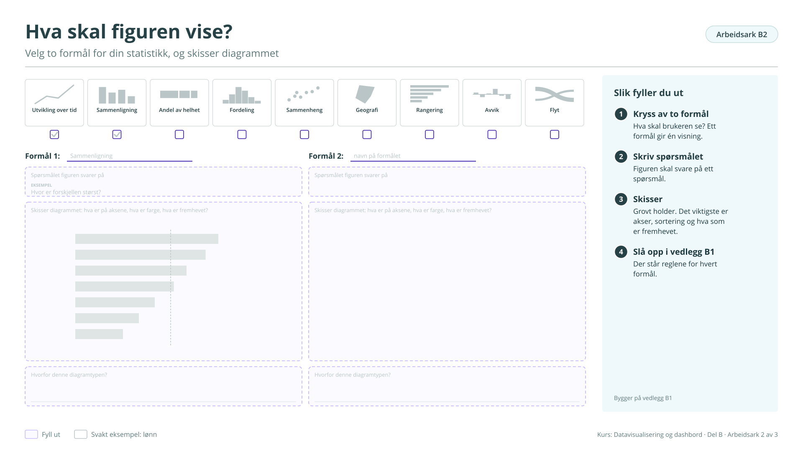

# Arbeidsark B2: Hva skal figuren vise?

Velg to formål for din statistikk, og beskriv diagrammet. Bygger på [figur B1](../b-godt-dashbord.md#figur-b1). Brukes i økt 1.

!!! info "Slik fyller du ut"

    1. **Kryss av to formål.** Hva skal brukeren se? Ett formål gir én visning.
    2. **Skriv spørsmålet.** Figuren skal svare på ett spørsmål.
    3. **Skisser.** Grovt holder, på papir eller med ord. Det viktigste er akser, sortering og hva som er fremhevet.
    4. **Slå opp i vedlegg B1.** Der står reglene for hvert formål.

    Svarene lagres bare i denne nettleseren. Last dem ned når du er ferdig, eller ta en sikkerhetskopi fra [oversikten](index.md#svarene-dine).

<button type="button" class="md-button" data-gjor="kopier">Kopier svarene</button>
<button type="button" class="md-button" data-gjor="lastned">Last ned (.md)</button>
<button type="button" class="md-button" data-gjor="skrivut">Skriv ut</button>
<button type="button" class="md-button ark-tom" data-gjor="tom">Tøm arket</button>

<form class="ark-skjema" onsubmit="return false">
<label class="ark-felt ark-felles">Min statistikk (følger med på alle arkene)<input type="text" data-k="felles.statistikk" data-l="Min statistikk" placeholder="Eksempel: Lønn, tabell 11421"></label>
<section class="ark-del"><h3>De ni formålene</h3>

<label class="ark-kryss"><input type="checkbox" data-k="B2.formal.1" data-l="Utvikling over tid"> Utvikling over tid</label><label class="ark-kryss"><input type="checkbox" data-k="B2.formal.2" data-l="Sammenligning"> Sammenligning</label><label class="ark-kryss"><input type="checkbox" data-k="B2.formal.3" data-l="Andel av helhet"> Andel av helhet</label><label class="ark-kryss"><input type="checkbox" data-k="B2.formal.4" data-l="Fordeling"> Fordeling</label><label class="ark-kryss"><input type="checkbox" data-k="B2.formal.5" data-l="Sammenheng"> Sammenheng</label><label class="ark-kryss"><input type="checkbox" data-k="B2.formal.6" data-l="Geografi"> Geografi</label><label class="ark-kryss"><input type="checkbox" data-k="B2.formal.7" data-l="Rangering"> Rangering</label><label class="ark-kryss"><input type="checkbox" data-k="B2.formal.8" data-l="Avvik"> Avvik</label><label class="ark-kryss"><input type="checkbox" data-k="B2.formal.9" data-l="Flyt"> Flyt</label>

</section><section class="ark-del"><h3>To figurer</h3>

<h4>Formål 1</h4><label class="ark-felt">Formålet<input type="text" data-k="B2.f1.navn" data-l="Formålet" placeholder="Eksempel: Sammenligning"></label><label class="ark-felt">Spørsmålet figuren svarer på<input type="text" data-k="B2.f1.sporsmal" data-l="Spørsmålet figuren svarer på" placeholder="Eksempel: Hvor er forskjellen størst?"></label><label class="ark-felt">Diagrammet: hva er på aksene, hva er farge, hva er fremhevet?<textarea data-k="B2.f1.skisse" data-l="Diagrammet: hva er på aksene, hva er farge, hva er fremhevet?" rows="6" placeholder="Eksempel: Liggende stolper per næring, sortert, med en referanselinje for alle næringer"></textarea></label><label class="ark-felt">Hvorfor denne diagramtypen?<input type="text" data-k="B2.f1.hvorfor" data-l="Hvorfor denne diagramtypen?"></label>

<h4>Formål 2</h4><label class="ark-felt">Formålet<input type="text" data-k="B2.f2.navn" data-l="Formålet"></label><label class="ark-felt">Spørsmålet figuren svarer på<input type="text" data-k="B2.f2.sporsmal" data-l="Spørsmålet figuren svarer på"></label><label class="ark-felt">Diagrammet: hva er på aksene, hva er farge, hva er fremhevet?<textarea data-k="B2.f2.skisse" data-l="Diagrammet: hva er på aksene, hva er farge, hva er fremhevet?" rows="6"></textarea></label><label class="ark-felt">Hvorfor denne diagramtypen?<input type="text" data-k="B2.f2.hvorfor" data-l="Hvorfor denne diagramtypen?"></label>

</section>
</form>

??? note "Arbeidsarket som figur (til utskrift eller tavle)"

    { loading=lazy }

    [Last ned SVG](ark/ARK_B2.svg){ download } · [Last ned PNG](ark/ARK_B2.png){ download }

[← Arbeidsark B1](b1.md) · [Alle arbeidsark](index.md) · [Arbeidsark B3 →](b3.md)
