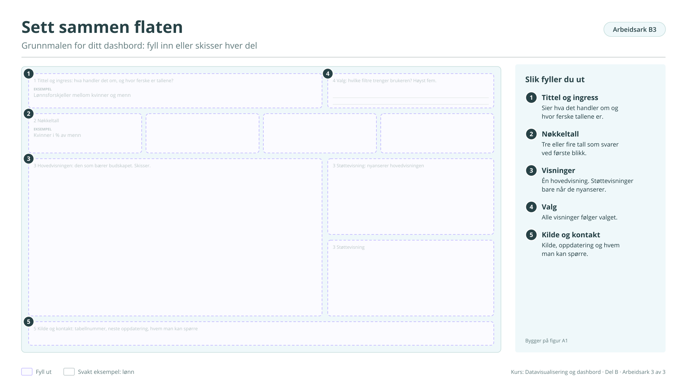

# Arbeidsark B3: Sett sammen flaten

Grunnmalen for ditt dashbord: fyll inn eller beskriv hver del. Bygger på [figur A1](../a-hvorfor.md#figur-a1). Brukes i økt 2.

!!! info "Slik fyller du ut"

    1. **Tittel og ingress.** Sier hva det handler om og hvor ferske tallene er.
    2. **Nøkkeltall.** Tre eller fire tall som svarer ved første blikk.
    3. **Visninger.** Én hovedvisning. Støttevisninger bare når de nyanserer.
    4. **Valg.** Alle visninger følger valget.
    5. **Kilde og kontakt.** Kilde, oppdatering og hvem man kan spørre.

    Svarene lagres bare i denne nettleseren. Last dem ned når du er ferdig, eller ta en sikkerhetskopi fra [oversikten](index.md#svarene-dine).

<button type="button" class="md-button" data-gjor="kopier">Kopier svarene</button>
<button type="button" class="md-button" data-gjor="lastned">Last ned (.md)</button>
<button type="button" class="md-button" data-gjor="skrivut">Skriv ut</button>
<button type="button" class="md-button ark-tom" data-gjor="tom">Tøm arket</button>

<form class="ark-skjema" onsubmit="return false">
<label class="ark-felt ark-felles">Min statistikk (følger med på alle arkene)<input type="text" data-k="felles.statistikk" data-l="Min statistikk" placeholder="Eksempel: Lønn, tabell 11421"></label>
<section class="ark-del"><h3>Flaten</h3>
<label class="ark-felt">1 Tittel og ingress: hva handler det om, og hvor ferske er tallene?<textarea data-k="B3.tittel" data-l="1 Tittel og ingress: hva handler det om, og hvor ferske er tallene?" rows="2" placeholder="Eksempel: Lønnsforskjeller mellom kvinner og menn"></textarea></label><label class="ark-felt">4 Valg: hvilke filtre trenger brukeren? Høyst fem.<textarea data-k="B3.valg" data-l="4 Valg: hvilke filtre trenger brukeren? Høyst fem." rows="2"></textarea></label>

<label class="ark-felt">2 Nøkkeltall 1<input type="text" data-k="B3.nokkeltall.1" data-l="2 Nøkkeltall 1" placeholder="Eksempel: Kvinner i % av menn"></label><label class="ark-felt">2 Nøkkeltall 2<input type="text" data-k="B3.nokkeltall.2" data-l="2 Nøkkeltall 2"></label><label class="ark-felt">2 Nøkkeltall 3<input type="text" data-k="B3.nokkeltall.3" data-l="2 Nøkkeltall 3"></label><label class="ark-felt">2 Nøkkeltall 4<input type="text" data-k="B3.nokkeltall.4" data-l="2 Nøkkeltall 4"></label>

<label class="ark-felt">3 Hovedvisningen: den som bærer budskapet<textarea data-k="B3.hoved" data-l="3 Hovedvisningen: den som bærer budskapet" rows="7"></textarea></label><label class="ark-felt">3 Støttevisning 1: nyanserer hovedvisningen<textarea data-k="B3.stotte1" data-l="3 Støttevisning 1: nyanserer hovedvisningen" rows="3"></textarea></label><label class="ark-felt">3 Støttevisning 2<textarea data-k="B3.stotte2" data-l="3 Støttevisning 2" rows="3"></textarea></label>
<label class="ark-felt">5 Kilde og kontakt: tabellnummer, neste oppdatering, hvem man kan spørre<input type="text" data-k="B3.kilde" data-l="5 Kilde og kontakt: tabellnummer, neste oppdatering, hvem man kan spørre"></label></section>
</form>

??? note "Arbeidsarket som figur (til utskrift eller tavle)"

    { loading=lazy }

    [Last ned SVG](ark/ARK_B3.svg){ download } · [Last ned PNG](ark/ARK_B3.png){ download }

[← Arbeidsark B2](b2.md) · [Alle arbeidsark](index.md) · [Arbeidsark C1 →](c1.md)
