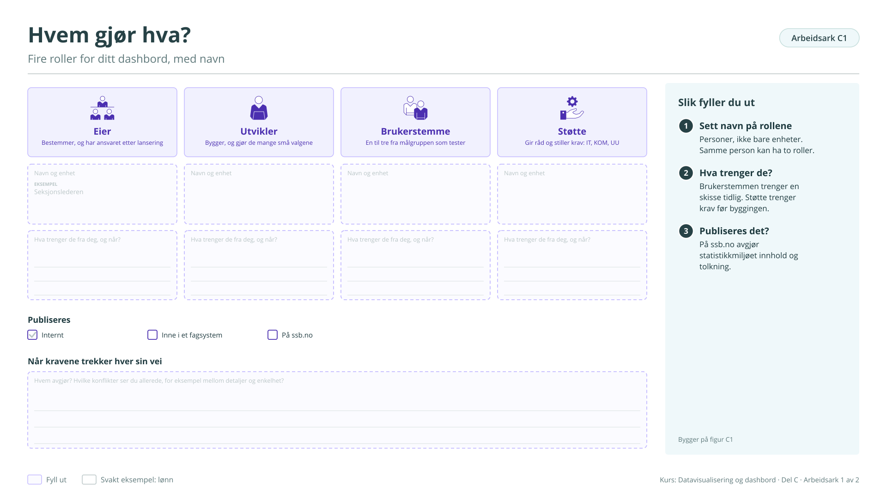

# Arbeidsark C1: Hvem gjør hva?

Fire roller for ditt dashbord, med navn. Bygger på [figur C1](../c-hvordan-jobbe.md#figur-c1). Brukes i økt 1.

!!! info "Slik fyller du ut"

    1. **Sett navn på rollene.** Personer, ikke bare enheter. Samme person kan ha to roller.
    2. **Hva trenger de?.** Brukerstemmen trenger en skisse tidlig. Støtte trenger krav før byggingen.
    3. **Publiseres det?.** På ssb.no avgjør statistikkmiljøet innhold og tolkning.

    Svarene lagres bare i denne nettleseren. Last dem ned når du er ferdig, eller ta en sikkerhetskopi fra [oversikten](index.md#svarene-dine).

<button type="button" class="md-button" data-gjor="kopier">Kopier svarene</button>
<button type="button" class="md-button" data-gjor="lastned">Last ned (.md)</button>
<button type="button" class="md-button" data-gjor="skrivut">Skriv ut</button>
<button type="button" class="md-button ark-tom" data-gjor="tom">Tøm arket</button>

<form class="ark-skjema" onsubmit="return false">
<label class="ark-felt ark-felles">Min statistikk (følger med på alle arkene)<input type="text" data-k="felles.statistikk" data-l="Min statistikk" placeholder="Eksempel: Lønn, tabell 11421"></label>
<section class="ark-del"><h3>Rollene</h3>

<h4>Eier</h4>
Bestemmer, og har ansvaret etter lansering
<label class="ark-felt">Navn og enhet<input type="text" data-k="C1.eier.navn" data-l="Navn og enhet" placeholder="Eksempel: Seksjonslederen"></label><label class="ark-felt">Hva trenger de fra deg, og når?<textarea data-k="C1.eier.trenger" data-l="Hva trenger de fra deg, og når?" rows="3"></textarea></label>

<h4>Utvikler</h4>
Bygger, og gjør de mange små valgene
<label class="ark-felt">Navn og enhet<input type="text" data-k="C1.utvikler.navn" data-l="Navn og enhet"></label><label class="ark-felt">Hva trenger de fra deg, og når?<textarea data-k="C1.utvikler.trenger" data-l="Hva trenger de fra deg, og når?" rows="3"></textarea></label>

<h4>Brukerstemme</h4>
En til tre fra målgruppen som tester
<label class="ark-felt">Navn og enhet<input type="text" data-k="C1.brukerstemme.navn" data-l="Navn og enhet"></label><label class="ark-felt">Hva trenger de fra deg, og når?<textarea data-k="C1.brukerstemme.trenger" data-l="Hva trenger de fra deg, og når?" rows="3"></textarea></label>

<h4>Støtte</h4>
Gir råd og stiller krav: IT, KOM, UU
<label class="ark-felt">Navn og enhet<input type="text" data-k="C1.støtte.navn" data-l="Navn og enhet"></label><label class="ark-felt">Hva trenger de fra deg, og når?<textarea data-k="C1.støtte.trenger" data-l="Hva trenger de fra deg, og når?" rows="3"></textarea></label>

</section><section class="ark-del"><h3>Publisering</h3><fieldset class="ark-valg" data-k="C1.publiseres" data-l="Publiseres"><legend>Publiseres</legend><label><input type="radio" name="C1.publiseres" value="Internt"> Internt</label><label><input type="radio" name="C1.publiseres" value="Inne i et fagsystem"> Inne i et fagsystem</label><label><input type="radio" name="C1.publiseres" value="På ssb.no"> På ssb.no</label></fieldset></section><section class="ark-del"><h3>Når kravene trekker hver sin vei</h3><label class="ark-felt">Hvem avgjør? Hvilke konflikter ser du allerede, for eksempel mellom detaljer og enkelhet?<textarea data-k="C1.konflikt" data-l="Hvem avgjør? Hvilke konflikter ser du allerede, for eksempel mellom detaljer og enkelhet?" rows="3"></textarea></label></section>
</form>

??? note "Arbeidsarket som figur (til utskrift eller tavle)"

    { loading=lazy }

    [Last ned SVG](ark/ARK_C1.svg){ download } · [Last ned PNG](ark/ARK_C1.png){ download }

[← Arbeidsark B3](b3.md) · [Alle arbeidsark](index.md) · [Arbeidsark C2 →](c2.md)
