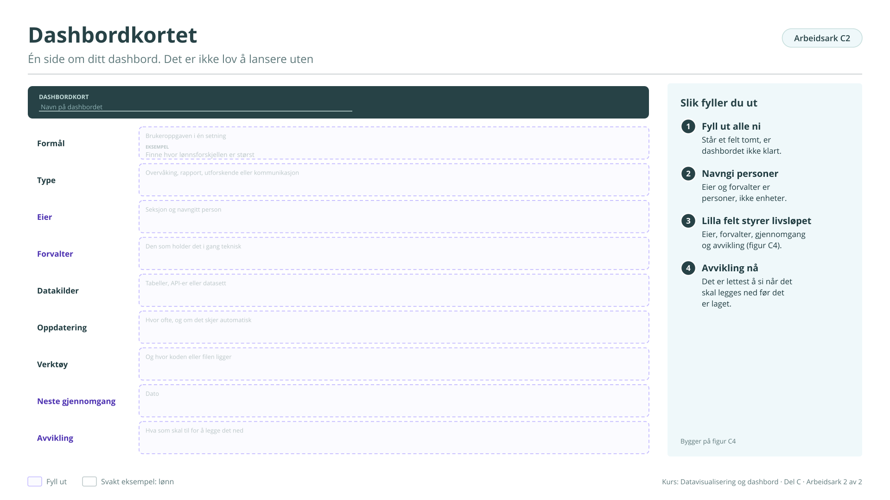

# Arbeidsark C2: Dashbordkortet

Én side om ditt dashbord. Det er ikke lov å lansere uten. Bygger på [figur C4](../c-hvordan-jobbe.md#figur-c4). Brukes ikke i kurset på fire timer, men står i veilederen.

!!! info "Slik fyller du ut"

    1. **Fyll ut alle ni.** Står et felt tomt, er dashbordet ikke klart.
    2. **Navngi personer.** Eier og forvalter er personer, ikke enheter.
    3. **Livsløpet.** Eier, forvalter, gjennomgang og avvikling styrer livsløpet (figur C4).
    4. **Avvikling nå.** Det er lettest å si når det skal legges ned før det er laget.

    Svarene lagres bare i denne nettleseren. Last dem ned når du er ferdig, eller ta en sikkerhetskopi fra [oversikten](index.md#svarene-dine).

<button type="button" class="md-button" data-gjor="kopier">Kopier svarene</button>
<button type="button" class="md-button" data-gjor="lastned">Last ned (.md)</button>
<button type="button" class="md-button" data-gjor="skrivut">Skriv ut</button>
<button type="button" class="md-button ark-tom" data-gjor="tom">Tøm arket</button>

<form class="ark-skjema" onsubmit="return false">
<label class="ark-felt ark-felles">Min statistikk (følger med på alle arkene)<input type="text" data-k="felles.statistikk" data-l="Min statistikk" placeholder="Eksempel: Lønn, tabell 11421"></label>
<section class="ark-del"><h3>Dashbordkort</h3><label class="ark-felt">Navn på dashbordet<input type="text" data-k="C2.navn" data-l="Navn på dashbordet"></label><label class="ark-felt">Formål: Brukeroppgaven i én setning<input type="text" data-k="C2.formal" data-l="Formål: Brukeroppgaven i én setning" placeholder="Eksempel: Finne hvor lønnsforskjellen er størst"></label><label class="ark-felt">Type: Overvåking, rapport, utforskende eller kommunikasjon<input type="text" data-k="C2.type" data-l="Type: Overvåking, rapport, utforskende eller kommunikasjon"></label><label class="ark-felt">Eier: Seksjon og navngitt person<input type="text" data-k="C2.eier" data-l="Eier: Seksjon og navngitt person"></label><label class="ark-felt">Forvalter: Den som holder det i gang teknisk<input type="text" data-k="C2.forvalter" data-l="Forvalter: Den som holder det i gang teknisk"></label><label class="ark-felt">Datakilder: Tabeller, API-er eller datasett<input type="text" data-k="C2.kilder" data-l="Datakilder: Tabeller, API-er eller datasett"></label><label class="ark-felt">Oppdatering: Hvor ofte, og om det skjer automatisk<input type="text" data-k="C2.oppdatering" data-l="Oppdatering: Hvor ofte, og om det skjer automatisk"></label><label class="ark-felt">Verktøy: Og hvor koden eller filen ligger<input type="text" data-k="C2.verktoy" data-l="Verktøy: Og hvor koden eller filen ligger"></label><label class="ark-felt">Neste gjennomgang: Dato<input type="text" data-k="C2.gjennomgang" data-l="Neste gjennomgang: Dato"></label><label class="ark-felt">Avvikling: Hva som skal til for å legge det ned<input type="text" data-k="C2.avvikling" data-l="Avvikling: Hva som skal til for å legge det ned"></label></section>
</form>

??? note "Arbeidsarket som figur (til utskrift eller tavle)"

    { loading=lazy }

    [Last ned SVG](ark/ARK_C2.svg){ download } · [Last ned PNG](ark/ARK_C2.png){ download }

[← Arbeidsark C1](c1.md) · [Alle arbeidsark](index.md) · [Arbeidsark D1 →](d1.md)
