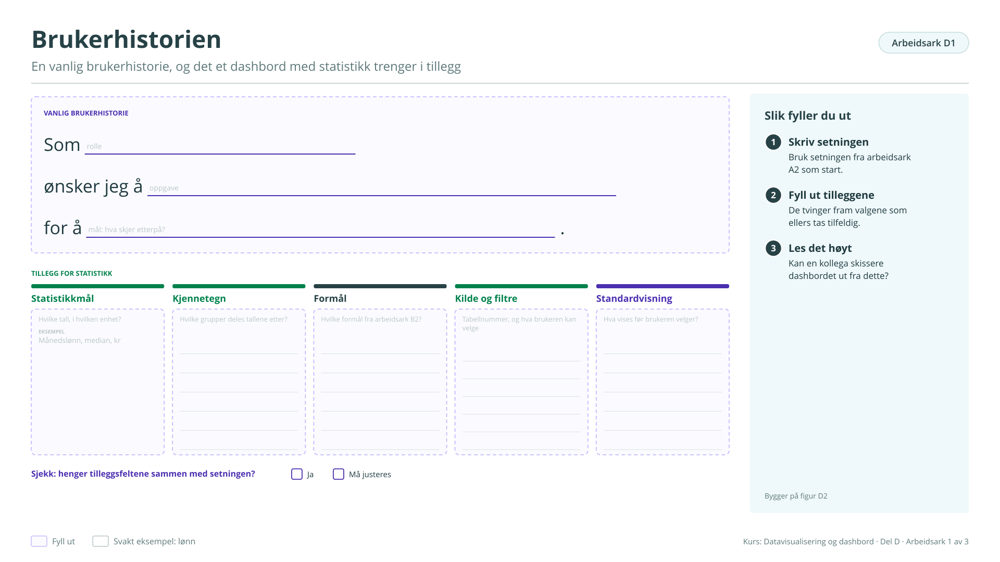

# Arbeidsark D1: Brukerhistorien

En vanlig brukerhistorie, og det et dashbord med statistikk trenger i tillegg. Bygger på [figur D2](../d-hvordan-lage.md#figur-d2). Brukes i økt 1.

!!! info "Slik fyller du ut"

    1. **Skriv setningen.** Bruk setningen fra arbeidsark A2 som start.
    2. **Fyll ut tilleggene.** De tvinger fram valgene som ellers tas tilfeldig.
    3. **Les det høyt.** Kan en kollega skissere dashbordet ut fra dette?

    Svarene lagres bare i denne nettleseren. Last dem ned når du er ferdig, eller ta en sikkerhetskopi fra [oversikten](index.md#svarene-dine).

<button type="button" class="md-button" data-gjor="kopier">Kopier svarene</button>
<button type="button" class="md-button" data-gjor="lastned">Last ned (.md)</button>
<button type="button" class="md-button" data-gjor="skrivut">Skriv ut</button>
<button type="button" class="md-button ark-tom" data-gjor="tom">Tøm arket</button>

<form class="ark-skjema" onsubmit="return false">
<label class="ark-felt ark-felles">Min statistikk (følger med på alle arkene)<input type="text" data-k="felles.statistikk" data-l="Min statistikk" placeholder="Eksempel: Lønn, tabell 11421"></label>
<section class="ark-del"><h3>Fra tidligere ark</h3>
Setningen din fra arbeidsark A2

Formålene du krysset av på arbeidsark B2

</section><section class="ark-del"><h3>Vanlig brukerhistorie</h3>
Brukerhistorien
Som <input type="text" class="ark-hull" data-k="D1.s.rolle" data-l="rolle" placeholder="rolle" style="width:9ch"> ønsker jeg å <input type="text" class="ark-hull" data-k="D1.s.oppgave" data-l="oppgave" placeholder="oppgave" style="width:11ch"> for å <input type="text" class="ark-hull" data-k="D1.s.mal" data-l="mål: hva skjer etterpå?" placeholder="mål: hva skjer etterpå?" style="width:27ch"> .

</section><section class="ark-del"><h3>Tillegg for statistikk</h3>
<label class="ark-felt">Statistikkmål: hvilke tall, i hvilken enhet?<textarea data-k="D1.mal" data-l="Statistikkmål: hvilke tall, i hvilken enhet?" rows="4" placeholder="Eksempel: Månedslønn, median, kr"></textarea></label><label class="ark-felt">Kjennetegn: hvilke grupper deles tallene etter?<textarea data-k="D1.kjennetegn" data-l="Kjennetegn: hvilke grupper deles tallene etter?" rows="4"></textarea></label><label class="ark-felt">Formål: hvilke formål fra arbeidsark B2?<textarea data-k="D1.formal" data-l="Formål: hvilke formål fra arbeidsark B2?" rows="4"></textarea></label><label class="ark-felt">Kilde og filtre: tabellnummer, og hva brukeren kan velge<textarea data-k="D1.kilde" data-l="Kilde og filtre: tabellnummer, og hva brukeren kan velge" rows="4"></textarea></label><label class="ark-felt">Standardvisning: hva vises før brukeren velger?<textarea data-k="D1.standard" data-l="Standardvisning: hva vises før brukeren velger?" rows="4"></textarea></label>
</section><section class="ark-del"><h3>Sjekk</h3><fieldset class="ark-valg" data-k="D1.sjekk" data-l="Henger tilleggsfeltene sammen med setningen?"><legend>Henger tilleggsfeltene sammen med setningen?</legend><label><input type="radio" name="D1.sjekk" value="Ja"> Ja</label><label><input type="radio" name="D1.sjekk" value="Må justeres"> Må justeres</label></fieldset></section>
</form>

??? note "Arbeidsarket som figur (til utskrift eller tavle)"

    { loading=lazy }

    [Last ned SVG](ark/ARK_D1.svg){ download } · [Last ned PNG](ark/ARK_D1.png){ download }

[← Arbeidsark C2](c2.md) · [Alle arbeidsark](index.md) · [Arbeidsark D2 →](d2.md)
