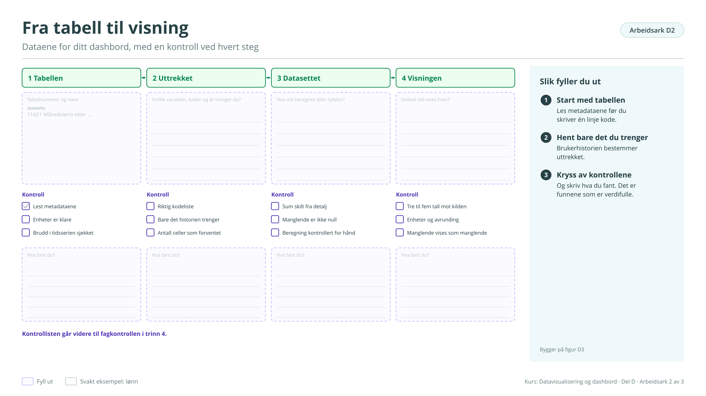

# Arbeidsark D2: Fra tabell til visning

Dataene for ditt dashbord, med en kontroll ved hvert steg. Bygger på [figur D3](../d-hvordan-lage.md#figur-d3). Brukes i økt 2.

!!! info "Slik fyller du ut"

    1. **Start med tabellen.** Les metadataene før du skriver én linje kode.
    2. **Hent bare det du trenger.** Brukerhistorien bestemmer uttrekket.
    3. **Kryss av kontrollene.** Og skriv hva du fant. Det er funnene som er verdifulle.

    Svarene lagres bare i denne nettleseren. Last dem ned når du er ferdig, eller ta en sikkerhetskopi fra [oversikten](index.md#svarene-dine).

<button type="button" class="md-button" data-gjor="kopier">Kopier svarene</button>
<button type="button" class="md-button" data-gjor="lastned">Last ned (.md)</button>
<button type="button" class="md-button" data-gjor="skrivut">Skriv ut</button>
<button type="button" class="md-button ark-tom" data-gjor="tom">Tøm arket</button>

<form class="ark-skjema" onsubmit="return false">
<label class="ark-felt ark-felles">Min statistikk (følger med på alle arkene)<input type="text" data-k="felles.statistikk" data-l="Min statistikk" placeholder="Eksempel: Lønn, tabell 11421"></label>
<section class="ark-del"><h3>Fire steg</h3>

<h4>1 Tabellen</h4><label class="ark-felt">Tabellnummer og navn<textarea data-k="D2.tabell.svar" data-l="Tabellnummer og navn" rows="3" placeholder="Eksempel: 11421 Månedslønn etter …"></textarea></label><label class="ark-kryss"><input type="checkbox" data-k="D2.tabell.k1" data-l="Lest metadataene"> Lest metadataene</label><label class="ark-kryss"><input type="checkbox" data-k="D2.tabell.k2" data-l="Enheter er klare"> Enheter er klare</label><label class="ark-kryss"><input type="checkbox" data-k="D2.tabell.k3" data-l="Brudd i tidsserien sjekket"> Brudd i tidsserien sjekket</label><label class="ark-felt">Hva fant du?<textarea data-k="D2.tabell.funn" data-l="Hva fant du?" rows="3"></textarea></label>

<h4>2 Uttrekket</h4><label class="ark-felt">Hvilke variabler, koder og år trenger du?<textarea data-k="D2.uttrekk.svar" data-l="Hvilke variabler, koder og år trenger du?" rows="3"></textarea></label><label class="ark-kryss"><input type="checkbox" data-k="D2.uttrekk.k1" data-l="Riktig kodeliste"> Riktig kodeliste</label><label class="ark-kryss"><input type="checkbox" data-k="D2.uttrekk.k2" data-l="Bare det historien trenger"> Bare det historien trenger</label><label class="ark-kryss"><input type="checkbox" data-k="D2.uttrekk.k3" data-l="Antall celler som forventet"> Antall celler som forventet</label><label class="ark-felt">Hva fant du?<textarea data-k="D2.uttrekk.funn" data-l="Hva fant du?" rows="3"></textarea></label>

<h4>3 Datasettet</h4><label class="ark-felt">Hva må beregnes eller ryddes?<textarea data-k="D2.datasett.svar" data-l="Hva må beregnes eller ryddes?" rows="3"></textarea></label><label class="ark-kryss"><input type="checkbox" data-k="D2.datasett.k1" data-l="Sum skilt fra detalj"> Sum skilt fra detalj</label><label class="ark-kryss"><input type="checkbox" data-k="D2.datasett.k2" data-l="Manglende er ikke null"> Manglende er ikke null</label><label class="ark-kryss"><input type="checkbox" data-k="D2.datasett.k3" data-l="Beregning kontrollert for hånd"> Beregning kontrollert for hånd</label><label class="ark-felt">Hva fant du?<textarea data-k="D2.datasett.funn" data-l="Hva fant du?" rows="3"></textarea></label>

<h4>4 Visningen</h4><label class="ark-felt">Hvilket tall vises hvor?<textarea data-k="D2.visning.svar" data-l="Hvilket tall vises hvor?" rows="3"></textarea></label><label class="ark-kryss"><input type="checkbox" data-k="D2.visning.k1" data-l="Tre til fem tall mot kilden"> Tre til fem tall mot kilden</label><label class="ark-kryss"><input type="checkbox" data-k="D2.visning.k2" data-l="Enheter og avrunding"> Enheter og avrunding</label><label class="ark-kryss"><input type="checkbox" data-k="D2.visning.k3" data-l="Manglende vises som manglende"> Manglende vises som manglende</label><label class="ark-felt">Hva fant du?<textarea data-k="D2.visning.funn" data-l="Hva fant du?" rows="3"></textarea></label>

</section><section class="ark-del"><h3>Kontrolltall</h3><label class="ark-felt">Tre tall prototypen skal kontrolleres mot, med verdien fra kilden<textarea data-k="D2.kontrolltall" data-l="Tre tall prototypen skal kontrolleres mot, med verdien fra kilden" rows="3"></textarea></label></section>
</form>

??? note "Arbeidsarket som figur (til utskrift eller tavle)"

    { loading=lazy }

    [Last ned SVG](ark/ARK_D2.svg){ download } · [Last ned PNG](ark/ARK_D2.png){ download }

[← Arbeidsark D1](d1.md) · [Alle arbeidsark](index.md) · [Arbeidsark D3 →](d3.md)
