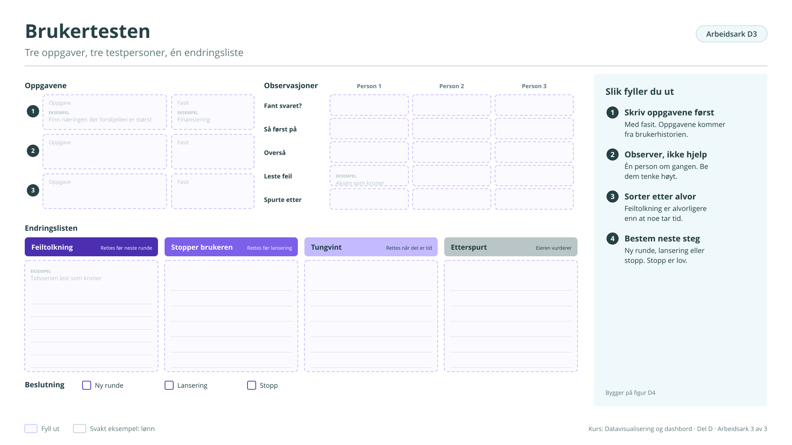

# Arbeidsark D3: Brukertesten

Tre oppgaver, tre testpersoner, én endringsliste. Bygger på [figur D4](../d-hvordan-lage.md#figur-d4). Brukes i økt 2.

!!! info "Slik fyller du ut"

    1. **Skriv oppgavene først.** Med fasit. Oppgavene kommer fra brukerhistorien.
    2. **Observer, ikke hjelp.** Én person om gangen. Be dem tenke høyt.
    3. **Sorter etter alvor.** Feiltolkning er alvorligere enn at noe tar tid.
    4. **Bestem neste steg.** Ny runde, lansering eller stopp. Stopp er lov.

    Svarene lagres bare i denne nettleseren. Last dem ned når du er ferdig, eller ta en sikkerhetskopi fra [oversikten](index.md#svarene-dine).

<button type="button" class="md-button" data-gjor="kopier">Kopier svarene</button>
<button type="button" class="md-button" data-gjor="lastned">Last ned (.md)</button>
<button type="button" class="md-button" data-gjor="skrivut">Skriv ut</button>
<button type="button" class="md-button ark-tom" data-gjor="tom">Tøm arket</button>

<form class="ark-skjema" onsubmit="return false">
<label class="ark-felt ark-felles">Min statistikk (følger med på alle arkene)<input type="text" data-k="felles.statistikk" data-l="Min statistikk" placeholder="Eksempel: Lønn, tabell 11421"></label>
<section class="ark-del"><h3>Oppgavene</h3>
<label class="ark-felt">Oppgave 1<input type="text" data-k="D3.oppg1.tekst" data-l="Oppgave 1" placeholder="Eksempel: Finn næringen der forskjellen er størst"></label><label class="ark-felt">Fasit<input type="text" data-k="D3.oppg1.fasit" data-l="Fasit" placeholder="Eksempel: Finansiering"></label>

<label class="ark-felt">Oppgave 2<input type="text" data-k="D3.oppg2.tekst" data-l="Oppgave 2"></label><label class="ark-felt">Fasit<input type="text" data-k="D3.oppg2.fasit" data-l="Fasit"></label>

<label class="ark-felt">Oppgave 3<input type="text" data-k="D3.oppg3.tekst" data-l="Oppgave 3"></label><label class="ark-felt">Fasit<input type="text" data-k="D3.oppg3.fasit" data-l="Fasit"></label>
</section><section class="ark-del"><h3>Observasjoner</h3>
<table><tr><th></th><th>Person 1</th><th>Person 2</th><th>Person 3</th></tr><tr><th>Fant svaret?</th><td><input type="text" data-k="D3.obs.fant.p1" data-l="Fant svaret?, person 1"></td><td><input type="text" data-k="D3.obs.fant.p2" data-l="Fant svaret?, person 2"></td><td><input type="text" data-k="D3.obs.fant.p3" data-l="Fant svaret?, person 3"></td></tr><tr><th>Så først på</th><td><input type="text" data-k="D3.obs.forst.p1" data-l="Så først på, person 1"></td><td><input type="text" data-k="D3.obs.forst.p2" data-l="Så først på, person 2"></td><td><input type="text" data-k="D3.obs.forst.p3" data-l="Så først på, person 3"></td></tr><tr><th>Overså</th><td><input type="text" data-k="D3.obs.oversa.p1" data-l="Overså, person 1"></td><td><input type="text" data-k="D3.obs.oversa.p2" data-l="Overså, person 2"></td><td><input type="text" data-k="D3.obs.oversa.p3" data-l="Overså, person 3"></td></tr><tr><th>Leste feil</th><td><input type="text" data-k="D3.obs.feil.p1" data-l="Leste feil, person 1" placeholder="Eksempel: Aksen som kroner"></td><td><input type="text" data-k="D3.obs.feil.p2" data-l="Leste feil, person 2"></td><td><input type="text" data-k="D3.obs.feil.p3" data-l="Leste feil, person 3"></td></tr><tr><th>Spurte etter</th><td><input type="text" data-k="D3.obs.spurte.p1" data-l="Spurte etter, person 1"></td><td><input type="text" data-k="D3.obs.spurte.p2" data-l="Spurte etter, person 2"></td><td><input type="text" data-k="D3.obs.spurte.p3" data-l="Spurte etter, person 3"></td></tr></table>
</section><section class="ark-del"><h3>Endringslisten</h3>

<h4>Feiltolkning</h4><label class="ark-felt">Rettes før neste runde<textarea data-k="D3.endring.feiltolkning" data-l="Rettes før neste runde" rows="5" placeholder="Eksempel: Tidsserien lest som kroner"></textarea></label>

<h4>Stopper brukeren</h4><label class="ark-felt">Rettes før lansering<textarea data-k="D3.endring.stopper" data-l="Rettes før lansering" rows="5"></textarea></label>

<h4>Tungvint</h4><label class="ark-felt">Rettes når det er tid<textarea data-k="D3.endring.tungvint" data-l="Rettes når det er tid" rows="5"></textarea></label>

<h4>Etterspurt</h4><label class="ark-felt">Eieren vurderer<textarea data-k="D3.endring.etterspurt" data-l="Eieren vurderer" rows="5"></textarea></label>

</section><section class="ark-del"><h3>Beslutning</h3><fieldset class="ark-valg" data-k="D3.beslutning" data-l="Beslutning"><legend>Beslutning</legend><label><input type="radio" name="D3.beslutning" value="Ny runde"> Ny runde</label><label><input type="radio" name="D3.beslutning" value="Lansering"> Lansering</label><label><input type="radio" name="D3.beslutning" value="Stopp"> Stopp</label></fieldset></section>
</form>

??? note "Arbeidsarket som figur (til utskrift eller tavle)"

    { loading=lazy }

    [Last ned SVG](ark/ARK_D3.svg){ download } · [Last ned PNG](ark/ARK_D3.png){ download }

[← Arbeidsark D2](d2.md) · [Alle arbeidsark](index.md) · [Arbeidsark E1 →](e1.md)
