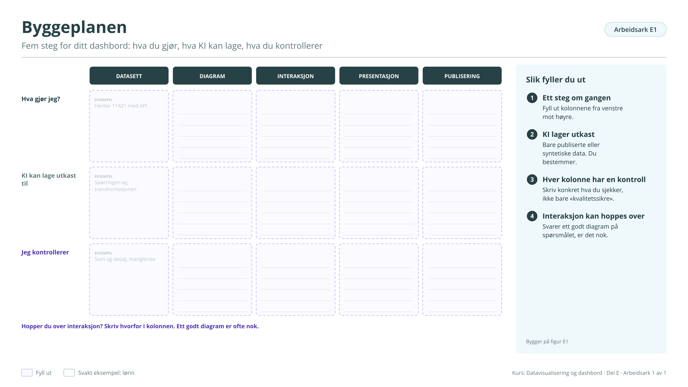

# Arbeidsark E1: Byggeplanen

Fem steg for ditt dashbord: hva du gjør, hva KI kan lage, hva du kontrollerer. Bygger på [figur E1](../e-bygge-prototypen.md#figur-e1). Brukes i økt 2.

!!! info "Slik fyller du ut"

    1. **Ett steg om gangen.** Fyll ut kolonnene fra venstre mot høyre.
    2. **KI lager utkast.** Bare publiserte eller syntetiske data. Du bestemmer.
    3. **Hver kolonne har en kontroll.** Skriv konkret hva du sjekker, ikke bare «kvalitetssikre».
    4. **Interaksjon kan hoppes over.** Svarer ett godt diagram på spørsmålet, er det nok. Skriv hvorfor.

    Svarene lagres bare i denne nettleseren. Last dem ned når du er ferdig, eller ta en sikkerhetskopi fra [oversikten](index.md#svarene-dine).

<button type="button" class="md-button" data-gjor="kopier">Kopier svarene</button>
<button type="button" class="md-button" data-gjor="lastned">Last ned (.md)</button>
<button type="button" class="md-button" data-gjor="skrivut">Skriv ut</button>
<button type="button" class="md-button ark-tom" data-gjor="tom">Tøm arket</button>

<form class="ark-skjema" onsubmit="return false">
<label class="ark-felt ark-felles">Min statistikk (følger med på alle arkene)<input type="text" data-k="felles.statistikk" data-l="Min statistikk" placeholder="Eksempel: Lønn, tabell 11421"></label>
<section class="ark-del"><h3>Fem steg</h3>

<h4>1 Datasett</h4><label class="ark-felt">Hva gjør jeg?<textarea data-k="E1.datasett.gjor" data-l="Hva gjør jeg?" rows="3" placeholder="Eksempel: Henter 11421 med API"></textarea></label><label class="ark-felt">KI kan lage utkast til<textarea data-k="E1.datasett.ki" data-l="KI kan lage utkast til" rows="3" placeholder="Eksempel: Spørringen og transformasjonen"></textarea></label><label class="ark-felt">Jeg kontrollerer<textarea data-k="E1.datasett.kontroll" data-l="Jeg kontrollerer" rows="3" placeholder="Eksempel: Sum og detalj, manglende"></textarea></label>

<h4>2 Diagram</h4><label class="ark-felt">Hva gjør jeg?<textarea data-k="E1.diagram.gjor" data-l="Hva gjør jeg?" rows="3"></textarea></label><label class="ark-felt">KI kan lage utkast til<textarea data-k="E1.diagram.ki" data-l="KI kan lage utkast til" rows="3"></textarea></label><label class="ark-felt">Jeg kontrollerer<textarea data-k="E1.diagram.kontroll" data-l="Jeg kontrollerer" rows="3"></textarea></label>

<h4>3 Interaksjon</h4><label class="ark-felt">Hva gjør jeg?<textarea data-k="E1.interaksjon.gjor" data-l="Hva gjør jeg?" rows="3"></textarea></label><label class="ark-felt">KI kan lage utkast til<textarea data-k="E1.interaksjon.ki" data-l="KI kan lage utkast til" rows="3"></textarea></label><label class="ark-felt">Jeg kontrollerer<textarea data-k="E1.interaksjon.kontroll" data-l="Jeg kontrollerer" rows="3"></textarea></label>

<h4>4 Presentasjon</h4><label class="ark-felt">Hva gjør jeg?<textarea data-k="E1.presentasjon.gjor" data-l="Hva gjør jeg?" rows="3"></textarea></label><label class="ark-felt">KI kan lage utkast til<textarea data-k="E1.presentasjon.ki" data-l="KI kan lage utkast til" rows="3"></textarea></label><label class="ark-felt">Jeg kontrollerer<textarea data-k="E1.presentasjon.kontroll" data-l="Jeg kontrollerer" rows="3"></textarea></label>

<h4>5 Publisering</h4><label class="ark-felt">Hva gjør jeg?<textarea data-k="E1.publisering.gjor" data-l="Hva gjør jeg?" rows="3"></textarea></label><label class="ark-felt">KI kan lage utkast til<textarea data-k="E1.publisering.ki" data-l="KI kan lage utkast til" rows="3"></textarea></label><label class="ark-felt">Jeg kontrollerer<textarea data-k="E1.publisering.kontroll" data-l="Jeg kontrollerer" rows="3"></textarea></label>

</section>
</form>

??? note "Arbeidsarket som figur (til utskrift eller tavle)"

    { loading=lazy }

    [Last ned SVG](ark/ARK_E1.svg){ download } · [Last ned PNG](ark/ARK_E1.png){ download }

[← Arbeidsark D3](d3.md) · [Alle arbeidsark](index.md)
